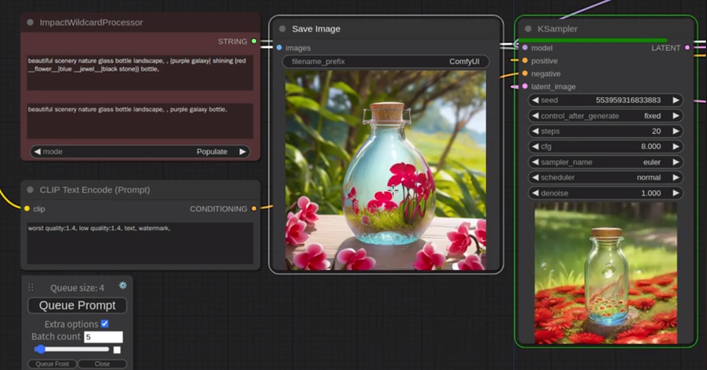
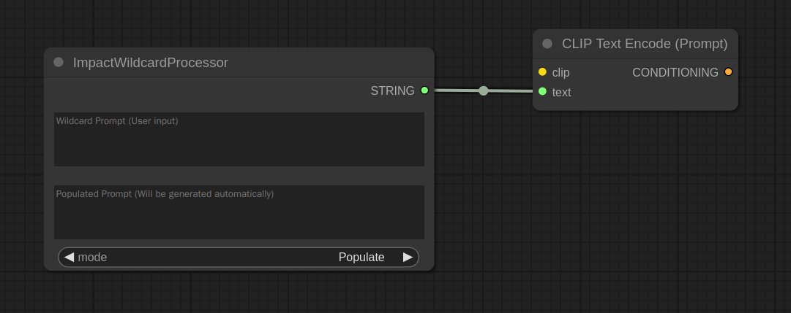
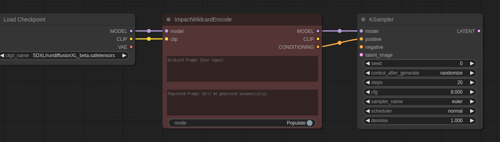
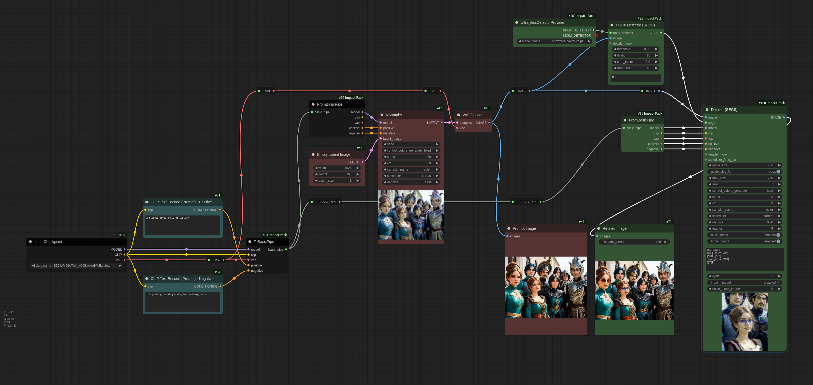
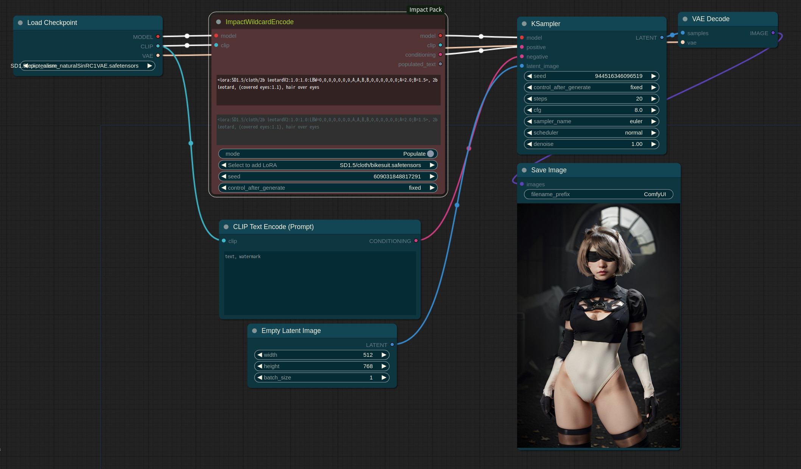
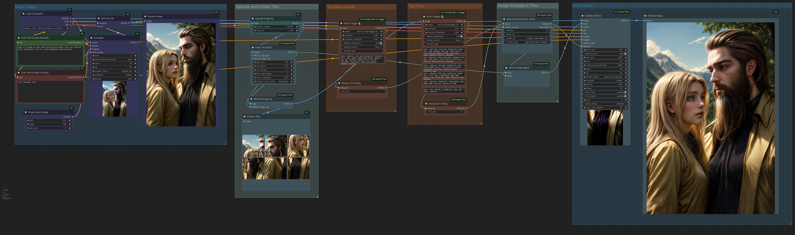
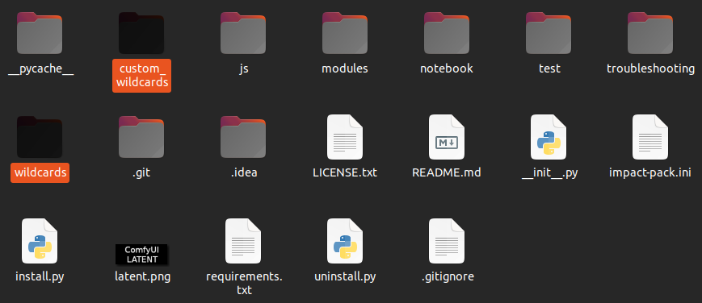
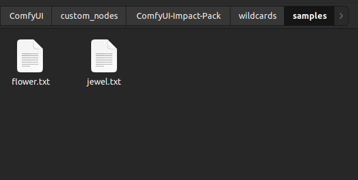
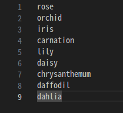

# ImpactWildcardProcessor/ImpactWildcardEncode

The wildcard feature is a functionality that allows random selection from multiple text files described as prompt texts using placeholders like `__flower__`. It assists in choosing and using a random prompt text among the specified files.



You can find the instructions on how to use it in the [YouTube video](https://www.youtube.com/watch?v=joNVYSIzA4k).


## HOW TO USE

### Behavior
* `ImpactWildcardProcessor` is a functionality that operates at the browser level. When running the queue prompt, `ImpactWildcardProcessor` generates the text.
* `ImpactWildcardProcessor` node has two text input fields, but the input using wildcards is only valid in the upper text input box, which is the Wildcard Prompt.
* In the bottom mode settings, there are two options: **Populate** and **Fixed**. When set to Populate, running the queue prompt will process the prompt with wildcards used in the upper Wildcard Prompt section and populate the generated text in the bottom Populated Prompt section.
* In the case of **Populate**, when running the queue prompt, the text generated by the Wildcard Prompt will be entered into the Populated Prompt, and the Populated Prompt will be in a read-only state, where user input is not possible. In the case of **Fixed**, the Wildcard Prompt is ignored, and the Populated Prompt becomes editable, allowing user editing.
* When using `ImpactWildcardProcessor` to generate images, the mode is set to **Fixed**, and the populated text is already entered when the image is saved.
* `ImpactWildcardEncode` is similar to `ImpactWildcardProcessor` but offers the loading functionality of LoRAs. Populated prompts are encoded using the provided clip after all lora loading is completed. All loaded LoRAs are applied to the `model` and `clip` and then returned.





### Syntax
* `ImpactWildcardProcessor` supports two main types of grammar: dynamic prompts using the format `{a|b|c}`, and wildcards using the format `__wildcard__`.
* Dynamic prompts in `ImpactWildcardProcessor` allow nesting, such as `{a|{d|e|f}|c}`, where items separated by | are randomly selected, including nested options.
* If you use a dynamic prompt like `{blue apple|red {cherry|berry}|green melon}`, one option will be randomly selected from the following choices: `blue apple, red cherry, red berry,` or `green melon`.
* If there is a file named `person.txt` inside the wildcards directory, using the wildcard `__person__` will randomly select one item from within that file.
* You can also use compound grammar like `1{girl is holding {blue pencil|red __safruit__|colorful __flower__}|boy is riding __vehicle__}`.
* You can set the selection probability by prefixing a number as in `{5::red|4::green|7::blue|black}`. Each item's selection probability is normalized to 100% based on the sum of all items within the {} brackets, distributing the probabilities evenly.
  - **NOTICE: The selection weight syntax has been updated. Now you should use `{5::red|4::green|7::blue|black}` instead of the previous `{5:red|4:green|7:blue|black}` syntax.**
* The pattern inside `__` is case-insensitive. In other words, `__Jewel__` and `__jewel__` are treated as identical.
* `*` serves as an aggregation pattern, allowing you to group all items from the person path and its wildcard files into one collection, from which you can make selections.
  * Supported in V4.15.1 or above
* Multi-select '$$': Select multiple items from the available choices.
  * {n1-n2$$sel1|sel2|...} - Select between n1 and n2 items from the available choices. If the range exceeds the number of available options, the excess will be ignore d.
  * {-n$$sel1|sel2|...} - Select between 1 and n items.
  * {n$$sel1|sel2|...} - Select n items.
  * custom seperator
    * `{n$$ and $$sel1|sel2|...}` - Select n items using ' and ' as a separator.
    * `{n1-n2$$ or $$sel1|sel2|...}` - Select between n1 and n2 items using ' or ' as a separator.
* Quantifying wildcard: `count#wildcards` repeats wildcards many as count
  * `{2$$, $$5#__wildcards__}` 
    turns into
    `{2$$, $$__wildcards__|__wildcards__|__wildcards__|__wildcards__|__wildcards__}`
* comment-out: Lines starting with `#` are treated as comments and removed. The text following a comment is considered to be separated by a single blank space from the text before the comment.

  input:
    ```
    first {a|b|c} second # not a comment,
    # this is a comment
    trailing text
    newline text
    ```
  
  populated:
    ```
    first a second # not a comment, trailing text
    newline text
    ```


### Limitation
* When converting Seed to input, only `ImpactInt` and `Seed (rgthree)` are allowed as input.
  * The wildcard feature of Impact/Inspire needs to be determined before the workflow is executed since it requires storing information populated in the workflow.
  * It is not possible to receive the execution results of other nodes as input. Even if you use `ImpactInt` or `Seed (rgthree)`, the current prompt only reads the superficial input provided in the prompt and does not utilize the execution results of other nodes.

### Special Syntax for ImpactWildcardEncode/Detailer Wildcard/Inspire Wildcard
* `<lora:loraname:model_weight:clip_weight>`: In a wildcard prompt, you can directly specify LoRA to load. If you omit the `clip_weight`, it is treated the same as `model_weight`.
* `BREAK`: Separately encode the prompts and connect them using `Conditioning (Concat)`.

### Special Syntax for Detailer Wildcard
* Start the prompt by placing `[ASC]`, `[DSC]`, `[ASC-SIZE]`, `[DSC-SIZE]`, `[RND]`, `[LAB]`, `[CONCAT]` at the very beginning.
  - ASC: Ascending order (x, y)
  - DSC: Descending order (x, y)
  - ASC-SIZE: Ascending order (area size)
  - DSC-SIZE: Descending order (area size)
  - RND: Random
  - LAB: label
    - `[ASC]`, `[DSC]`, `[ASC-SIZE]`, `[DSC-SIZE]`, `[RND]` denotes the order of SEGS' bboxes. The left of the bbox takes precedence as the primary criterion, and the top is the secondary criterion.
  - CONCAT: Instead of replacing the **positive conditioning** with the **wildcard_opt**, Concatenate the wildcard conditioning with the positive conditioning using the `Conditioning Concat`.
* `[SEP]` is used to separate prompts for each detection area (SEG).
* When `[SKIP]` is used in the prompt, the Detailing for that SEG is skipped.
* When `[STOP]` is used in the prompt, the Detailing is stopped, including the SEG where it appears.

  **e.g.**
  ```
  [ASC]
  1girl, blue eyes, smile [SEP]
  1boy, brown eyes [SEP]
  ```

  - Detection regions are sorted in ascending order based on x, y coordinates, and Detailing is performed sequentially from left to right using the prompts `1girl, blue eyes, smile` and `1boy, brown eyes`.

  **e.g.**
  ```
  [DSC-SIZE]
  sun glasses[SEP]
  [SKIP][SEP]
  blue glasses[SEP]
  [STOP]
  ```

  - Multiple faces are sorted in descending order based on the area of their detection regions. The second largest face is skipped. The largest face and the third largest face are Detailed using the prompts `sun glasses` and `blue glasses` respectively. The remaining faces are not Detailed.

 

 * `[LAB]` is based on the application according to labels. Each label can appear only once, and `[ALL]` functions as a prefix.

  **e.g.**
  ```
  [LAB]
  [ALL] laugh, detailed eyes
  [Female] blue eyes
  [Male] brown eyes
  ```

  - A SEG with the label `Female` is detailed with `laugh, detailed eyes blue eyes`. A SEG whose label is not listed gets the prefix alone.
  - The prefix and the prompt of the label are joined with one space (V9.1.1 or later; before, they were joined with nothing between them). No comma is added: to have one, end the `[ALL]` line with a comma.

  **e.g.**
  ```
  [CONCAT]detailed eyes, faint smile face
  ```
  

### Lora Block Weight support
* If the [Inspire Pack](https://github.com/ltdrdata/ComfyUI-Inspire-Pack) is installed, you can use Lora Block Weight in the form of `LBW=lbw spec;`. If the `Inspire Pack` is not installed, this spec will be ignored.
* "The 'spec' within `LBW=spec` internally uses semicolons (;) as separators.". It is recommended to end the LBW spec definition with a semicolon (;). If it ends without a semicolon, specifying the weight afterward may result in a specification error.
* Specs that come after `LBW=` without `A=` or `B=` are applicable for use in the `Inspire Pack`'s `Lora Loader (Block Weight)` node. Specs provided with `A=` or `B=` are inputted as parameters for the `A` and `B` parameters of the `Lora Loader (Block Weight)` node.
  * For detailed information about LBW, please refer to this [link](https://github.com/ltdrdata/ComfyUI-extension-tutorials/blob/Main/ComfyUI-Inspire-Pack/tutorial/LoraBlockWeight.md).
* EX) 
  * `<lora:chunli:1.0:1.0:LBW=B11:0,0,0,0,0,0,0,0,0,0,A,0,0,0,0,0,0;A=0.;>`
  * `<lora:chunli:1.0:1.0:LBW=0,0,0,0,0,0,0,0,0,0,A,B,0,0,0,0,0;A=0.5;B=0.2;>`
  * `<lora:chunli:1.0:1.0:LBW=SD-MIDD;>`




### Application
* If you use wildcards with files, you can save frequently used prompts in a file and load them for usage. For example, if you have a line composed of `photorealistic:1.4, best quality:1.4` and save it as `ppos.txt` in the custom_wildcards directory, you can create prompts in a concise form like `__ppos__`, beautiful nature.

## Lora Wildcard Source / Modes

`Lora Wildcard Source / Modes` (`LoraWildcardSource`, V8.30 or later) takes a line with a LoRA tag from a wildcard file, applies the LoRA to `model` and `clip`, and encodes the prompt.

* `category` lists the `.txt` files directly in the `custom_wildcards` directory, the path that `custom_wildcards` in `impact-pack.ini` names. See [Wildcard Directories](#wildcard-directories). Files in subfolders, `.yaml` files and the `wildcards` directory are not listed.
* `lora_wildcard` lists the lines of that file that hold a `<lora:...>` tag, by the name of their LoRA. A name that comes again gets ` (1)`, ` (2)` and so on. Choosing another `category` reloads the list.
  * For the line `90s_melancholy, retro, <lora:90s Anime Melancholy [Illustrious - Style - 1738546]:0.8>`, the entry is `90s Anime Melancholy [Illustrious - Style - 1738546]`.
  * Lines without a LoRA tag and lines that start with `#` are left out.
  * The pack has sample lines in `example_workflows/wildcards/styles.txt`. To use them, copy the file into the directory under a name that none of your wildcard files has.
* `mode` selects the line:
  * `fixed`: the line chosen in `lora_wildcard`. When that line is no longer in the file, the run stops with an error.
  * `random`: a line chosen at random from `seed`. The same seed gives the same line.
  * `sequential`: the line at position `seed` modulo the number of lines, counted from 0. With `control_after_generate` set to `increment`, each run takes the next line.
  * `batch`: every line, in one run.
  * `random`, `sequential` and `batch` take only lines whose tag has a single weight of 0 or more, such as `<lora:name:0.7>`. A line such as `<lora:name>` or `<lora:name:0.7:0.5>` works with `fixed` only. When no line qualifies, these modes encode `base_prompt` alone.
* `strength` replaces the weight of the line's LoRA, for the model and the CLIP alike. When the line has several LoRA tags, the others keep their weights.
* The prompt is `base_prompt` and the line, joined with a comma. The node applies its LoRA tags in order, removes them and encodes the rest. `BREAK` splits the prompt into parts that are encoded separately and concatenated.
  * Wildcards and dynamic prompts such as `__flower__` or `{a|b}` are not processed. The encoder gets them as written. `LBW=` specs are ignored.
  * A LoRA is looked up by its name in the LoRA folders of ComfyUI, and else by its file name in any subfolder. `.safetensors` is added to a name that does not end in `.safetensors`, `.ckpt` or `.pt`. A LoRA that is not found is skipped, with a warning in the log.
* Outputs: `model` and `clip` with the LoRAs applied, `conditioning`, `text`, `lora_name` and `name`.
  * `text` is the prompt without the LoRA tags. `lora_name` is the name of the LoRA, made safe for a file name. `name` is the entry of the line.
  * Every output is a list. In `batch` mode it has an item for each line, and the nodes after it run once for each LoRA. See [Lists and batches](lists.md).
  * `lora_name` or `name` can be the `filename_prefix` of `Save Image`.
  * When no line is used, `lora_name` is `no_lora` and `name` is `no_` followed by the category.
* The pack's [LORA_WILDCARD_SOURCE.md](https://github.com/ltdrdata/ComfyUI-Impact-Pack/blob/Main/docs/LORA_WILDCARD_SOURCE.md) describes the node in full, and [7-LoraWildcardSource.json](https://github.com/ltdrdata/ComfyUI-Impact-Pack/blob/Main/example_workflows/7-LoraWildcardSource.json) is an example workflow.

## Wildcard Prompt from String

`Wildcard Prompt from String` (`WildcardPromptFromString`) turns a text with one prompt for each SEG into a `[LAB]` prompt for the `wildcard` of a Detailer. See [Special Syntax for Detailer Wildcard](#special-syntax-for-detailer-wildcard).

* `string` is an input that another node fills, not a text field. `delimiter` splits it into parts. The default `\n` splits it at each line break.
* The parts get the labels `1`, `2`, `3` and so on, in order. The `wildcard` output is `[LAB]` and then a line `[n] prefix_all tags postfix_all` for each part.
* `segs_labels` lists the labels, as `1, 2, 3`. Connect it to `labels` of `SEGS Assign (label)`, so that the first SEG gets the label `1` and with it the first prompt.
* A part is read as tags separated by `, `, a comma and a space. Only the tags that `restrict_to_tags` lists stay, and the tags that `exclude_tags` lists are removed. Both take tags separated by `, `. Leave them empty to keep all tags.
  * When either is set, the tags of a part can come out in another order, and a tag that appears twice comes out once.
* `prefix_all` and `postfix_all` go before and after the tags of every part. Double spaces and double commas are cleaned up.

[](../workflow/prompt-per-tile.png)

* `Make Tile SEGS` cuts the upscaled image into tiles. `SEGSToImageList` gives a picture of each tile, and the tagger of [ComfyUI-WD14-Tagger](https://github.com/pythongosssss/ComfyUI-WD14-Tagger) tags each one. `String List to String` joins the tags into one text, a line for each tile.
* The tags of the whole image go to `restrict_to_tags`, so that a tile gets no tag the whole image does not have. `exclude_tags` removes tags such as `1girl` and `1boy` from every tile.
* `wildcard` goes to `Detailer (SEGS)`, and `segs_labels` to `SEGS Assign (label)` on the tiles. Each tile is detailed with its own tags.
* [Prompt per Tile Upscale](PromptPerTileUpscale.md) explains the workflow step by step.

## SETUP

### Wildcard Directories
* Under the ComfyUI-Impact-Pack/ directory, there are two paths: custom_wildcards and wildcards. Both paths are created to hold wildcards files, but it is recommended to avoid adding content to the wildcards file in order to prevent potential conflicts during future updates.



### Progressive On-Demand Loading
* The wildcard system now features **intelligent automatic loading** based on your wildcard collection size:
  - **Full Cache Mode**: If total wildcard size < 50MB → All wildcards are loaded into memory at startup for instant access
  - **On-Demand Mode**: If total wildcard size ≥ 50MB → Only metadata is scanned at startup, actual wildcard data is loaded progressively as you use them

* **Benefits of On-Demand Mode** (for large wildcard collections):
  - **Fast Startup**: < 1 minute even with 10GB+ of wildcards (vs 20-60 minutes in older versions)
  - **Low Memory**: < 100MB initial memory usage, grows only as you use wildcards
  - **Scalable**: Supports tens of gigabytes of wildcard data efficiently

* **Configuration** (in `impact-pack.ini`):
  ```ini
  [default]
  wildcard_cache_limit_mb = 50  # Adjust based on your needs
  ```
  - Lower limit → More likely to use on-demand mode
  - Higher limit → More likely to use full cache mode
  - `impact-pack.ini` is in the Impact Pack directory. The pack creates it with the default values at the first start (V9.0.1 or later).

* **How to Check Current Mode**:

  **Method 1 - UI Indicator**: Check the wildcard selector dropdown in ComfyUI interface:
  - 🟢 **Full Cache**: `Select Wildcard 🟢 Full Cache` - All wildcards loaded
  - 🔵 **On-Demand**: `Select Wildcard 🔵 On-Demand: X loaded` - Shows how many wildcards are currently loaded

  **Method 2 - Startup Logs**: Check ComfyUI console output:
  ```
  [Impact Pack] Wildcard total size (45.32 MB) is within cache limit (50.00 MB).
  Using full cache mode.
  ```
  or
  ```
  [Impact Pack] Wildcard total size (125.67 MB) exceeds cache limit (50.00 MB).
  Using on-demand loading mode (metadata scan only).
  ```

* **YAML vs TXT Files**:
  - **TXT files**: Fully support on-demand loading (loaded only when used)
  - **YAML files**: Always pre-loaded at startup (because wildcard keys are embedded in file content)
  - For large wildcard collections with true on-demand loading, prefer TXT file structure over YAML

* **Wildcard Refresh Behavior**:
  - Using the wildcard refresh function clears **all cached data** (both full cache and on-demand loaded wildcards)
  - After refresh, the system re-scans wildcard directories and re-determines the loading mode
  - In on-demand mode: Previously loaded wildcards are cleared and will be loaded again when accessed
  - This is useful when you add/modify wildcard files and want to reload them without restarting ComfyUI

* The wildcard supports subfolder feature.
  * For example, if there is a wildcard file named `custom_wildcards/obj/person.txt`, it should be used as `__obj/person__` instead of `__person__`.
  * NOTICE: The subfolder feature was not supported in older versions. The subfolder feature is a newly updated functionality.



* `.yaml` wildcards file supports. (V4.18.4)
  * You can download and use [Wildcard YAML](https://civitai.com/models/138970/billions-of-wildcards-all-in-one) files in this format.
  * For example, if a YAML file is structured like the following, you can use `__astronomy/Celestial-Bodies__` and `__surface-swap__` as wildcards, and one of the item inside can be chosen.
  ```
  astronomy:
    Celestial-Bodies:
        - Star
        - Planet
        ...
  surface-swap:
      - swap the surfaces for
      - replace the surfaces with
      ...
  ```
  * **Important Note**: YAML files are always pre-loaded at startup even in on-demand mode, because the wildcard keys exist inside the file content rather than in the file path. For truly on-demand loading with large collections, consider converting YAML wildcards to TXT file structure:
    ```
    # YAML structure (pre-loaded)
    colors.yaml:
      warm: [red, orange, yellow]
      cold: [blue, green, purple]

    # Convert to TXT structure (on-demand)
    colors/warm.txt:
      red
      orange
      yellow

    colors/cold.txt:
      blue
      green
      purple
    ```

* Within the wildcard, the items to be randomly selected should be placed one per line.
* If items are entered on a single line separated by commas, the entire line will be considered as one item.
* Below is the content of the file flower.txt. If written as follows, using `__flower__` in the prompt text will randomly select one from `rose, orchid, iris, carnation, lily, daisy, chrysanthemum, daffodil, and dahlia`.



### Performance Tips for Large Wildcard Collections

* Use SSD for faster file I/O when using large wildcard collections
* Organize wildcards into subdirectories for better file system performance
* Consider splitting very large single files into multiple smaller files
* Adjust `wildcard_cache_limit_mb` based on available system memory


