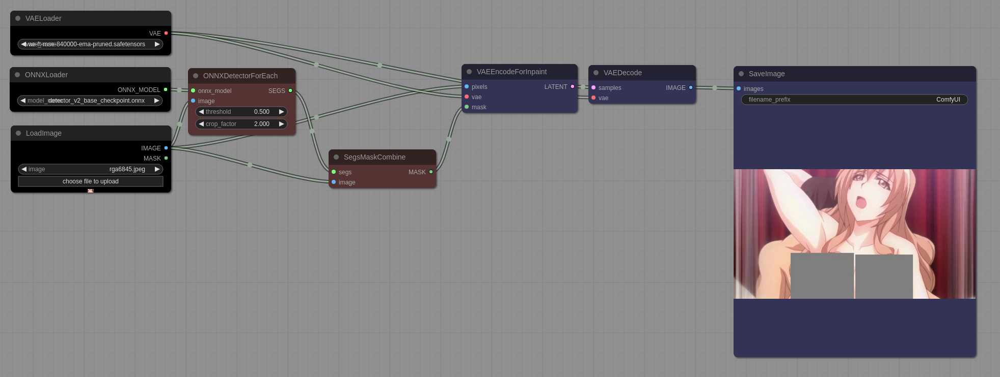
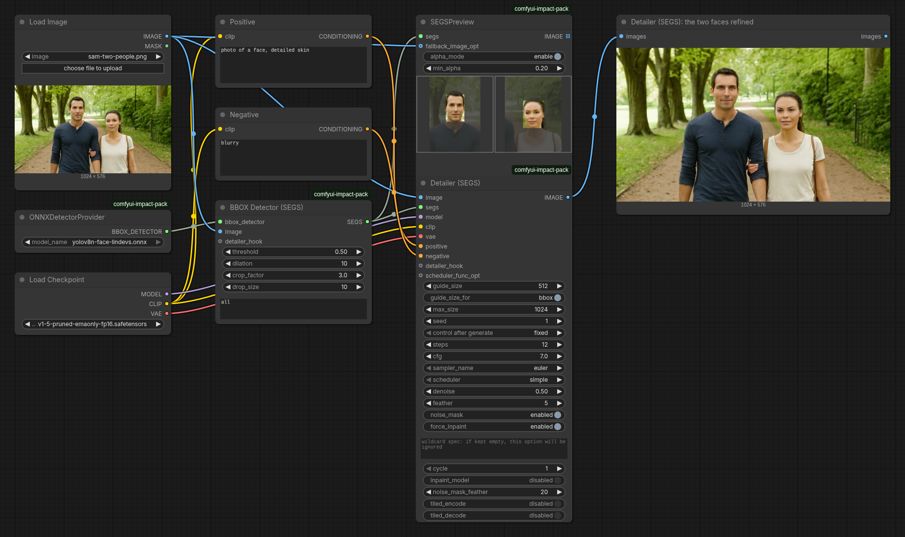

# NudeNet [**need to update document**]
Nudenet uses an ONNX model to detect NSFW content. This example is an application of [NudeNet](https://github.com/notAI-tech/NudeNet)'s capabilities, which detects NSFW elements in images and applies a mask as a post-processing step. This technique demonstrates the use of nudenet to detect potentially inappropriate content in order to ensure the safety of minors on certain websites

* [detector_v2_base_checkpoint.onnx](https://github.com/notAI-tech/NudeNet/releases/download/v0/detector_v2_base_checkpoint.onnx) is a model for nudenet. Download and placed into **ComfyUI/models/onnx**

* [onnx.json](../workflow/onnx.json) is a workflow of this example.

* This model is a RetinaNet model. The labels of its SEGS are the class numbers of the model, such as `0` or `2`.

# Models exported by Ultralytics YOLO
In V9.4 or later, `ONNXDetectorProvider` takes a detection model that Ultralytics YOLO exported to ONNX. It gives a `BBOX_DETECTOR` without the Impact Subpack and without the `ultralytics` package.

* Place the `.onnx` file into **ComfyUI/models/onnx**.
  * A model that is published as ONNX works as it is, such as `yolov8n-face-lindevs.onnx` from the [releases of lindevs/yolov8-face](https://github.com/lindevs/yolov8-face/releases).
  * To export a model of your own, run `yolo export model=<name>.pt format=onnx` where `ultralytics` is installed.
* The labels of the SEGS are the class names that the model holds, such as `face`. Write these names in `labels` of `BBOX Detector (SEGS)`.
* A model with a fixed input size and a model with a free one both work, and so does a model that filters its own boxes, such as YOLOv10. Of a model with masks, only the boxes are used.
* The model runs on the CPU.

In the workflow below, `ONNXDetectorProvider` loads `yolov8n-face-lindevs.onnx`. `BBOX Detector (SEGS)` finds the two faces, `SEGSPreview` shows them, and `Detailer (SEGS)` refines them.

* The picture holds the workflow. The example image is [sam-two-people.png](../images/sam-two-people.png).

# Other ONNX models
* `ONNXDetectorProvider` takes the two formats above. Other ONNX detection models, such as those of the [PINTO_model_zoo](https://github.com/PINTO0309/PINTO_model_zoo), have formats of their own. A model that is in neither of the two formats stops the detector node with an error.
