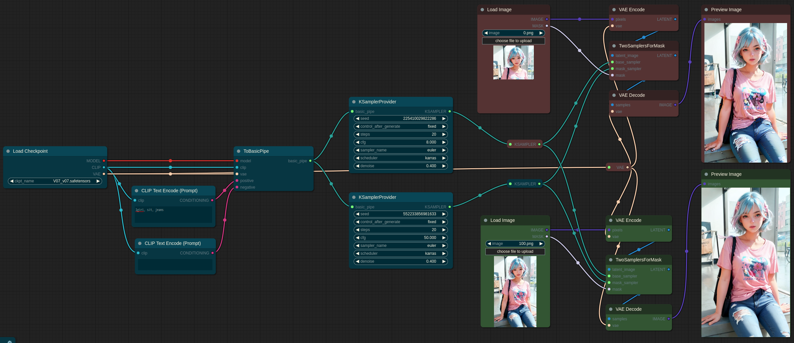
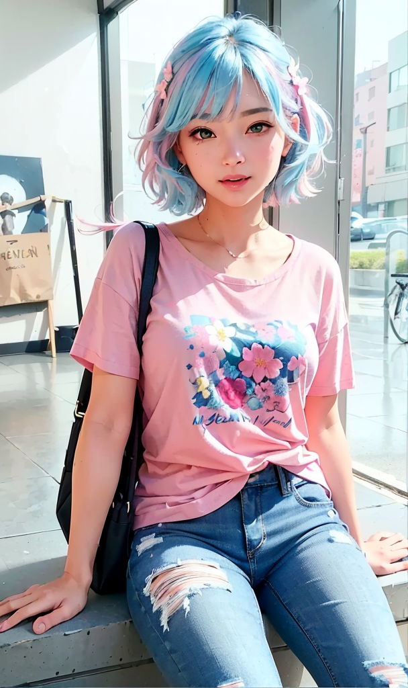
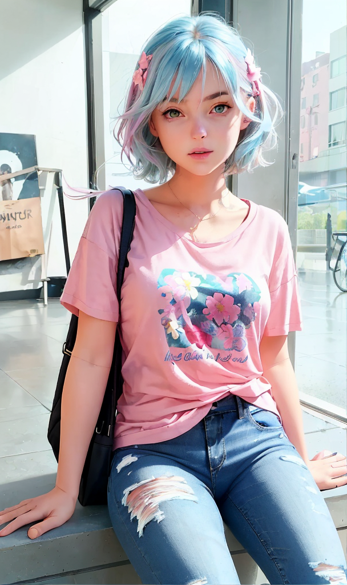
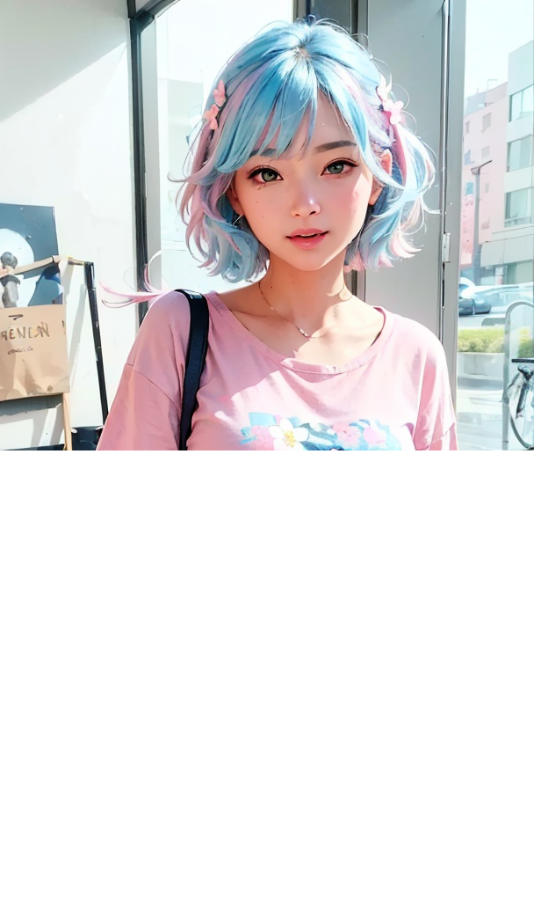
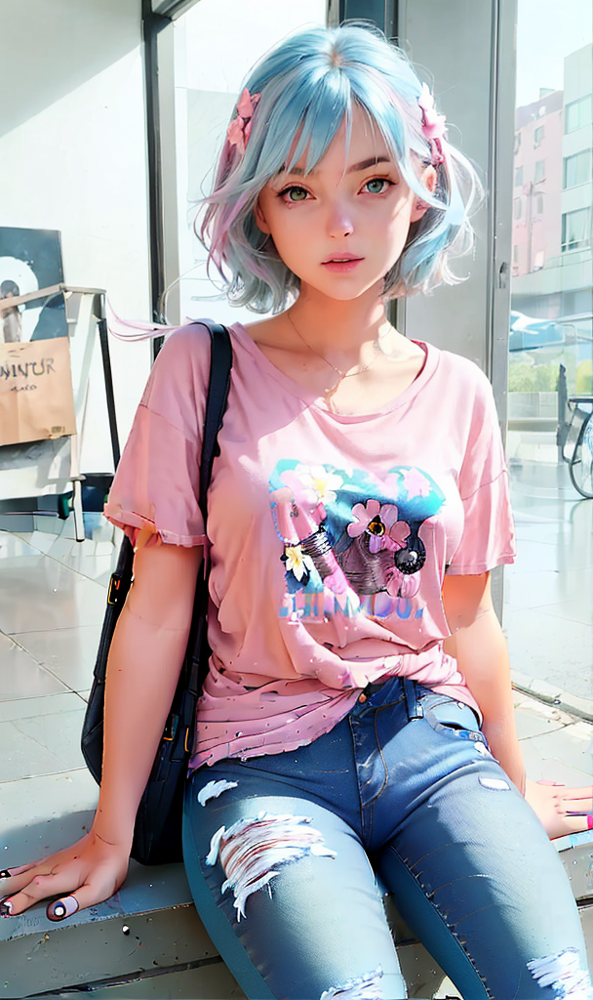

# TwoSamplersForMask

* Using TwoSamplersForMask, it is possible to apply different levels of denoising or cfg to different parts of an image. Particularly, it can be applied to specific areas such as hands with low denoising and cfg using the mask of CLIPSeg.

* The workflow for utilizing TwoSamplersForMask is as follows:

* If the mask is not used, you can see that only the base_sampler is applied.

* If a mask is applied to the lower body, you can see that the base_sampler is applied to the upper body and the mask_sampler is applied to the lower body with a high cfg of 50.

* Before V9.0, TwoSamplersForMask left its mask on the latent it was given. Another sampler that used the same latent, such as a second sampler on the same `Empty Latent Image`, then sampled under the inverse of that mask. Since V9.0 the node sets the mask on a copy, and the latent it is given stays as it was.
