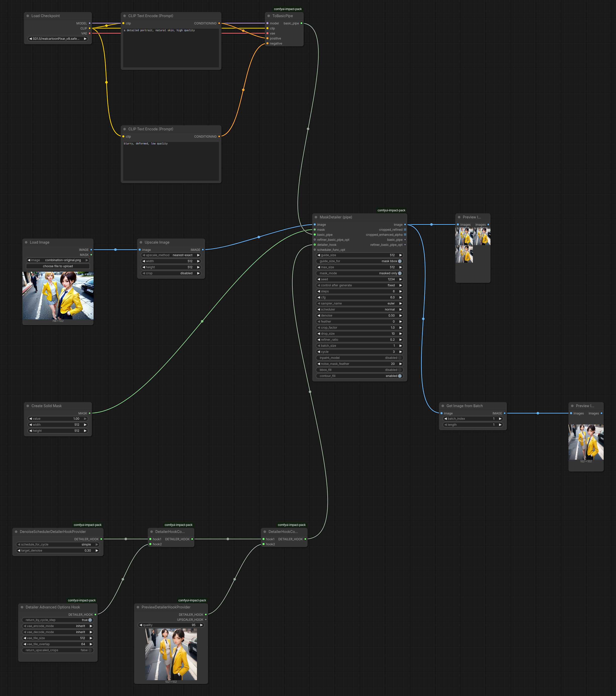
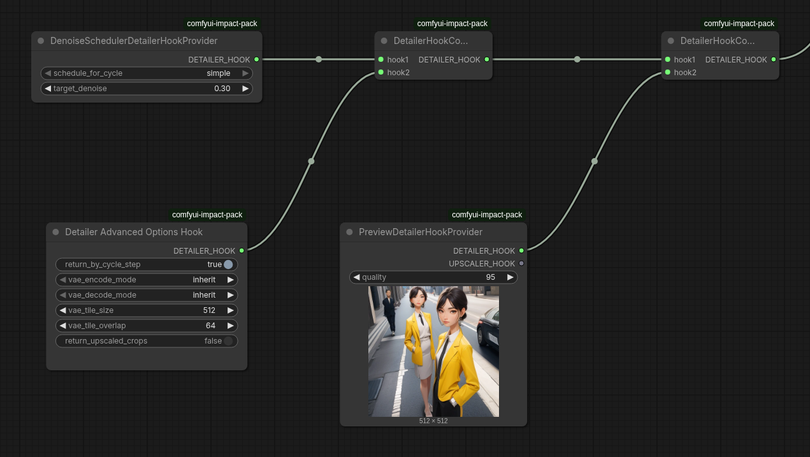
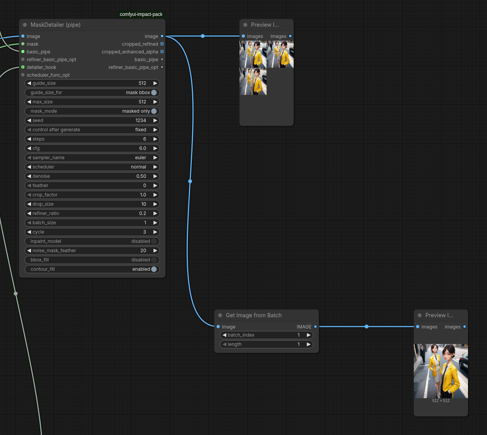
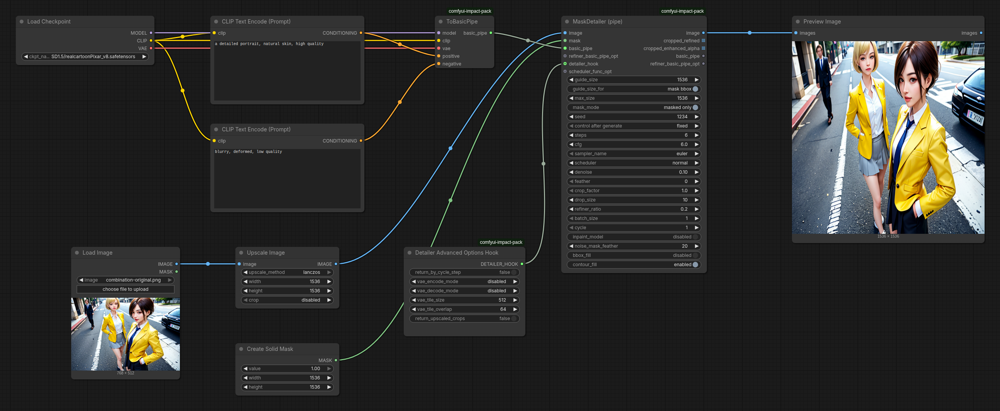
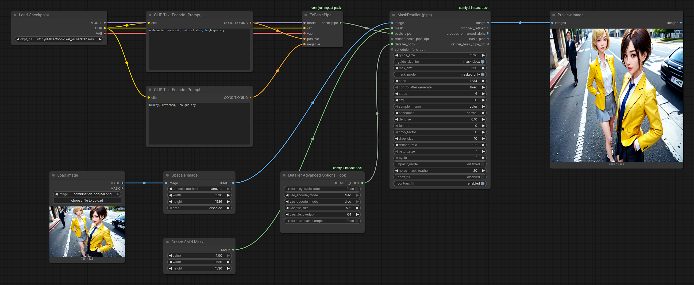
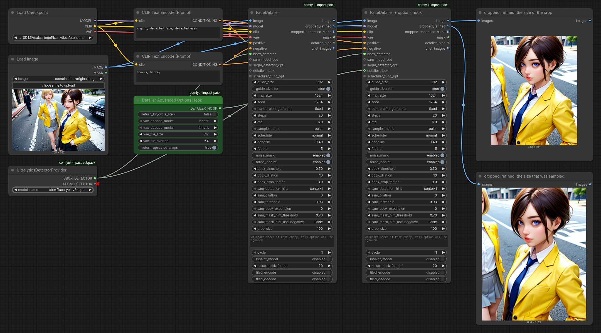

# Detailer advanced options

`DetailerAdvancedOptionsHook` supplies cycle-output, VAE and crop-output settings
through a Detailer's `detailer_hook` input. Use it with the sampling, detection
and preview hooks described in [Detailer hooks](detailer_hooks.md).

Cycle output, VAE tiling and the size of the crop outputs can each be used independently. Start
with the section for the feature you need, then combine settings if useful.

Normally, `cycle=3` returns only the third cycle's image. If the second result
looks better, that intermediate result is unavailable downstream. With
`return_by_cycle_step=True`, the same run returns cycles 1, 2 and 3 as an image
batch. You can inspect them and select the result to continue with. The option
changes which completed images are returned; the denoise scheduler still controls
how each cycle is sampled.

This guide covers [cycle selection](#select-a-result-from-each-cycle),
[downstream uses](#apply-the-results-to-another-workflow),
[VAE tiling](#configure-vae-tiling-on-its-own),
[crop outputs at the sampled size](#return-the-crops-at-the-sampled-size),
[combining options](#combine-options-after-checking-them-separately), and
[output behavior and supported Detailers](#output-and-execution-behavior).

Expand a workflow example to view its image. Each image links to the original
PNG, which you can save and drag onto ComfyUI to load the embedded workflow.

## Select a result from each cycle

Download [the workflow PNG](../workflow/detailer-advanced-options.png) and drag it
onto the ComfyUI canvas. It contains the complete workflow, like the existing
`detailer-hook.png` example. [JSON export](../workflow/detailer-advanced-options.json)
is also available.
It uses core ComfyUI and Impact Pack nodes, without the legacy Workflow Component
nodes from the older examples.

These images show only the workflow rendered in ComfyUI after execution, with
its nodes, connections and result previews. The full graph and detail images
below all contain the same workflow metadata; save the linked original PNG to
load its nodes, settings and connections:

Workflow PNG: cycle selection with denoise, Advanced Options and Preview

1. Select an installed SD1.5 checkpoint. The example uses
   `SD1.5/realcartoonPixar_v8.safetensors`.
2. Upload [the example image](../images/combination-original.png) to `Load Image`,
   or choose your own image.
3. Keep `cycle=3` on `MaskDetailerPipe`. The example uses a full white `SolidMask`
   and resizes the image to 512×512. To edit a smaller region, replace that mask
   with a mask for the region you want to refine.
4. Enable `return_by_cycle_step` on `DetailerAdvancedOptionsHook` and click Run.
   The first preview receives three images in cycle order. `ImageFromBatch`
   selects the second image with `batch_index=1` for the second preview.
5. Change `batch_index` to select another cycle for downstream processing.
   Disable `return_by_cycle_step` to return only the final image; set
   `batch_index=0` when using this single-image output.

The example combines a denoise scheduler, the advanced options, and a Preview
hook. The scheduler still controls sampling; the Preview hook shows progress;
the options determine which completed cycle images are returned. Six sampling
steps per cycle make the example quick to try. Increase `steps` as needed for
your checkpoint and image.

`DetailerAdvancedOptionsHook` is a container for typed advanced settings. It provides
boolean switches, VAE mode choices and integer tile settings. Existing Detailer controls keep their names
and positions. If two option hooks specify the same setting, `hook2` wins,
including an explicit `False`. An ordinary hook does not overwrite those options.

The hook connections in the example are:

Workflow PNG: combined hook connections (detail)

The first Combine receives the denoise scheduler as `hook1` and advanced options
as `hook2`. The second Combine adds the Preview hook. Connect its output to
MaskDetailer's `detailer_hook`. To add these options to your existing workflow,
put your current hook on `hook1` and the advanced-options node on `hook2` of a new
Combine; reconnect that Combine to the Detailer. If there was no hook, connect
the advanced-options node directly.

## Apply the results to another workflow

### Choose an intermediate result for further processing

In this example the denoise schedule is 0.5, 0.4, then 0.3. Inspect the three
images in the batch preview. If cycle 2 is the result you want, set
`ImageFromBatch.batch_index=1` and `length=1`. Connect that node's image output to
Save Image, an upscaler or another image-processing stage. Only the chosen image
continues downstream. Connect the whole batch instead when you want that next
stage to process every candidate.

Workflow PNG: the batch and cycle-2 selection branch (detail)

An interactive image-selection node that accepts an `IMAGE` batch can serve the
same role. The provided workflow uses core `ImageFromBatch`, so trying the example
does not require another node pack.

### Save every cycle for comparison

Connect the Detailer's main `IMAGE` output directly to Save Image and keep
`return_by_cycle_step=True`. For one input and `cycle=3`, the downstream node
receives three images from that one Detailer run. Keep the ImageFromBatch branch
as well if you want to save all candidates while processing only the selected one.
Cropping outputs and SEGS are still final-cycle outputs; use the main image batch
when comparing intermediate full-image results.

### Select a cycle from multiple inputs

For two FaceDetailer input images A and B with three cycles, the batch order is
A1, A2, A3, B1, B2, B3. Select A2 with index 1 or B2 with index 4, using `length=1`.
In general, the zero-based index is `input_index * cycle + cycle_index`.
FaceDetailer's mask batch follows that same order. MaskDetailer's `batch_size`
groups use the same group-first, cycle-second ordering.

When disabling the option, change ImageFromBatch back to index 0 for a single
input: only the final image is returned. If the desired workflow always uses the
final image, leave the option disabled to avoid collecting and decoding the
intermediate images.

## Configure VAE tiling on its own

VAE tiling processes the crop in smaller overlapping pieces to reduce the memory
needed for an individual encode or decode. Evaluate its memory cost and output
fidelity; it is not a setting for adding detail or improving a face.

The two examples below process the same 1536×1536 crop with the same image,
checkpoint, prompt, seed and sampling settings. They change only
`vae_encode_mode` and `vae_decode_mode`. Advanced Options connects directly to
MaskDetailer; there are no denoise-scheduler, Preview-hook or cycle-selection
branches.

| Setting | Ordinary VAE baseline | Tiled VAE |
| --- | --- | --- |
| `return_by_cycle_step` | False | False |
| Detailer `cycle` / `batch_size` | 1 / 1 | 1 / 1 |
| `vae_encode_mode` | disabled | tiled |
| `vae_decode_mode` | disabled | tiled |
| `vae_tile_size` / `vae_tile_overlap` | 512 / 64 (unused) | 512 / 64 |

1. Load the [ordinary-VAE workflow PNG](../workflow/detailer-vae-untiled.png),
   select an installed SD1.5 checkpoint and upload
   [the example image](../images/combination-original.png). The recorded example
   uses `SD1.5/realcartoonPixar_v8.safetensors`.
2. Run it with seed 1234, 6 steps, CFG 6, denoise 0.1, `euler` and `normal`.
   ImageScale, SolidMask, `guide_size` and `max_size` all use 1536, so the VAE
   receives the same full-image crop in both runs.
3. Set only `vae_encode_mode=tiled` and `vae_decode_mode=tiled`, or load the
   [tiled-VAE workflow PNG](../workflow/detailer-vae-tiled.png). Run again with
   the same seed and compare the result with the baseline.
4. Keep cycle output disabled during this comparison. Each run
   produces one image. Inspect tile boundaries, color and fine detail as well
   as the measured memory and processing time.

Workflow PNG: ordinary VAE baseline — cycle output disabled

Workflow PNG: tiled VAE only — cycle output disabled

Native JSON exports are available for the
[baseline](../workflow/detailer-vae-untiled.json) and
[tiled example](../workflow/detailer-vae-tiled.json).

### What to compare

The intended benefit is lower VAE working memory. Similar-looking output is
useful here: tiling should not be presented as a visual quality improvement.
Tiled and ordinary VAE outputs can differ, so check the image at full resolution.
A small 512×512 success example alone cannot demonstrate useful memory savings.

For the 1536×1536 example above, the measured comparison was:

| Measurement | Ordinary VAE | Tiled VAE, 512 / 64 |
| --- | --- | --- |
| Encode peak allocated GPU tensor memory | 2.84 GiB | 0.32 GiB |
| Decode peak allocated GPU tensor memory | 4.83 GiB | 0.55 GiB |
| Encode time | 0.41 s | 0.95 s |
| Decode time | 0.54 s | 1.76 s |

Here tiling reduced the VAE tensor-memory peak by about 89%, at the cost of
longer encoding and decoding. These are medians of four runs per configuration
after one warmup each, on an RTX 4080 with a bfloat16 SD1.5 VAE, ComfyUI 0.44.0
and PyTorch 2.10.0+cu128. The peak is PyTorch CUDA allocated memory during each
VAE call, not total device or whole-workflow VRAM; the times cover VAE calls,
not sampling. Neither ordinary call fell back to tiling.

The outputs were not pixel-identical: the mean absolute RGB difference was
2.13 on a 0–255 scale. The workflow previews let you inspect the corresponding
images. This demonstrates a memory/time tradeoff for this crop, not improved
image quality. The [measurement record](../workflow/detailer-vae-measurements.json)
contains the settings, individual observations and validation results.

### Choose encoding and decoding independently

| Setting | Default | Choices |
| --- | --- | --- |
| `vae_encode_mode` | inherit | Follow the Detailer's existing policy, disable explicit tiling, or use fixed `tiled` size |
| `vae_decode_mode` | inherit | Follow the Detailer's existing policy, disable explicit tiling, or use fixed `tiled` size |
| `vae_tile_size` | 512 | Tile size in pixels for explicit `tiled` modes |
| `vae_tile_overlap` | 64 | Overlap in pixels for explicit `tiled` modes; zero means no overlap |

To bound the size of individual VAE operations on large crops, choose `tiled`
and set `vae_tile_size` yourself. Tiled memory follows the tile, not the crop,
so a larger crop does not need a smaller tile. Encoding and decoding share
these tile controls. Overlap is capped at a quarter of the chosen
tile so ComfyUI's smaller internal tile passes remain valid. Smaller tiles add
work. Compare memory and processing time as well as the output when choosing a
tile size.

`inherit` contributes no override and retains the Detailer's existing switch and
512/64 defaults. A default options hook therefore does not erase another hook's
VAE selection. Explicit duplicate settings still use `hook2`, including
`disabled`; tile geometry is shared and the last explicit geometry wins.
The existing encode switch now also applies to both VAE encodes in inpaint
conditioning. `disabled` disables explicitly selected tiling; normal decoding
still retains its existing tiled retry if decoding fails, and ComfyUI can apply
its own memory fallback.

Choose encoding and decoding independently. For example, `vae_encode_mode=disabled`
with `vae_decode_mode=tiled` keeps the ordinary encoder while tiling the output
decode.

| VAE behavior | What changes for the workflow |
| --- | --- |
| Inpaint encoding | `tiled_encode=True` previously left both conditioning encodes untiled. It now tiles both the masked conditioning image and the original image, including when no options hook is connected. |
| Default and explicit overrides | `inherit` keeps the existing switches. `disabled` can override a True switch without being re-enabled by a calculated tile size. |
| Manual tiles | `tile_size=512, overlap=256` uses overlap 128 so the encoder's half-size passes remain valid. Explicit overlap 0 remains 0. |

## Return the crops at the sampled size

The Detailer enlarges a crop to its working size, samples it there, and scales
the result back to the size of the crop before pasting it. `cropped` and
`cropped_refined` are returned at that crop size, so they do not show the image
that was sampled.

With `return_upscaled_crops=True`, these two outputs are returned at the
working size.

Workflow PNG: cropped_refined at the crop size and at the sampled size

1. Load [the workflow PNG](../workflow/detailer-upscaled-crops.png), select an
   installed SD1.5 checkpoint and upload
   [the example image](../images/combination-original.png).
2. Both `FaceDetailer` nodes use the same settings. `drop_size=100` leaves only
   the largest face. Only the second node has the options hook on its
   `detailer_hook` input.
3. Run. The first `cropped_refined` is 310×394, the size of the crop in the
   image. The second is 800×1024, the size the face was sampled at:
   `guide_size=512` for the bbox, limited by `max_size=1024`.

Only `cropped` and `cropped_refined` change. The pasted `image`, the alpha
crop output (`cropped_refined_alpha`, or `cropped_enhanced_alpha` on
FaceDetailer), masks and SEGS are the same with and without the option. Both
crop lists keep their regions in the same order.

## Combine options after checking them separately

Once you have chosen the VAE policy, you can combine it with cycle output.
These features are independent; VAE tiling does not require intermediate image
collection.

The [combined workflow PNG](../workflow/detailer-advanced-options-vae.png)
([JSON export](../workflow/detailer-advanced-options-vae.json)) uses the
same denoise → options → Preview composition as the cycle example, with
`return_by_cycle_step=True`, tiled encoding and tiled decoding. ImageFromBatch selects cycle 2. This is an example
of how the settings compose; use the isolated VAE comparison above to evaluate
tiling.

Workflow PNG: combined application — cycle selection and VAE tiling

## Output and execution behavior

With `return_by_cycle_step=True`:

- The main `IMAGE` output contains one full image per cycle. Input images and
  MaskDetailer's `batch_size` groups come first, followed by cycles within each
  group. For two inputs and three cycles, the order is A1, A2, A3, B1, B2, B3.
- Each image composites the same-numbered cycle result from every processed
  region. Regions keep their existing processing order; later regions use the
  final result of preceding regions as their input. These snapshots are not
  independent reruns with smaller `cycle` values.
- Cropped refinement outputs and SEGS still describe the final cycle. FaceDetailer
  repeats each input's mask to match its cycle images.
- Empty detections, skipped regions, and DUMMY inputs retain the input pixels
  in every cycle slot. A hook that skips sampling, such as Lama, supplies its
  processed result to every slot. This keeps the output batch length predictable.
- AutoRetry returns the cycles from the successful attempt. Its retry decision
  uses that attempt's final patch; rejected attempts are not included.
- Sampling is performed once per cycle. Intermediate latent snapshots use CPU
  memory, including separate copies of tensor fields such as `noise_mask` and
  metadata such as `batch_index`, so later in-place hooks cannot overwrite them.
  Each returned sampled cycle is decoded once. Expect more VAE
  decoding and image memory than with the option disabled. Tiled decoding is
  supported. Decode and post-paste hooks also run for each returned sampled
  cycle, so progress hooks can produce more updates.

The option applies to Detailer (SEGS), its pipe/debug/auto-retry variants,
FaceDetailer and its pipe variant, and MaskDetailer. It does not add cycle
outputs to AnimateDiff, iterative upscalers, or the SEGS-only `SEGSDetailer`.
`return_upscaled_crops` applies to the same Detailers.

## Regression checks

Impact Pack's `tests/test_e2e_detailer_hooks.py` imports the original hook
examples, checks widget names/order/typed values and hook connections, then
uses native Export and reload under positional and named restoration.
`tests/test_detailer_hooks.py` checks the existing sampling and callback
contracts, while `tests/test_detailer_advanced_options.py` covers optional cycle
outputs, composition, skipped paths, retries, and batch/mask ordering.
`tests/test_detailer_vae.py` checks VAE selection in normal/inpaint
paths, both encoded latent values reaching sampling/conditioning, independent
encode/decode choices and safe tile overlap.
The browser suite runs tiled encoding with ordinary and with inpaint
conditioning, both with tiled decode and cycle selection using a real SD1.5 VAE
and sampler. It loads those two composition
workflow PNGs directly and checks the two detail PNGs in positional and named
restoration modes.
`test_vae_only_png_preserves_controls_and_output` separately loads the ordinary
and tiled VAE PNGs with cycle collection disabled. It checks every
node's widget names, order and values, all 13 links, and image reproducibility
after native Export/reload in both restoration modes. Embedded workflows match
their native JSON exports exactly.
It does not reproduce
FLUX.2-specific symptoms. The memory comparison above is limited to the stated
VAE operations and configuration.

The original PNGs are hash-pinned references. Keep them unchanged when updating
the implementation; use the separate advanced-options example for new behavior.
