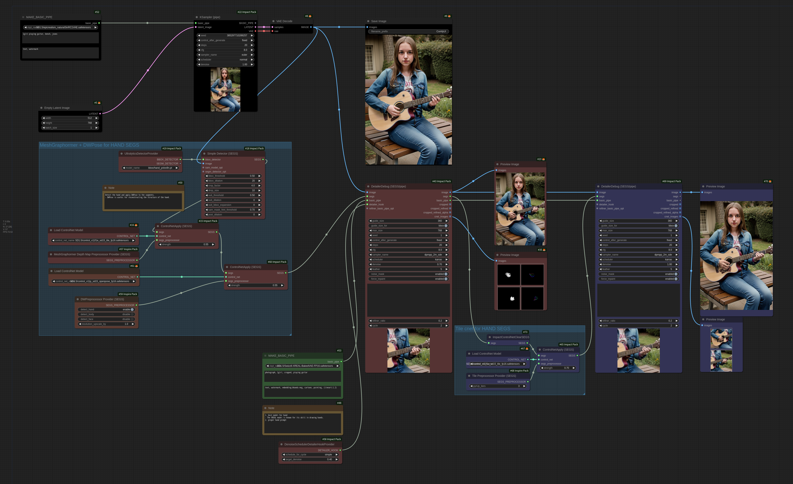
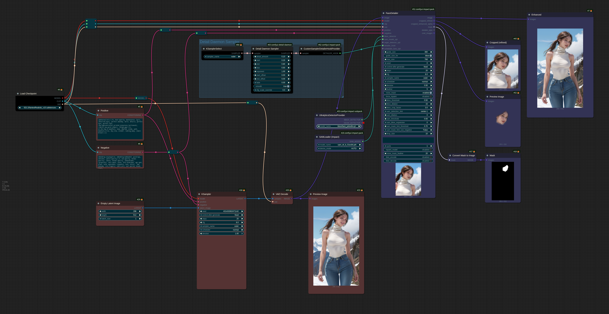
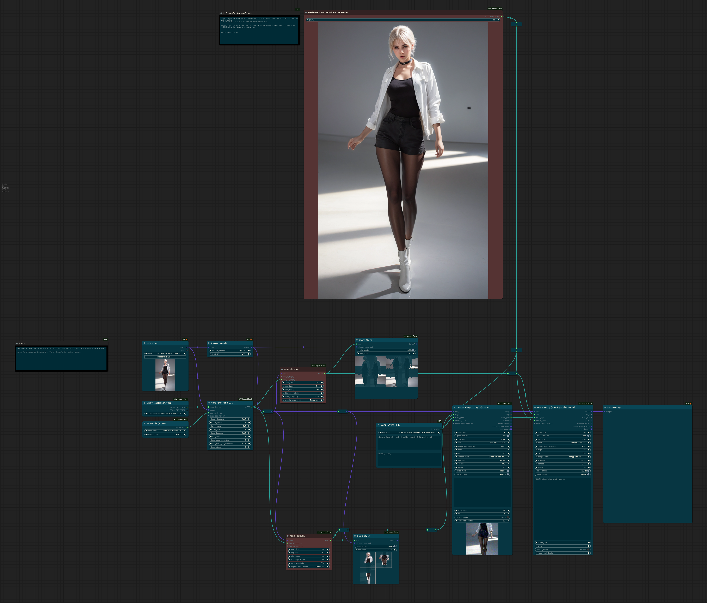
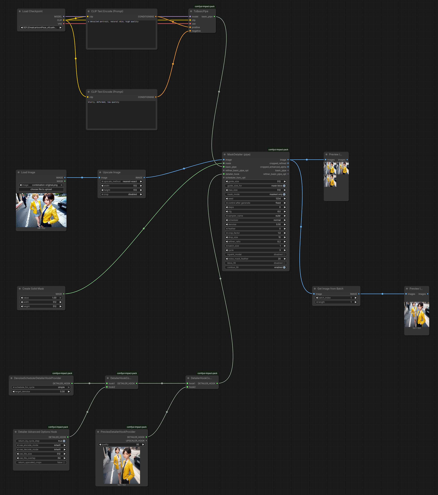
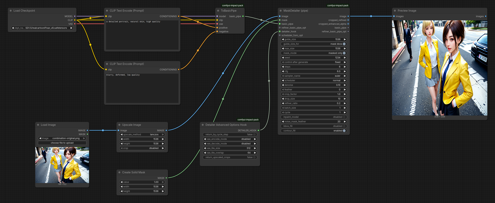
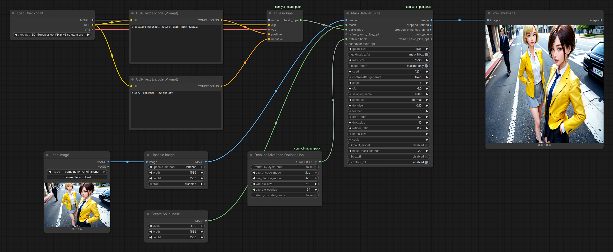

# Detailer hooks

A hook adds behavior to a Detailer through its `detailer_hook` input. Use one to
change denoise across cycles, inject noise, supply a custom sampler, choose
which detections to refine, or watch the image as regions are pasted back.
`DetailerHookCombine` lets several hooks share that input.

Start with a working [Detailer workflow](detailers.md), then choose the behavior
you need. Each section below explains where to connect the hook, which settings
to change, and how to combine it with another hook.

| What you want to do | Hook and instructions |
| --- | --- |
| Gradually change refinement strength | [Denoise scheduler](#change-denoise-across-cycles) |
| Add noise before a sampling cycle | [Noise injection](#inject-noise-between-cycles) |
| Prepare the latent with reverse sampling | [Unsampler](#use-unsampler-before-a-cycle) |
| Explore variations while keeping a base seed | [Variation noise](#apply-a-variation-seed) |
| Use a sampler supplied by another node | [Custom sampler](#use-a-custom-sampler) |
| Watch regions being pasted into the image | [Preview](#watch-detailing-progress) |
| Keep detections by size, position or label | [SEGS filters](#choose-which-detections-to-refine) |
| Remove a masked region with Lama | [Lama Remover](#remove-regions-with-lama) |
| Retry a dark, nearly uniform patch | [Black-patch retry](#retry-a-black-patch) |
| Match a CoreML model's fixed dimensions | [CoreML](#match-a-coreml-models-resolution) |
| Return cycle images or control VAE tiles | [Advanced Options](#return-cycle-images-and-set-vae-options) |

## Connect and combine hooks

For a single hook, connect its `DETAILER_HOOK` output directly to the Detailer's
`detailer_hook` input. Keep the image, model, conditioning and detector/mask
connections in your existing workflow.

To add a second behavior, connect the existing hook to `DetailerHookCombine.hook1`
and the new hook to `hook2`. Connect the Combine output to the Detailer. For a
third hook, feed the first Combine into `hook1` of another Combine.

For example, connect a denoise scheduler to `hook1` and a Preview hook to
`hook2`. The scheduler adjusts sampling strength for each cycle, and Preview
shows the image when a processed region is pasted back. The same arrangement
works when your existing hook is already a combination of several hooks.

Combine order matters:

| Behavior | Rule |
| --- | --- |
| Transforming latents, images or detections | `hook1` runs first; `hook2` receives its result. Two filters therefore operate in sequence. |
| Custom sampler | The first hook that supplies a sampler wins. A second sampler does not replace it. |
| Advanced Options | For duplicate explicit settings, `hook2` wins, including `False`. VAE `inherit` contributes no override. |
| Skipping sampling | All processing hooks must request a skip. Advanced Options is neutral; adding an ordinary scheduler or Preview hook to Lama enables sampling again. |
| Retrying a patch | Either hook can request a retry from an AutoRetry Detailer. |

The socket type matters too. `DenoiseSchedulerDetailerHookProvider` supplies a
`DETAILER_HOOK`; the similarly named `DenoiseScheduleHookProvider` supplies a
`PK_HOOK` for iterative upscalers. Use [PK_HOOK](pk_hook.md) and
`PixelKSampleHookCombine` for those upscalers. The
[pixel-sampling workflow](../workflow/pk_hook.png) shows CFG and denoise
schedules applied during iterative upscaling.

Workflow PNG: CFG and denoise schedules for iterative upscaling

Expand a workflow example below to view its image. Click the image to open the
original PNG, then save and drag it onto ComfyUI to load its embedded nodes,
connections and settings. Older examples
can also require Workflow Component definitions, input images, models and extra
node packs. Their saved settings are examples to adapt to your installed models.

## Change denoise across cycles

Use `DenoiseSchedulerDetailerHookProvider` when you want stronger changes early
and gentler refinement later in the same Detailer run.

1. Connect its output to the Detailer's `detailer_hook` input.
2. Set the Detailer's `cycle=3` and `denoise=0.5`.
3. Set the hook's `schedule_for_cycle=simple` and `target_denoise=0.3`.
4. Run with a fixed seed. The three cycles use denoise 0.5, 0.4 and 0.3.

With `cycle=1`, the hook keeps the Detailer's denoise value. Each subsequent
cycle samples the preceding latent, without a VAE roundtrip between cycles.
The scheduler changes sampling strength; the Detailer normally returns only
the final image.

The shared cycle-hook example combines this scheduler with a Switch that selects
noise injection or Unsampler. To try only the denoise schedule in your own
workflow, connect the scheduler directly to the Detailer.

Workflow PNG: denoise scheduler with noise injection or Unsampler

The [hand-refinement workflow](../workflow/meshgraphomer_dwpose_tile-segs-handfix.png)
uses the same hook on a two-cycle Detailer: denoise starts at 0.7 and reaches 0.4.
Other Detailers in that graph use a single cycle. This lets you spend additional
refinement cycles only on the stage that needs them.

Workflow PNG: two-cycle denoise schedule for hand refinement

Combine the scheduler with noise injection or Unsampler using the next two
sections. Add [Advanced Options](detailer_advanced_options.md) when you also
want to compare or select the completed cycle images.

## Inject noise between cycles

Use `NoiseInjectionDetailerHookProvider` to add noise to the current latent
before sampling a cycle. This can give a later pass more room to change the
region while a denoise scheduler gradually reduces refinement strength.
The hook requires the ComfyUI_Noise node pack.

1. Keep the denoise scheduler on `DetailerHookCombine.hook1`.
2. Connect the noise-injection hook to `hook2`, then the Combine to the Detailer.
3. Choose `schedule_for_cycle=skip_start` to leave the first cycle untouched,
   or `from_start` to inject noise before the first cycle as well.
4. Set `source` to CPU or GPU and keep the hook's `seed` fixed while comparing
   settings. `start_strength` controls the first injection; `end_strength`
   sets the target toward which subsequent injections progress.

In the [original hook workflow](../workflow/detailer-hook.png), set the Switch's
`select=1` to choose this branch. The saved hook uses `from_start`, GPU noise,
`start_strength=9` and `end_strength=1`, alongside three cycles of denoise
0.5 → 0.4 → 0.3. Those are the example's settings, not defaults for every model.
The injection schedule does not necessarily reach `end_strength` on the last
cycle: here the strengths are 9, about 6.33 and about 3.67.

Workflow PNG: noise injection with a denoise scheduler — select 1

With `skip_start` and `cycle=1`, no injection occurs. When comparing the noise
and Unsampler branches, keep the input, Detailer seed and denoise schedule fixed.
Use a Preview hook to monitor pasting, or Advanced Options to return the cycle
images for downstream comparison.

## Use Unsampler before a cycle

Use `UnsamplerDetailerHookProvider` to run reverse sampling on the current latent
before the Detailer's next sampling pass. Its own model and conditioning inputs
let you control that preparation separately from the following refinement.

1. Connect `model`, `positive` and `negative` to the hook. A `FromBasicPipe` node
   can expose the model and conditioning from an existing basic pipe.
2. Set the hook's `steps`, `cfg`, `sampler_name` and `scheduler` for unsampling.
   `start_end_at_step` and `end_end_at_step` schedule its stopping point across
   cycles. `normalize` controls normalization of the unsampled latent.
3. Choose `skip_start` or `from_start` as with noise injection.
4. Combine its output with the denoise scheduler, then connect the result to
   the Detailer's `detailer_hook` input.

In the [original hook workflow](../workflow/detailer-hook.png), `select=2` on the
Switch selects Unsampler, which is also the saved selection. The hook uses
`steps=20`, `start_end_at_step=16`, `end_end_at_step=20`, `cfg=8`, `euler`,
`normal`, `normalize=disable` and `from_start`. Its stopping points are 16, 17
and 18 over the three cycles. The hook's separate positive prompt is
`perfect armor, clean, glassy, blue`; the subsequent Detailer uses the pipe's
conditioning.

Workflow PNG: Unsampler with a denoise scheduler — select 2

The Switch chooses one preparation hook while keeping the denoise scheduler
connected. It does not run noise injection and Unsampler together. To compare
their effects, run each selection with the same input and fixed seeds. Like
noise injection, Unsampler with `skip_start` does nothing when `cycle=1`.

## Apply a variation seed

Use `VariationNoiseDetailerHookProvider` to mix a second noise seed into the
Detailer's sampling noise. This is useful for exploring related alternatives
while keeping the Detailer's base seed fixed.

1. Connect the variation hook to `detailer_hook`, or combine it with your
   existing denoise scheduler.
2. Fix the Detailer's seed and set the hook's `seed` to a different value.
3. Compare `strength=0` with, for example, `strength=0.2`. Change only the
   variation seed to explore alternatives at that strength.

`strength=0` uses the base noise; `strength=1` uses the variation noise. Values
between them blend the two with variance correction. This hook controls the
noise supplied to sampling; use Noise Injection when you want to modify the
current latent before a cycle.

You can combine multiple variation hooks. They mix in order, so later hooks
receive the noise already mixed by earlier ones. Add Preview for progress or
Advanced Options for cycle-image selection using the same Combine connection.

## Use a custom sampler

Use `CustomSamplerDetailerHookProvider` when a node produces a `SAMPLER` you want
the Detailer to use.

1. Connect that node's `SAMPLER` output to the hook's `sampler` input.
2. Connect the hook's `DETAILER_HOOK` output to the Detailer's `detailer_hook`.
3. Configure the sampler on its source node. Keep the Detailer's steps, CFG,
   denoise and cycle settings appropriate for your model.

The example below connects `KSamplerSelect` to Detail Daemon's sampler, then
through `CustomSamplerDetailerHookProvider` to `FaceDetailer`. It requires the
Detail Daemon node pack and the detector/model assets used by the workflow.
Its FaceDetailer uses one cycle, so this hook also works without a cycle loop.

Workflow PNG: Detail Daemon custom sampler with FaceDetailer

To add a denoise schedule, connect the custom-sampler hook and scheduler through
Combine. If both inputs supply custom samplers, the sampler from `hook1` wins;
use a Switch upstream when you want to choose between samplers. Advanced Options
can be added to return cycle images without replacing the chosen sampler.

## Watch detailing progress

Use `PreviewDetailerHookProvider` when a Detailer processes many faces or tiles
and you want to see the image as each processed region is pasted back.

1. Connect its `DETAILER_HOOK` output to the Detailer's `detailer_hook` input.
2. Leave `quality=95` initially. This controls the preview image's compression
   quality, not the sampling quality or the saved output.
3. Run the workflow and watch the image displayed on the hook node.

The example shares one Preview hook between two Detailers for person and
background refinement. Each stage updates the same preview. Use separate Preview
hooks when you want to monitor each Detailer on its own.

Workflow PNG: shared Preview for person and background refinement

Combine Preview with a scheduler or a custom sampler to keep both behaviors.
Preview updates after pasting; it does not select a cycle or provide an `IMAGE`
output for Save Image. Use the Detailer's image output for downstream work.
It has no effect on the SEGS-only `SEGSDetailer`, which does not paste into a
full image.

The [SDXL-Lightning and IPAdapter tile workflow](../workflow/MakeTileSEGS_upscale_sdxl-lightning_ipadapter.png)
uses separate Preview hooks for its background and subject Detailers.

Workflow PNG: separate Preview hooks for SDXL-Lightning tile refinement

The [AnimateDiff tile workflow](../workflow/MakeTileSEGS_upscale_AnimateDiff_ControlNet.png)
uses separate Preview hooks on its AnimateDiff Detailers.

Workflow PNG: Preview hooks for AnimateDiff tile refinement

For iterative upscaling, use the hook's `UPSCALER_HOOK` output at the matching input, as in
[Extreme Highresolution Upscale](extreme-upscale.md).

## Choose which detections to refine

Use the SEGS filter hooks at a detection stage, such as `FaceDetailer` or a
Detector node with a `detailer_hook` input. They select regions before refinement.
For an existing SEGS output, place ordinary SEGS filter nodes between that output
and the Detailer instead.

| Hook | Example settings | Effect |
| --- | --- | --- |
| `SEGSOrderedFilterDetailerHookProvider` | `target=area(=w*h)`, `order=descending`, `take_start=0`, `take_count=1` | Keep the region with the largest crop area. With `target=x1` and ascending order, keep the leftmost crop. |
| `SEGSRangeFilterDetailerHookProvider` | `target=width`, `mode=inside`, `min_value=100`, `max_value=500` | Keep crops whose width is from 100 through 500 pixels. `outside` keeps those outside the range. |
| `SEGSLabelFilterDetailerHookProvider` | Put the detector's desired labels in `labels`, separated by commas | Keep matching labels. The `preset` picker helps fill the text field; the `labels` text determines the filter. |

Connect the chosen hook to the detection consumer's `detailer_hook` input. Size
and position filters measure the crop region, so `crop_factor` can affect the
selection. See [Detectors](detectors.md) for how bounding boxes and crops differ.
Label filtering uses the labels produced by your detector; it does not detect
new categories from a text prompt.

For example, to refine only the largest region of a particular label, connect
the label filter to Combine's `hook1` and the area-order filter to `hook2`.
Reversing them first selects the largest region overall, then checks its label,
which can leave no regions. Combine that result with a scheduler if you also
want several refinement cycles on the selected region.

## Remove regions with Lama

Use `LamaRemoverDetailerHookProvider` to fill a masked region with Lama during
crop processing. Install the `comfyui-lama-remover` node pack first.

1. Start with a masked image Detailer workflow, or a detector that selects the
   region you want to remove, and connect the hook to `detailer_hook`.
2. Start with `mask_threshold=250` and `gaussblur_radius=8`; these control the
   mask sent to Lama and its blur.
3. Keep `skip_sampling=True` for the Lama result alone. Set it to `False` when
   you want the Detailer's sampler to refine the filled crop afterward.

For example, use Lama alone for a removal pass, then compare it with a run that
samples afterward using your chosen prompt and denoise. Ensure the region is
actually processed by the Detailer; its normal size/skip conditions still apply.
This hook is for image Detailers, not AnimateDiff Detailers.

When combined, every processing hook must allow skipping. Adding a denoise
scheduler or Preview hook therefore causes sampling to run, even if Lama's own
`skip_sampling` is True. Combining Lama only with Advanced Options preserves
its skip choice; cycle output then repeats the processed Lama result in each
cycle slot because no sampling cycles occurred.

## Retry a black patch

Use `BlackPatchRetryHookProvider` with `Detailer (SEGS) with auto retry`
(`DetailerForEachAutoRetry`) when sampling sometimes produces a dark, almost
uniform crop.

1. Connect the hook to the AutoRetry Detailer's `detailer_hook` input.
2. Start with `mean_thresh=10` and `var_thresh=5`. A patch must meet both the
   low-brightness and low-variance conditions to be rejected.
3. Set the Detailer's `max_retries` to allow multiple attempts, for example 3.
   This value limits the total attempts, including the first attempt.

A rejected patch is sampled again with an incremented seed. If every permitted
attempt is rejected, the node reports that the maximum retries were reached.
Keep the thresholds low enough to accept intentionally dark image regions.
Connecting the hook to an ordinary Detailer does not give it extra attempts.

Combine it with a denoise scheduler to keep the cycle schedule on each attempt.
With Advanced Options, the returned cycle images come from the successful
attempt; rejected attempts are excluded.

## Match a CoreML model's resolution

Use `CoreMLDetailerHookProvider` with a CoreML model that needs fixed sampling
dimensions.

1. Connect the hook to the Detailer's `detailer_hook` input.
2. Select the model's required `mode`: `512x512`, `768x768`, `512x768` or `768x512`.
3. Check that the intended region is being processed. The Detailer's normal
   size/skip conditions still apply before the hook sets its sampling dimensions.

The selected dimensions determine the processed crop size, overriding the usual
scaled size for regions that reach that stage. For example, choose `512x768` for
a model compiled for that portrait resolution. Combine with a denoise scheduler
when the same fixed-size crop needs several refinement cycles.

## Return cycle images and set VAE options

Use `DetailerAdvancedOptionsHook` to return intermediate cycle results or choose
VAE encoding and decoding modes.

1. Put your existing hook on Combine's `hook1` and Advanced Options on `hook2`.
   Connect the Combine to the Detailer. If there is no existing hook, connect
   Advanced Options directly.
2. For comparison, set `cycle=3` on the Detailer and enable
   `return_by_cycle_step`. For one input image, the main image output contains
   cycles 1, 2 and 3.
3. Connect that output to `ImageFromBatch` with `batch_index=1`, `length=1` to
   select cycle 2 for Save Image or another processing stage.

For VAE tiling, start with `return_by_cycle_step=False` and one Detailer cycle. Compare ordinary encode/decode
with tiled encode/decode on the same crop. The useful comparison is VAE memory,
processing time and output fidelity. Tiling is not a visual enhancement setting.

The [Advanced Options tutorial](detailer_advanced_options.md) separates
[cycle selection](detailer_advanced_options.md#select-a-result-from-each-cycle) and
[VAE tiling](detailer_advanced_options.md#configure-vae-tiling-on-its-own).
It also explains [combining them](detailer_advanced_options.md#combine-options-after-checking-them-separately)
after checking each feature separately.

Workflow PNG: cycle selection with denoise, Advanced Options and Preview

Workflow PNG: ordinary VAE baseline — cycle output disabled

Workflow PNG: tiled VAE only — cycle output disabled

Workflow PNG: combined application — cycle selection and VAE tiling

## Example validation

The original hook PNGs covered by the regression suite are retained as fixed
references. Their hook
connections and widget names, order and saved values are checked through native
loading, Export and reload in both positional and named restoration modes.
These loading checks do not establish that every historical model and extension
in those graphs can execute in a current installation. The
[Advanced Options validation notes](detailer_advanced_options.md#regression-checks)
describe the separate sampling and workflow checks for those examples.
