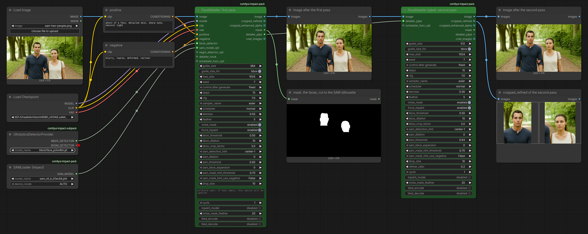
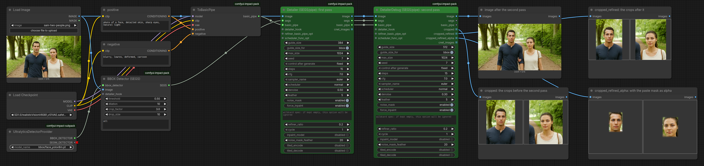
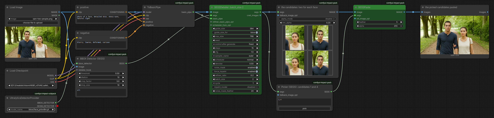

# Detailers

The Detailer enlarges images and internally utilizes KSampler to inpaint the images. Consequently, it shares common options with KSampler and additionally possesses the following options:

* `guide_size`: This is the reference size for the Detailer. Target images in SEGS smaller than `guide_size` are enlarged to match `guide_size`, while images already larger than `guide_size` are skipped, as they are deemed not requiring detailing. Enlarge the shorter side of the target image to match the `guide_size`.
* `guide_size_for`: Determines what the `guide_size` is based on. When set to `bbox`, it uses the bbox detected by the detector as the reference. When set to `crop_region`, it uses the recognized crop region based on the detected bbox as the reference. (Refer to the [detectors](detectors.md) section for more details on `bbox` and `crop_region`.)
 - When using bbox, be cautious as the size of the enlarged image based on the crop_factor can be several times larger than the guide_size.
* `max_size`: This is a safety measure that restricts the longer side of the target image to be smaller than `max_size`. It addresses issues where the bbox may become excessively large, particularly if it has an elongated shape.
  - The enlarged size is rounded down to a size the VAE keeps whole: a multiple of 8 for SD1.5, SDXL, SD3 and FLUX.1, and of 16 for FLUX.2 (V8.31 or later). Before, the VAE cut off the rest, and the patch came back slightly wider or taller than the area it replaced, so lines broke where the patch met the image. `Upscaler (SEGS)` and `Upscaler (SEGS/pipe)` round the size of a crop in the same way. The Detailers for video are not changed.
  - At a size the VAE does not keep whole, the same seed gives other pixels than before V8.31. At any other size nothing changes.
* `force_inpaint`: Prevents skipping the detailing process based on `guide_size` and applies inpainting regardless. This is useful when the objective is inpainting rather than detailing.SEGS smaller than the guide_size are not reduced to match the guide_size; instead, they are inpainted at their original size.

* `noise_mask`: This determines whether to apply a noise mask during the inpainting process. While a lower denoise value may sometimes yield more natural results with the noise mask turned off, it's generally recommended to have it activated.
* `inpaint_model`: When using an inpaint model, this option needs to be enabled to ensure proper inpainting at denoise values below 1.0.
* `noise_mask_feather`: This determines whether to feather the mask applied to the inpainting process. This option does not guarantee a more natural image; in fact, it may create artifacts along the edges.
* `refiner_ratio`: When using SDXL, this setting determines the proportion of the refiner step to apply out of the total steps.
* `cycle`: This setting determines the number of iterations for applying sampling in the Detailer. When used in conjunction with the Detailer hook, this option allows for the addition of intermittent noise and can also be used to gradually decrease the denoise size, initially establishing the basic structure and then refining it.

See [Detailer Hooks](detailer_hooks.md) for choosing, connecting and combining
schedulers, noise, samplers, previews and detection filters.
[Detailer Advanced Options](detailer_advanced_options.md) covers per-cycle image
batches, VAE tiling and crop outputs at the sampled size through the same hook input.

## Which Detailer to take

* `FaceDetailer` detects and refines in one node. It takes the image, the models, the prompts and a detector, and works on a batch of images.
* `FaceDetailer (pipe)` (`FaceDetailerPipe`) does the same with the models, prompts and detectors from a `DETAILER_PIPE`. Take it for a second pass, or for SDXL with a refiner.
* `Detailer (SEGS)` (`DetailerForEach`) refines a `SEGS` that other nodes made. Take it when the areas have to be filtered, labeled or changed before they are refined.
* `SEGSDetailer` refines a `SEGS` without pasting it. `SEGSPaste` pastes it afterwards, once you have looked at the results or picked some.
* `MaskDetailer (pipe)` (`MaskDetailerPipe`) refines the areas of a mask, such as one painted in the mask editor.
* `Detailer For Video (SEGS/pipe)` and `SEGSDetailer For Video (SEGS/pipe)` refine an area in all frames of a video in one sampling.
* The Detailers other than `FaceDetailer`, `FaceDetailer (pipe)` and the two for video stop with an error on a batch of images. See [Batching with Detailer](batching-detailer.md).

## Inputs the Detailers share

The section of each Detailer names the inputs it lacks.

* `feather`: blurs the edge of the mask with which the refined crop is pasted back. At `0` the edge is hard.
* `seed`: each SEG is sampled with `seed` plus its place in the `SEGS`, counted from 0. Each further `cycle` adds 1.
* `wildcard`: a prompt for the SEGs. When it is not empty, it is encoded with the Detailer's `clip` and replaces `positive` for every SEG. It takes wildcards and LoRA tags.
  * A special syntax gives each SEG its own prompt, adds the prompt to `positive` in place of replacing it, or skips SEGs. See [Special syntax for Detailer wildcard](ImpactWildcard.md#special-syntax-for-detailer-wildcard).
* `detailer_hook`: a hook that changes how the Detailer samples or pastes, or which detections it keeps. See [Detailer Hooks](detailer_hooks.md).
  * A hook that filters detections works where the detection happens: in `FaceDetailer` and in the detector nodes, not in `Detailer (SEGS)`.
* `tiled_encode`, `tiled_decode`: encode the enlarged crop and decode the sampled result in tiles of 512 pixels with an overlap of 64, so the VAE does not take a large crop at once.
  * With `tiled_decode` off, a decode that fails is tried again in tiles.
  * [Detailer Advanced Options](detailer_advanced_options.md#configure-vae-tiling-on-its-own) sets other tile sizes.
* `scheduler_func_opt`: a function that makes the noise schedule, such as the one from `GITSScheduler Func Provider`. While it is connected, the `scheduler` widget is not used.
* `model`: with `ImpactDummyInput` in place of the model, or as the model of the pipe, nothing is sampled and each crop goes back as it was. `FaceDetailer` still returns the `mask` of what it detected.

## FaceDetailer / FaceDetailer (pipe)

`FaceDetailer` detects areas with `bbox_detector` and refines them as `Detailer (SEGS)` does. With `bbox/face_yolov8m.pt` the areas are faces. Any other detection model works the same way.

* `bbox_threshold`, `bbox_dilation`, `bbox_crop_factor` and `drop_size` set the detection, as `threshold`, `dilation`, `crop_factor` and `drop_size` do in `BBOX Detector (SEGS)` ([Detectors](detectors.md)).
  * `bbox_threshold`: the confidence a detection needs.
  * `bbox_dilation`: grows the mask of each detection, so more of its surroundings is refined.
  * `bbox_crop_factor`: the size of the crop region, as a multiple of the bbox.
  * `drop_size`: a detection that is not both wider and taller than this many pixels is dropped.
* `sam_model_opt`: a model from `SAMLoader (Impact)`. The mask of each detection is cut to the SAM silhouette inside it, so the rest of its box is not pasted over.
* `segm_detector_opt`: a `SEGM_DETECTOR` cuts the masks to its silhouettes in the same way. It detects with the same `bbox_*` values. When both are connected, SAM is used.
* `sam_*`: the settings of `SAMDetector (combined)` for `sam_model_opt` ([Detectors](detectors.md)). Without a SAM model they do nothing.
  * `sam_detection_hint`: the points inside each bbox that SAM gets as its prompt, such as `center-1` for the center.
  * `sam_threshold`: the score a SAM mask needs to be kept. When no mask reaches it, the best one is kept.
  * `sam_dilation`: grows the SAM mask, or shrinks it with a negative value.
  * `sam_bbox_expansion`: widens the bbox that SAM gets by this many pixels on each side.
  * `sam_mask_hint_threshold`: with `mask-area`, the mask value above which a point becomes part of the prompt.
  * `sam_mask_hint_use_negative`: `Outter` adds negative points outside the crop region. `Small` makes small detections (`mask-points`) or empty parts of the mask (`mask-area`) negative points.
* A batch of images: each image is detected and refined on its own, with `seed` plus its place in the batch. A warning in the log says that the node is not meant for video.
* When nothing is detected, the image comes back unchanged.

The outputs:

* `image`: the refined image, or the refined batch.
* `cropped_refined`: a list of the refined crops.
* `cropped_enhanced_alpha`: the same crops, with the mask they were pasted with as alpha.
* `mask`: all areas of an image in one mask, after SAM or SEGM. There is one mask for each image.
* `detailer_pipe`: the models, prompts, `wildcard`, detectors and `detailer_hook` of the node. Connect it to `FaceDetailer (pipe)` for a second pass.
* `cnet_images`: as for [Detailer (SEGS)](#detailer-segs-and-its-variants).
* A crop output with no crop holds a 64x64 black image.

`FaceDetailer (pipe)` takes the models, prompts, `wildcard`, detectors and `detailer_hook` from `detailer_pipe` ([Pipes](pipes.md)). Its widgets are those of `FaceDetailer` without `wildcard`, plus `refiner_ratio`.

* It returns the `detailer_pipe` it got, for the next pass.
* `refiner_ratio` applies when the pipe holds a refiner, as one from `ToDetailerPipeSDXL` or `BasicPipe -> DetailerPipe (SDXL)` does. The `detailer_pipe` of `FaceDetailer` holds none.

* `FaceDetailer` finds the two faces with `bbox/face_yolov8m.pt`, cuts their masks to the SAM silhouette and refines them with `guide_size` 384 and `denoise` 0.5. Its `mask` output shows the areas it refined.
* `FaceDetailer (pipe)` takes the image and the `detailer_pipe` of the first pass, so it works with the same checkpoint, prompts and detectors. It enlarges the faces to a `guide_size` of 512 and changes them less, with `denoise` 0.3.
* `cropped_refined` shows the two faces after the second pass.
* The example image is [sam-two-people.png](../images/sam-two-people.png).

More workflows:

* [SDXL with a refiner](../workflow/sdxl-detailer.png): `FaceDetailer (pipe)` with a pipe from `ToDetailerPipeSDXL`, next to the base model alone, a second pass on its `detailer_pipe`, and `Detailer (SEGS/pipe)` with a `refiner_basic_pipe_opt`.
* [A list of images](../workflow/multibatch.png): two batches of two images in different sizes become one list of four with `Image Batch to Image List` and `Make Image List`. One `FaceDetailer (pipe)` refines all four. The workflow uses a group node that loads a checkpoint and makes a basic pipe.

## Detailer (SEGS) and its variants

`Detailer (SEGS)` (`DetailerForEach`) refines each SEG of `segs` and pastes it into `image`. The `SEGS` can come from a detector, from `MASK to SEGS` or from any node that changes a `SEGS` ([Detectors](detectors.md)).

* Each SEG is cropped from `image` when its turn comes. A `SEGS` from an earlier pass therefore works on the refined image.
* A `SEGS` detected on a copy of the image in another size, with the same aspect ratio, is scaled to `image`.
* A SEG with an empty mask is skipped.
* It returns the refined `image`.

The variants have the widgets of `Detailer (SEGS)`. They differ in where the models come from and in what they return:

| Node | Models from | Outputs |
| --- | --- | --- |
| `Detailer (SEGS)` | `model`, `clip`, `vae`, `positive`, `negative` | `image` |
| `Detailer (SEGS) with auto retry` (`DetailerForEachAutoRetry`) | the same, and the widget `max_retries` | `image` |
| `DetailerDebug (SEGS)` (`DetailerForEachDebug`) | the same | `image`, `cropped`, `cropped_refined`, `cropped_refined_alpha`, `cnet_images` |
| `Detailer (SEGS/pipe)` (`DetailerForEachPipe`) | `basic_pipe`, `refiner_basic_pipe_opt` | `image`, `segs`, `basic_pipe`, `cnet_images` |
| `DetailerDebug (SEGS/pipe)` (`DetailerForEachDebugPipe`) | `basic_pipe`, `refiner_basic_pipe_opt` | `image`, `segs`, `basic_pipe`, `cropped`, `cropped_refined`, `cropped_refined_alpha`, `cnet_images` |

* The pipe variants also have `refiner_ratio`, which applies when `refiner_basic_pipe_opt` is connected. See [Pipes](pipes.md).
* `segs`: the `SEGS`, each SEG with its refined crop. Give it to the next Detailer for a second pass on the same areas.
* `basic_pipe`: the `basic_pipe` that came in, for the next node.
* `cropped`: a list of the crops before sampling.
* `cropped_refined`: a list of the crops after sampling.
* `cropped_refined_alpha`: the refined crops, with the mask they were pasted with as alpha.
* `cnet_images`: the control images of a ControlNet that was applied to the SEGS. Without one it holds a 64x64 black image.
* The crop lists are sorted by the height of the crop, the tallest first, and not in the order of the `SEGS`. With `force_inpaint` off, a SEG that is skipped because it is large enough already is in `cropped` but not in the other two lists.
* `Detailer Advanced Options Hook` returns `cropped` and `cropped_refined` at the size they were sampled at ([Detailer Advanced Options](detailer_advanced_options.md#return-the-crops-at-the-sampled-size)).

`Detailer (SEGS) with auto retry` samples a SEG again when its `detailer_hook` rejects the result. `BlackPatchRetryHookProvider` rejects a dark, flat patch ([Retry a black patch](detailer_hooks.md#retry-a-black-patch)).

* Each new try uses the next seed. `max_retries` counts all tries, the first included.
* When the last try is rejected too, the run stops with `Max retries reached`. With `max_retries` 1 that happens at the first rejected try.
* Without a hook that rejects patches, it works as `Detailer (SEGS)`.

* `BBOX Detector (SEGS)` finds the two faces. `ToBasicPipe` puts the checkpoint and the prompts into one `basic_pipe`.
* `Detailer (SEGS/pipe)` refines the faces with `denoise` 0.5. Its `image`, `segs` and `basic_pipe` go into `DetailerDebug (SEGS/pipe)`, which refines the same faces again with `denoise` 0.3 and a larger `guide_size`.
* The previews show the debug outputs of the second pass. `cropped` holds the faces as the first pass left them, `cropped_refined` the faces after the second pass, and `cropped_refined_alpha` the same with the paste mask as alpha.

## SEGSDetailer and SEGSPaste

`SEGSDetailer` refines the SEGs as `Detailer (SEGS)` does, but does not paste them. It returns the `SEGS` with the refined crop in each SEG. `SEGSPaste` pastes the crops of a `SEGS` into an image. Between the two, `SEGSPreview` shows the crops and `Picker (SEGS)` keeps the ones you choose.

* `SEGSDetailer` takes its models from `basic_pipe`, and a refiner from `refiner_basic_pipe_opt`. It has no `feather`, `wildcard`, `detailer_hook` or tiled VAE. `max_size` starts at 768.
* When a SEG already carries an image, `SEGSDetailer` refines that image and not the crop of `image`. The SEGS of the Ultralytics detectors and of an earlier `SEGSDetailer` carry one. `Remove Image from SEGS` takes it out.
* `batch_size`: makes that many candidates of each SEG. The first round samples every SEG with `seed + 1`, the second with `seed + 2`, and so on. The output holds the SEGs of the first round, then those of the second, and so on.
* `cnet_images`: as for `Detailer (SEGS)`.

`SEGSPaste`:

* `feather`: blurs the edge of each SEG's mask.
* `alpha`: how much the crops cover the image, from `0` (not at all) to `255` (fully).
* `ref_image_opt`: when connected, the crops are cut from this image at the place of each SEG, and the images in the `SEGS` are not used. It must have the size of `image`.
* Without `ref_image_opt`, a SEG that carries no image is left out.
* It pastes every SEG in order. With a `batch_size` above 1 the later candidates cover the earlier ones, so pick the ones to keep first.
* On a batch of images it pastes frame by frame. That is how it pastes the result of `SEGSDetailer For Video (SEGS/pipe)`.

* `SEGSDetailer` with `batch_size` 2 refines each of the two faces twice. `SEGSPreview` shows the four candidates: both faces of the first round, then both of the second.
* `Picker (SEGS)` keeps candidates 1 and 4: the first face from the first round and the second face from the second. After a run, its `pick` button opens a dialog to choose others.
* `SEGSPaste` pastes the two picked faces into the original image.
* [segs-detailer.png](../workflow/segs-detailer.png) shows the plain case: `Simple Detector (SEGS)` with SAM, `SEGSDetailer`, `SEGSPreview` of the refined SEGs and `SEGSPaste` into the original image.

## MaskDetailer (pipe)

`MaskDetailer (pipe)` refines the areas of `mask`. Each separate area becomes a SEG, as with `MASK to SEGS` and `combined` off, and is refined as in `Detailer (SEGS)`.

* `mask_mode` takes the place of `noise_mask`. `masked only` samples only the masked area. `whole` samples the whole crop region around it. In both cases only the masked area is pasted back.
* `guide_size_for`: `mask bbox` or `crop region`, the `bbox` and `crop_region` of the other Detailers.
* `crop_factor`: the size of the crop region, as a multiple of the bbox of each area.
* `drop_size`: an area that is not both wider and taller than this many pixels is dropped.
* `bbox_fill`: the mask of each area becomes its whole bbox.
* `contour_fill` (on by default): the mask of each area is filled up to its outline, holes included. When it is off, the mask keeps its own values inside the outline.
* `batch_size`: refines the image that many times, with `seed`, `seed + 1` and so on, and returns a batch of the results.
* It always inpaints. It has no `force_inpaint`, `wildcard` or tiled VAE switches. VAE tiling works through `Detailer Advanced Options Hook`.
* `basic_pipe` and `refiner_basic_pipe_opt` come out as they went in.
* An empty mask returns the image unchanged.
* [maskdetailer.png](../workflow/maskdetailer.png): a mask painted in the mask editor of `Load Image` goes into `MaskDetailer (pipe)` with the prompt `fox girl` and `denoise` 0.75. The previews show `image` and `cropped_enhanced_alpha`. A group node loads the checkpoint and makes the basic pipe.

## Detailers for video

`Detailer For Video (SEGS/pipe)` (`DetailerForEachPipeForAnimateDiff`) and `SEGSDetailer For Video (SEGS/pipe)` (`SEGSDetailerForAnimateDiff`) take a batch of frames in `image_frames`. For each SEG they crop every frame and sample the crops of all frames together in one latent batch, so a motion model such as AnimateDiff sees the frames together.

* `Detailer For Video (SEGS/pipe)` pastes each refined SEG into the frames, with `feather`. It returns the frames, the `SEGS` with the refined crops, the `basic_pipe` and `cnet_images`.
* `SEGSDetailer For Video (SEGS/pipe)` returns the `SEGS` only and has no `feather`. Paste it with `SEGSPaste`, which has one.
* The mask of a SEG can hold one mask for each frame, as the SEGS of `Simple Detector for Video (SEGS)`, `SAM2 Video Detector (SEGS)`, `SAM3 Video Detector (SEGS)` and `MASK to SEGS for Video` do ([Detectors](detectors.md)). A single mask applies to every frame.
* When a SEG holds more than one mask but not one for each frame, its masks are combined into one mask for every frame, and a warning is logged.
* They always inpaint inside the mask. They have no `force_inpaint`, `noise_mask`, `cycle`, `wildcard`, `inpaint_model` or tiled VAE. A crop is never skipped for its size.
* Every SEG is sampled with the same `seed`.
* `max_size` starts at 1024 in `Detailer For Video (SEGS/pipe)` and at 768 in `SEGSDetailer For Video (SEGS/pipe)`.
* `Detailer For Video (SEGS/pipe)` calls its `detailer_hook` only after each paste. A preview hook such as `PreviewDetailerHookProvider` works there, and hooks that change sampling do nothing. `SEGSDetailer For Video (SEGS/pipe)` has no hook input.
* [detailer-for-animatediff.png](../workflow/detailer-for-animatediff.png): AnimateDiff makes 16 frames. `Simple Detector for Video (SEGS)` finds the face, `SEGSDetailer For Video (SEGS/pipe)` refines it in all frames and `SEGSPaste` pastes it. A second `SEGSDetailer For Video (SEGS/pipe)` turns the skirt into pants inside a mask painted on one frame and made into SEGS by `MASK to SEGS`. The workflow needs nodes of other packs: `ADE_AnimateDiffLoaderGen1`, `VHS_VideoCombine` and `ChangeImageBatchSize //Inspire`.

## Detailer hooks

The hook nodes of the `ImpactPack/Detailer` category, `DenoiseSchedulerDetailerHookProvider`, `NoiseInjectionDetailerHookProvider`, `UnsamplerDetailerHookProvider`, `VariationNoiseDetailerHookProvider`, `CustomSamplerDetailerHookProvider`, `CoreMLDetailerHookProvider` and `Detailer Advanced Options Hook`, are explained in [Detailer Hooks](detailer_hooks.md) and [Detailer Advanced Options](detailer_advanced_options.md).
