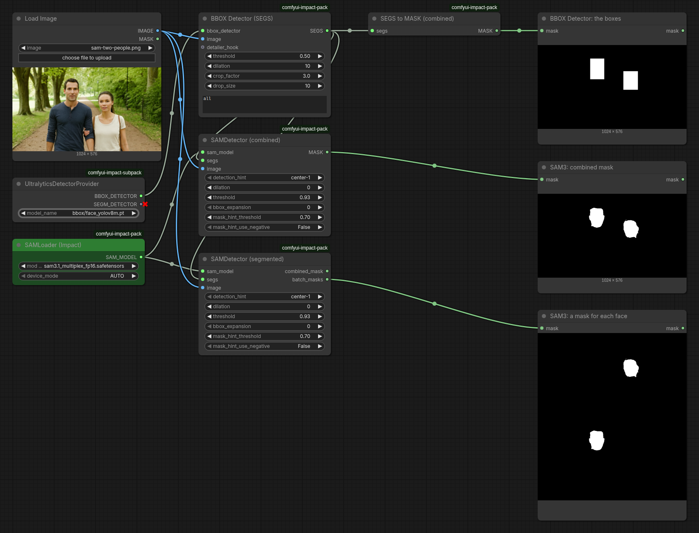
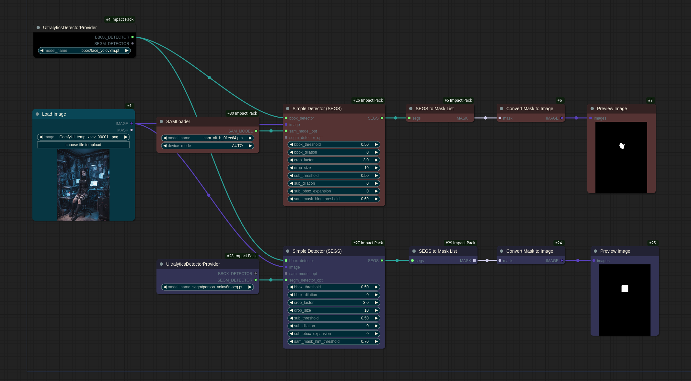
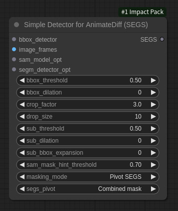
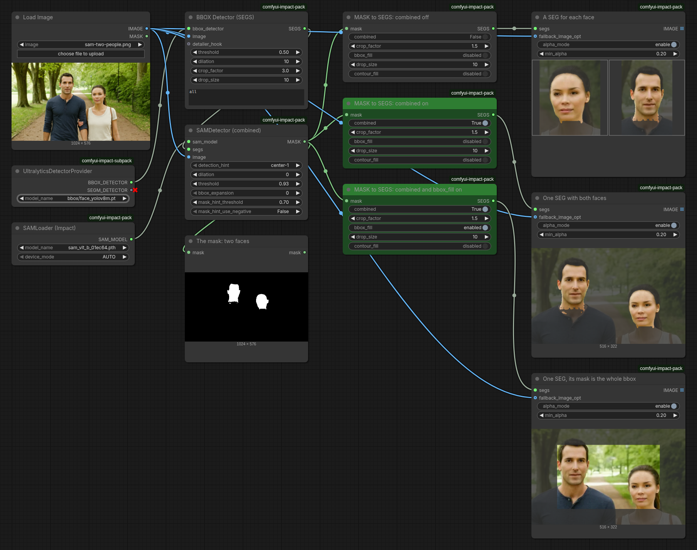

# Detectors

The Impact Pack's Detector includes three main types: BBOX, SEGM, and SAM.
* The Detector detects specific regions based on the model and returns processed data in the form of SEGS.
  - `SEGS` is a comprehensive data format that includes information required for **Detailer operations**, such as `masks`, `bbox`, `crop regions`, `confidence`, `label`, and `controlnet` information.
  - Through SEGS, conditioning can be applied for Detailer[[ControlNet](https://www.youtube.com/watch?v=RoWzBo9I0MQ)], and SEGS can also be categorized using information such as labels or size within SEGS[[SEGSFilter](https://www.youtube.com/watch?v=4IjplfhDU60), [Crowd Control](https://www.youtube.com/watch?v=9GSQlxZFrLI)].

  - bbox: Detected regions are represented by rectangular bounding boxes consisting of left, top, right, and bottom coordinates.
  - mask: Represents the silhouette of the object within the bbox as a mask, providing a more precise delineation of the object's area. In the case of BBOX detector, the mask area covers the entire bbox region.
  - crop region: Determines the size of the region to be cropped based on the bbox.
    - When the bbox is formed near the border, the area on the opposite side is expanded, resulting in the bbox being off-centered within the crop region.
    - Having a larger crop region provides more context for a more natural inpaint, but it also increases the time required for inpainting.

* BBOX stands for Bounding Box, which captures detection areas as rectangular regions.
  - For example, using the `bbox/face_yolov8m.pt` model, you can obtain masks for the rectangular regions of faces.
  - This can be obtained using the `BBOX_DETECTOR` obtained through `UltralyticsDetectorProvider` or `ONNXDetectorProvider`.

* SEGM stands for Segmentation, which captures detection areas in the form of silhouettes.
  - For instance, when using the `segm/person_yolov8n-seg.pt` model, you can obtain silhouette masks for human shapes.
  - This can be obtained using the `SEGM_DETECTOR` obtained through `UltralyticsDetectorProvider`.

* SAM generates silhouette masks using the [Segment Anything](https://segment-anything.com/) technique.
  - It cannot be used independently but, when used in conjunction with a `BBOX` model to specify the target for detection, it can create finely detailed silhouette masks for the detected objects.

## Ultralytics Detector

The `UltralyticsDetectorProvider` node loads Ultralytics' detection models and returns either a `BBOX_DETECTOR` or `SEGM_DETECTOR`.
* When using a model that starts with `bbox/`, only `BBOX_DETECTOR` is valid, and `SEGM_DETECTOR` cannot be used.
* If using a model that starts with `segm/`, both `BBOX_DETECTOR` and `SEGM_DETECTOR` can be used.
* `BBOX_DETECTOR` and `SEGM_DETECTOR` can be used with the `BBOX Detector` node and `SEGM Detector` node, respectively. 

The workflow below is an example that utilizes `BBOX_DETECTOR` and `SEGM_DETECTOR` for detection.

## SAM Detector

The `SAMDetector` node loads the `SAM` model through the `SAMLoader` node for use. 
* Please note that it is not compatible with `WAS-NS's SAMLoader`.

* The following workflow demonstrates the use of the `BBOX Detector` to generate `SEGS`, and then using the `SAMDetector` for creating more precise segments.

### SAM, SAM2 and SAM3 models

`SAMLoader (Impact)` selects the kind of model by the file name, and the nodes that take a `SAM_MODEL` work with each of them.

| Model | Files | What it needs |
| --- | --- | --- |
| SAM | `.pth`, `.pt` or `.safetensors` files in `models/sams`. A name with `vit_h` or `vit_l` selects that model, any other name is ViT-B. | Nothing more. The `.safetensors` form, such as the files of [kornia/sam](https://huggingface.co/kornia/sam), loads since V9.0.2. |
| SAM2 | `sam2_hiera_*.pt` and `sam2.1_hiera_*.pt` in `models/sams`, under their original names. | The `sam2` package. Since V9.1 it is not installed with `requirements.txt`: run `pip install -r requirements-sam2.txt` in the Impact Pack directory with the Python of ComfyUI. |
| SAM3 | A file whose name starts with `sam3`, in `models/sams` or `models/checkpoints`, such as [`sam3.1_multiplex_fp16.safetensors`](https://huggingface.co/Comfy-Org/sam3.1/resolve/main/checkpoints/sam3.1_multiplex_fp16.safetensors). | Impact Pack V9.1 or later and ComfyUI v0.21.0 or later. No extra package: it runs on ComfyUI's own SAM3. |

* A SAM3 model works in `SAMDetector (combined)`, `SAMDetector (segmented)`, the `Simple Detector` nodes and the `sam_model_opt` of the detailers. Since V9.1 a SAM2 model works in `SAMDetector (segmented)` too.
* SAM3 returns one mask for a prompt, without a score. The `threshold` of a SAM detector does not apply to it.
* The SAM editor (`Open in SAM Detector`) takes SAM models only.

`device_mode` says where a SAM or SAM2 model is kept between detections.
* `AUTO`: the model moves to the GPU for a detection and back to the CPU afterwards.
* `Prefer GPU`: the model moves to the GPU once and stays there. When the VRAM is short it stays on the CPU, with a line in the log.
* `CPU`: the model runs on the CPU.
* Since V9.1.1 the three modes work for a SAM2 model as well. Before, `Prefer GPU` failed in `SAMLoader (Impact)` and `CPU` ran on the GPU.
* `device_mode` does not apply to a SAM3 model. ComfyUI's model management places it.

The workflow below gives the two faces that the `BBOX Detector` finds to a SAM3 model. `SAMDetector (combined)` returns one mask with both faces, and the `batch_masks` of `SAMDetector (segmented)` holds a mask for each face. To use another model, select it in `SAMLoader (Impact)`. The rest of the workflow stays as it is.

* The example image is [sam-two-people.png](../images/sam-two-people.png).

## Simple Detector

The `Simple Detector` first performs primary detection using `BBOX_DETECTOR` and then generates `SEGS` using the intersected mask from the detection results of `SEGM_DETECTOR` or `SAMDetector`.

* `sam_model_opt` and `segm_detector_opt` are both optional inputs, and if neither of them is provided, the detection results from BBOX are returned as is. When both inputs are provided, `sam_model_opt` takes precedence, and the `segm_detector_opt` input is ignored.

* `SAM` has the disadvantage of requiring direct specification of the target for segmentation, but it generates more precise silhouettes compared to `SEGM`. The workflow below is an example of compensate `BBOX` with `SAM` and `SEGM`. In the case of `person SEGM`, it creates a silhouette that includes the entire `face BBOX`, resulting in a silhouette that is too rough and doesn't show significant improvement.

## Simple Detector For AnimateDiff

`Simple Detector For AnimateDiff` is a detector designed for video processing, such as AnimateDiff, based on the Simple Detector.

* The basic configuration is similar to the Simple Detector, but additional features such as `masking_mode` and `segs_pivot` are provided.
* `masking_mode` configures how masks are composed:
  * `Pivot SEGS`: Utilizes only one mask from the segs specified by `segs_pivot`. When used in conjunction with the Combined mask, it employs a unified mask that encompasses all frames.
  * `Combine neighboring frames`: Constructs each frame's mask by combining three masks, including the current frame and its adjacent frames. This method occasionally compensates for detection failures in specific frames.
  * `Don't combine`: Uses the original mask for each frame without combining them.
* `segs_pivot` sets the mask image that serves as the basis for identifying SEGS.
  * `Combined mask`: Combines the masks of all frames into one frame before identifying separate masks for each SEGS.
  * `1st frame mask`: Identifies separate masks for each SEGS based on the mask of the first frame.
  * Each option has its advantages and disadvantages. For instance, when `1st frame mask` is selected, if the target object moves rapidly, the SEGS created based on the mask of the first frame might extend beyond its initial boundaries in later frames. Conversely, when using the `Combined mask`, if moving objects overlap, they may be recognized as a single object.

  

## SAM2 Video Detector / SAM3 Video Detector

`SAM2 Video Detector (SEGS)` and `SAM3 Video Detector (SEGS)` track objects through the frames of a video.

* The `bbox_detector` finds the objects in the first frame. The SAM model then follows each of them through all frames.
  * When the first frame has no object, the last frame is tried, and the objects are followed backwards.
* The result is a `SEGS` with one SEG for each object. The mask of a SEG is a batch that holds the mask of that object in every frame.
* `SAM2 Video Detector (SEGS)` needs a SAM2 model, and `SAM3 Video Detector (SEGS)` (V9.1 or later) needs a SAM3 model. Each node reports the other kind of model as an error.
* `sam2_threshold` of the SAM2 node is the value from which a pixel belongs to the mask. The SAM3 node has no such input: SAM3 returns masks.

In the workflow below, the `BBOX Detector` model finds two faces in the first of 25 frames. `SEGS to Mask Batch` shows the result: 50 masks, the 25 frames of the first face and then the 25 frames of the second.

* The example video is [sam-video-example.mp4](../images/sam-video-example.mp4). `Load Video` and `Get Video Components` are nodes of ComfyUI. A batch of frames from any other node works the same way.

## MASK to SEGS

`MASK to SEGS` makes `SEGS` from a mask, so that a mask from any source can be given to the Detailer.

* `combined` off: every separate area of the mask becomes a SEG of its own.
* `combined` on: the whole mask becomes one SEG. Its bbox is the box around all areas.
* `bbox_fill`: the mask of each SEG is replaced by its bbox. With `combined` on, that is the box around all areas.
* `crop_factor`: the size of the crop region around the bbox, as in the detectors.
* `MASK to SEGS for Video` does the same for a batch of masks.

* Since V9.1.1 the bbox of a `combined` SEG ends where the mask ends. Before, it was one pixel short on the right and at the bottom, and `bbox_fill` with `combined` on did not fill the box of the mask. A workflow that uses `combined` gets results that differ by these pixels.
