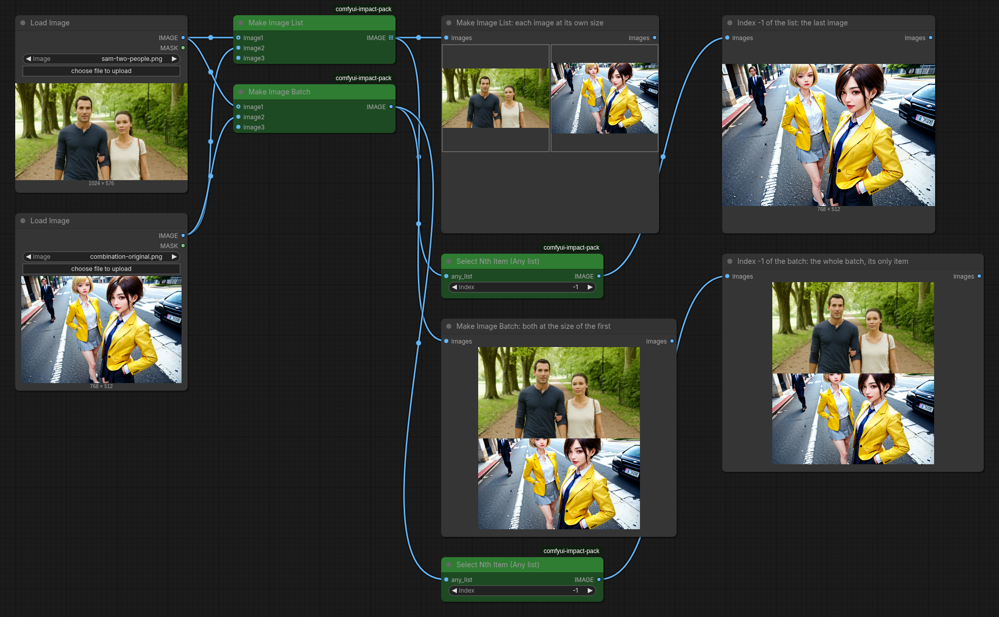
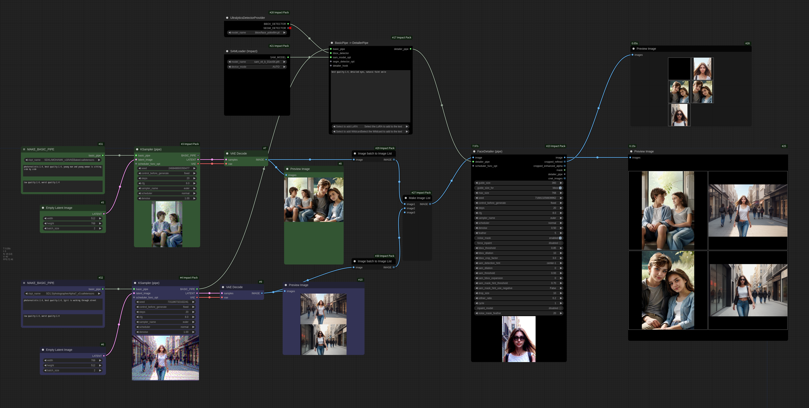
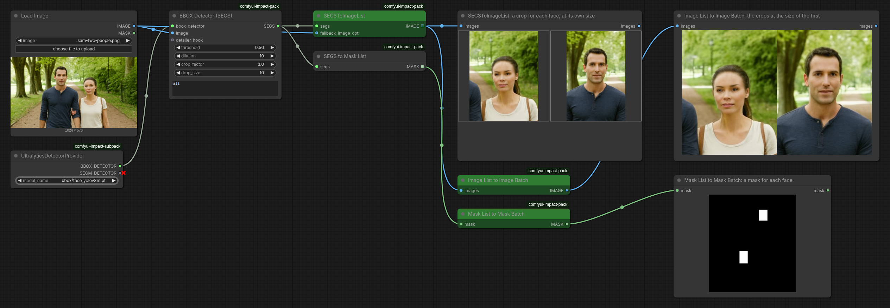
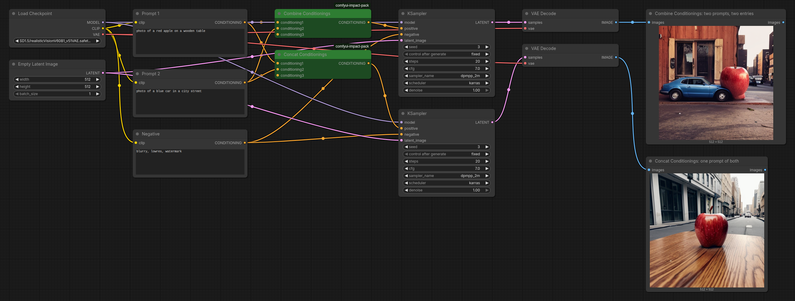

# Lists and batches

Several images, masks or other values can travel along one link in two forms: as a batch or as a list. The nodes on this page make lists and batches, turn one into the other, and take single items out of a list. A workflow needs them when images of different sizes go through one node, or when a node takes only one of the two forms.

## A list or a batch

* A **batch** is one value that holds several images or masks. A node gets the whole batch in one run.
  * All images of a batch have the same size. The nodes below that make a batch scale an image of another size to the size of the first.
* A **list** holds separate values. A node runs once for each item, and its results form a list again.
  * The items of a list can differ in size. A list can hold values of any type, such as conditionings, strings or `SEGS`.
  * When a node gets two lists of different lengths, it runs as often as the longer list has items. The shorter list repeats its last item.
  * A single value counts as a list of one item, so it goes with every item of a list.
* Some nodes take a whole list in one run: `Image List to Image Batch`, `Mask List to Mask Batch`, `Select Nth Item (Any list)`, `List Bridge`, `String List to String`, and the SEGS nodes `Assemble (SEGS)`, `Decompose (SEGS list)` and `Assemble (SEGS list)`.
* [Batching with Detailer](batching-detailer.md) explains which Detailer nodes take a batch, and how to give the others a list.

## Making a list or a batch

`Make Image List` (`ImpactMakeImageList`), `Make Image Batch` (`ImpactMakeImageBatch`), `Make Mask List` (`ImpactMakeMaskList`), `Make Mask Batch` (`ImpactMakeMaskBatch`) and `Make List (Any)` (`ImpactMakeAnyList`) put the values of their inputs together.

* Each starts with one input. Connecting the last input adds the next one: `image1`, `image2`, and so on. Disconnecting an input removes it.
* The list nodes make each input one item, in the order of the inputs. An input that is a batch stays one item.
* The batch nodes join all inputs into one batch. An input that is a batch adds all its images.
  * An image or mask of another size than the first is cropped at the center to the aspect ratio of the first, then scaled to its size.
* `Make List (Any)` takes values of any type. The first link sets the type of its inputs and its output.

* `Make Image List` and `Make Image Batch` get the same two images, one of 1024x576 and one of 768x512.
* The list keeps both sizes. In the batch, the second image is cropped and scaled to 1024x576.
* `Select Nth Item (Any list)` with `index` -1 takes the last image of the list. The batch is a single item, so on the batch the node returns the whole batch.
* The example images are [sam-two-people.png](../images/sam-two-people.png) and [combination-original.png](../images/combination-original.png).

## Converting between list and batch

* `Image Batch to Image List` (`ImpactImageBatchToImageList`) splits a batch into a list of single images.
* `Image List to Image Batch` joins all items of a list into one batch, with the same scaling as `Make Image Batch`.
  * When RGB and RGBA images are mixed, the batch is RGB.
  * An empty list gives no batch, and the nodes that need it do not run.
* `Mask Batch to Mask List` (`MasksToMaskList`) and `Mask List to Mask Batch` do the same for masks.

* Two samplers make a batch of two images each, one sampler at 512x768 and the other at 768x512.
* `Image Batch to Image List` turns each batch into a list, and `Make Image List` puts both lists into one list of four images.
* `FaceDetailer (pipe)` then runs once for each image, at the size of that image.
* The two `MAKE_BASIC_PIPE` nodes are group nodes with a checkpoint and two prompts each. Select checkpoints that you have.

## Select Nth Item (Any list)

`Select Nth Item (Any list)` (`ImpactSelectNthItemOfAnyList`) returns one item of a list.

* `index` counts from 0. A negative `index` counts from the end: -1 is the last item.
* An `index` out of range returns the last item, without an error.
* A batch is a single item, so the node returns the whole batch. To take one image out of a batch, convert it with `Image Batch to Image List` first, or use ComfyUI's `Get Image from Batch`.
* The result is a single value, and the nodes after it run once.

## List Bridge

`List Bridge` (`ImpactListBridge`) passes a list on unchanged.

* It takes the whole list in one run and returns it as a list. It takes any type.
* It collects the list before it passes it on, so the part of the workflow before it has finished for every item when the next node starts.

* `Load Prompts From Dir (Inspire)` and `Unzip Prompt (Inspire)` of the [Inspire Pack](https://github.com/ltdrdata/ComfyUI-Inspire-Pack) read a list of prompts from files.
* `CLIP Text Encode (Prompt)` runs once for each prompt. `List Bridge` collects the conditionings and gives them to `ToBasicPipe` as a list.
* `KSampler (pipe)` then samples once for each prompt.
* The workflow uses a FLUX.1 model, with `Negative Cond Placeholder` in place of a negative prompt.

## Lists from SEGS

* `SEGSToImageList` returns a list with a picture of each SEG of a `SEGS`. The pictures can differ in size, so they come as a list.
  * The picture is the image that the SEG carries, or else the crop of `fallback_image_opt`. With neither, it is a black 64x64 image.
  * When `fallback_image_opt` has another size than the image of the `SEGS`, the SEGS are scaled to it first.
  * A `SEGS` without SEGs gives one black 64x64 image.
* `SEGS to Mask List` returns a list with a mask for each SEG. See [Working with SEGS](segs.md#segs-to-masks).
* For a list of `SEGS`, one for each image of a list, see [Decompose (SEGS list) / Assemble (SEGS list)](segs_list.md).

* The `BBOX Detector (SEGS)` finds the two faces. `SEGSToImageList` returns a crop of each face, each at its own size.
* `Image List to Image Batch` joins the crops into a batch. The second crop is cropped and scaled to the size of the first.
* `SEGS to Mask List` returns a mask of each face, and `Mask List to Mask Batch` joins them into one batch.
* The example image is [sam-two-people.png](../images/sam-two-people.png).

## Combining conditionings

`Combine Conditionings` (`ImpactCombineConditionings`) and `Concat Conditionings` (`ImpactConcatConditionings`) put several conditionings into one. As with the Make nodes, connecting the last input adds the next one.

* `Combine Conditionings` puts the entries of all inputs side by side into one conditioning, as ComfyUI's `Conditioning (Combine)` does for two. Each prompt stays an entry of its own.
* `Concat Conditionings` appends the tokens of each further input to every entry of `conditioning1`, as ComfyUI's `Conditioning (Concat)` does. Each entry becomes one longer prompt. Everything else comes from `conditioning1`.
* `Concat Conditionings` uses only the first entry of each further input. When an input has more, the rest is dropped with a warning in the log.
* With one input connected, both nodes return it unchanged.

* The same two prompts, an apple and a car, go to both nodes. Both samplers use the same seed.
* After `Combine Conditionings` the sampler gets the two prompts as two entries. After `Concat Conditionings` it gets one prompt that holds both.
