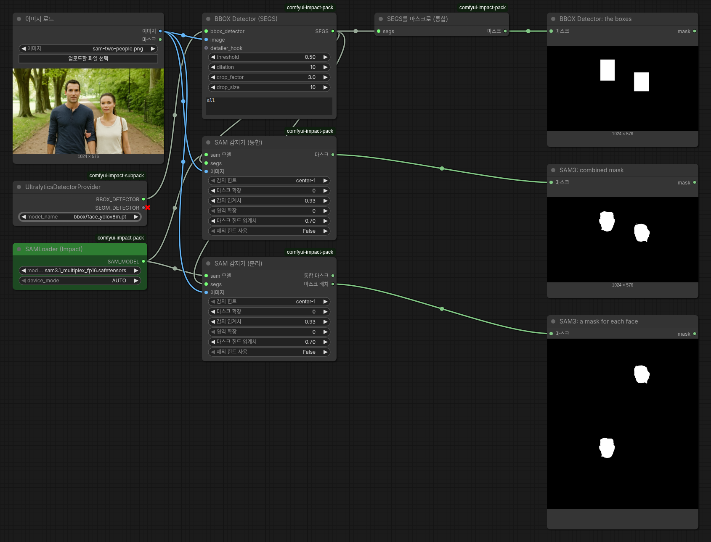

# Language of the nodes

The Impact Pack carries translations of its nodes. When the language of ComfyUI is set to one of them (**Settings > Language**), node titles, input and output names, descriptions and tooltips are shown in that language.

| Language | Nodes translated |
| --- | --- |
| Korean (`ko`) | 67 of the 202 nodes |
| Simplified Chinese (`zh`, V8.31 or later) | 201 of the 202 nodes |

* A node without a translation is shown in English.
* The tutorials use the English names.
* Only what is displayed changes. A workflow saved in one language loads in any other, and widget values, option values and node IDs are the same.

The picture below is the [SAM3 example](detectors.md#sam-sam2-and-sam3-models) with the language set to Korean. The two `SAMDetector` nodes and `SEGS to MASK (combined)` have a Korean translation. `BBOX Detector (SEGS)` and `SAMLoader (Impact)` do not have one yet.

* In V8.31 and V9.0 the English descriptions and tooltips of several nodes were corrected where they named an option that does not exist or described something the node does not do, and the Korean labels that sat on the wrong socket were moved. The texts are the source of the translations.
* Since V9.0, 51 nodes are defined on the V3 schema of ComfyUI, and since V9.2, 19 more. Their names, inputs, outputs and results are the same as before. A tool that reads `/object_info` itself sees the V3 form for these nodes: a combo input is `["COMBO", {"options": [...]}]` in place of `[[...], {...}]`.
