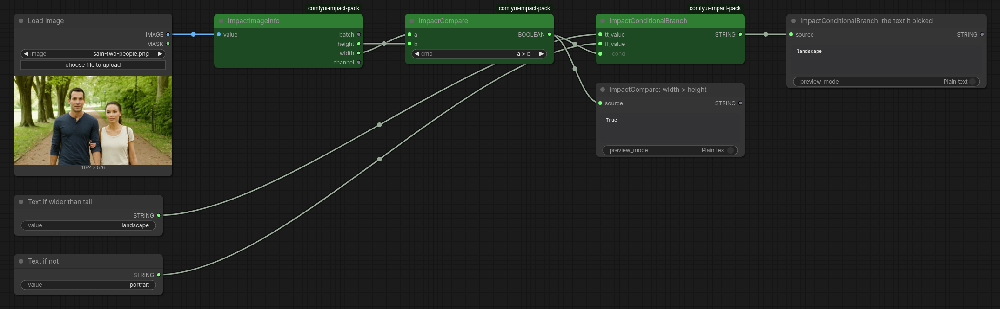
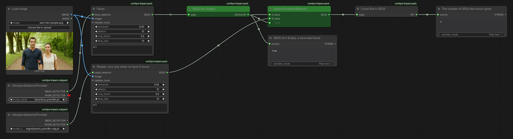

# Logic and flow control

These nodes hold values, compare them and choose with the result: which value goes on, which input a switch passes on, and which nodes run. Some of them act on the page or the queue instead of returning a value. They set a widget, mute a node or queue the workflow again, for work that spans several prompts. The pack calls its logic nodes experimental.

## Values

`ImpactInt`, `ImpactFloat` and `ImpactBoolean` each hold one value in a widget and return it. Set a value once and link it to every node that needs it.

* `ImpactInt` holds a whole number from 0 up, 0 by default. It cannot hold a negative number.
* `ImpactFloat` holds a decimal number, 1.0 by default.
* `ImpactBoolean` holds true or false, false by default.
* Two inputs are read when the prompt is queued, before any node runs. One is the `select` of a switch in `select_on_prompt` mode, see [sel_mode](switch.md#sel_mode). The other is the `seed` of a wildcard node in `populate` mode, see [ImpactWildcard](ImpactWildcard.md). A linked `ImpactInt` works there, because the pack reads its widget. A number that another node computes is not known at that time.

### String Selector

`String Selector` (`ImpactStringSelector`) returns one part of the text in `strings`. `select` picks the part, and the first part is 0.

* `multiline` `disabled`: each line is a part. Empty lines count too.
* `multiline` `enabled`: a line that starts with `#` starts a part, and the part goes on until the next such line. The `#` is removed, and the rest of that line stays in the result. Lines before the first `#` line are a part of their own.
* A `select` past the last part starts again at the first. With three parts, 3 selects the first part.
* Link an `INT` to `select` to pick a part by a computed number.

### ImpactConvertDataType

`ImpactConvertDataType` takes a value of any type and returns it as `STRING`, `FLOAT`, `INT` and `BOOLEAN` at once.

* A value whose text is a decimal number, such as `1.5` or `-3`, gives that number. `INT` drops the decimals, so 1.5 gives 1 and -1.5 gives -1. `BOOLEAN` is true for every number except 0.
* The text `false`, in any case, and the boolean false give 0 and false.
* Any other value gives 1 and true. This includes an empty text and the text `1e5`.
* `STRING` is the value as text.

## Comparing and deciding

### ImpactCompare

`ImpactCompare` compares `a` with `b` and returns a `BOOLEAN`.

* `cmp` sets the test: `a = b`, `a <> b` for not equal, `a > b`, `a < b`, `a >= b` and `a <= b`.
* `tt` is always true and `ff` always false, whatever `a` and `b` hold.
* `a` and `b` take any type. The first link to one of them sets the type of both.
* Compare values of one kind. A number and a text are never equal. The four tests with `>` or `<` stop the run with an error when one value is a number and the other a text.

### ImpactLogicalOperators and ImpactNeg

* `ImpactLogicalOperators` combines `bool_a` and `bool_b` with the `operator` `and`, `or` or `xor`. `xor` is true when exactly one of the two is true.
* `ImpactNeg` returns the opposite of `value`.
* Their inputs are sockets only. Link a `BOOLEAN` to each input, from `ImpactBoolean` for a fixed value.

### ImpactConditionalBranch and ImpactConditionalBranchSelMode

`ImpactConditionalBranch` returns `tt_value` when `cond` is true and `ff_value` when it is false. The values can be of any type.

* `cond` is a toggle. Link a `BOOLEAN` to it, such as the output of `ImpactCompare`.
* Only the value that the node returns is computed. The nodes that give the other value do not run, unless another node needs them.
* `tt_value` and `ff_value` both need a link. They and the output take the type of the first value you link.

`ImpactConditionalBranchSelMode` returns the same, with two differences.

* `tt_value` and `ff_value` are optional. When the selected one has no link, the output is `None`.
* Both values are computed before the node chooses, also the one it does not return.

* `ImpactImageInfo` returns the size of the image. `ImpactCompare` with `a > b` is true when the `width` is greater than the `height`.
* `ImpactConditionalBranch` returns the text `landscape` for such an image, and `portrait` for any other. Link its output where the text is needed, for example to the text of a prompt.
* The example image is [sam-two-people.png](../images/sam-two-people.png).

### ImpactIfNone

`ImpactIfNone` tells whether a value exists.

* `bool` is true when `any_input` has a link and its value is not `None`. Otherwise it is false.
* `signal_opt` returns `signal` unchanged.
* Use it after a node that can return `None`, such as `Switch (Any)` with a `select` that points at an input without a link, or `ImpactConditionalBranchSelMode` without the selected value.
* A value that a `Control Bridge` or an `Inversed Switch (Any)` stops is not `None`. `ImpactIfNone` then does not run at all.

### SEGS isn't Empty

`SEGS isn't Empty` (`ImpactIsNotEmptySEGS`) is true when the `SEGS` holds at least one SEG. Give it the output of a detector to choose another path when the detector found nothing.

* `SEGS isn't Empty` tells whether the `BBOX Detector (SEGS)` found a face.
* `ImpactConditionalBranch` returns the faces when it did. When it did not, the branch returns the people that the `SEGM Detector (SEGS)` finds.
* The `SEGM Detector (SEGS)` and its `UltralyticsDetectorProvider` run only when no face was found, because the branch computes only the value it returns.
* `Count Elts in SEGS` and `Preview as Text` show the number of SEGs that the branch returns. In a real workflow, a detailer takes the `SEGS` of the branch.
* The example image is [sam-two-people.png](../images/sam-two-people.png).

### ImpactMinMax

`ImpactMinMax` returns the greater of `a` and `b` with `mode` at `max`, and the smaller with `min`.

* The output is an `INT` socket, but the node does not convert the value. With two floats it returns a float, so give it whole numbers.

## Switches

* `Switch (Any)` passes on one of its inputs, and `Inversed Switch (Any)` sends its input to one of its outputs. [Switch (Any) / InversedSwitch (Any)](switch.md) explains them and `sel_mode`.
* `Switch (Any)` has two more outputs. `selected_label` gives the label of the selected input slot, and `selected_index` gives the value of `select`.
* `Switch (latent/legacy)` (`LatentSwitch`) and `Switch (SEGS/legacy)` (`SEGSSwitch`) are the same node as `Switch (Any)`. They have the same widgets and outputs, take any type, and grow an input as you link one. They keep these node IDs for old workflows. Use `Switch (Any)` in a new workflow.

`Switch (images, mask)` (`ImageMaskSwitch`) passes on one of four pairs of an image and a mask.

* `select` from 1 to 4 picks the pair.
* `images1` needs a link. The other images and all masks are optional, and one without a link gives `None` when its pair is selected.
* Every linked input runs, also the inputs of the pairs that the node does not pass on. `Switch (Any)` in `select_on_execution` mode runs only the input it passes on.

## Nodes that change the page or the queue

Each click on **Run** queues one prompt, a copy of the workflow as it is at that moment. The nodes of this section work through the ComfyUI page in the browser. When one of them runs, the server sends a message to the page, and the page sets a widget, mutes a node or queues the workflow again. Their outputs do not show it.

* A prompt does not change after it is queued. A widget or a mute state that one of these nodes changes counts from the next prompt on. `Remote Boolean (on prompt)` and `Remote Int (on prompt)` are the exception, because they change the prompt as it is queued.
* `ImpactValueSender`, `Control Bridge`, `Set Widget Value`, `Set Mute State` and the queue triggers are output nodes. They run even when nothing is linked to their output. Like every node, they run again only when one of their inputs changed. In a prompt where nothing changed for them, they do nothing.
* Every browser tab that has ComfyUI open on the server gets the messages. Each tab acts on the workflow that it shows at that moment. With a second tab open, a queue trigger queues a prompt from each tab. Keep one tab open, and keep the workflow open while it repeats.
* A `node_id` is the ID number of the target node. To show the IDs on the canvas, turn on a node ID badge, such as the `Badge: #ID Nickname` setting of ComfyUI-Manager.

### ImpactValueSender and ImpactValueReceiver

`ImpactValueSender` sends `value` to every `ImpactValueReceiver` with the same `link_id`.

* When the sender runs, the page writes `value` into the `value` widget of each such receiver, and sets its `typ` to the type of the value.
* The receiver returns what its widget held when the prompt was queued. In the prompt that sends the value, it still returns the old one. Use the pair to carry a value from one prompt to the next, with a `Queue Trigger` behind the sender.
* `typ` converts the text of the widget. `INT` and `FLOAT` read a number, `BOOLEAN` is true only for the text `true` in any case, and `STRING` keeps the text.
* Send numbers, texts and booleans. The receiver has no `typ` for other values.
* The sender returns its `signal_opt` input as `signal`. Link `signal` to the node that must run after the sender, such as the `signal` of a `Queue Trigger`.

`Image Sender`, `Image Receiver`, `LatentSender` and `LatentReceiver` send images and latents by a `link_id` in the same way. See [Image Sender, Image Receiver, Latent Sender, Latent Receiver](sender_receiver.md).

### Control Bridge

`Control Bridge` (`ImpactControlBridge`) passes `value` on, or keeps the nodes behind it from running. `mode` is `Active` or `Stop/Mute/Bypass`, and `behavior` says how the bridge stops them.

* `Stop`: with `mode` at `Active`, the value goes on. With `Stop/Mute/Bypass`, the nodes that take the output, and the nodes after them, do not run in this prompt. The page does not change.
* `Mute` or `Bypass`: with `mode` at `Stop/Mute/Bypass`, the bridge mutes or bypasses the nodes linked to its output. With `Active`, it makes them active again. The bridge looks through reroute nodes to the nodes behind them. Nodes further on keep their mode.
* When one of those nodes is not in that mode yet, the bridge interrupts the prompt that runs. The page then changes the mode of the nodes and queues the workflow again, so one click on **Run** gives two prompts. When all of them are in that mode already, the bridge passes its value on.
* `Mute` and `Bypass` read the workflow that the page sends with the prompt. A prompt sent to the API without it gets the value passed on and a warning in the log.
* The bridge does not work correctly with a batch count above 1. It is not guaranteed to work when a seed is randomized before it, or when `Queue Trigger`, `Set Widget Value` or `Set Mute State` change the workflow before it. Place those nodes at the end of the workflow. To change a seed for each prompt, set it with `Set Widget Value` at the end.

### Set Widget Value and Set Mute State

`Set Widget Value` (`ImpactSetWidgetValue`) sets a widget of another node. `Set Mute State` (`ImpactNodeSetMuteState`) mutes another node or makes it active.

* `node_id` names the target node, and `widget_name` names its widget, such as `seed`.
* `Set Widget Value` sets the value of the input that has a link: `boolean_value`, `int_value`, `float_value` or `string_value`. With several links, the first in that order wins. With none, the node does nothing.
* The page does not check the type. Give a value of the widget's type.
* `Set Mute State` with `set_state` at `mute` mutes the target, and with `active` makes it active. It cannot bypass a node.
* Both return their `signal` input as `signal_opt`. Lead `signal` from the node that must run before them.

### Remote Boolean (on prompt) and Remote Int (on prompt)

`Remote Boolean (on prompt)` (`ImpactRemoteBoolean`) and `Remote Int (on prompt)` (`ImpactRemoteInt`) set a widget of another node when the server receives the prompt, before any node runs.

* The server writes `value` into the widget `widget_name` of the node `node_id` in the prompt, and the page shows the new value in that widget. The prompt that you queued already uses it.
* They act on every prompt, also when nothing about them changed.
* `Remote Boolean (on prompt)` sets only a boolean widget. `Remote Int (on prompt)` sets an integer or a float widget.
* The node does nothing when the target is not in the prompt, for example because it is muted. It also does nothing when the target has no widget of that name. When the widget holds another type or has a link, the node does nothing.
* They act before the other prompt handlers of the pack. A `Remote Int (on prompt)` can therefore set the `select` of a switch in `select_on_prompt` mode.

### Queue Trigger and Queue Trigger (Countdown)

`Queue Trigger` (`ImpactQueueTrigger`) queues the workflow again each time it runs with `mode` at `Trigger`.

* The page queues the workflow as it is at that moment, with the widgets that other nodes changed.
* It runs only when `signal` or `mode` changed since its last run. With a `signal` that stays the same, it queues one more prompt, and the loop ends there. A `signal` that changes in every prompt loops until you set `mode` to `Don't trigger`.
* The page queues the next prompt as soon as the message arrives. A node that must act first, such as an `ImpactValueSender`, has to run before the trigger. Lead the trigger's `signal` through that node.
* Keep the batch count at 1. With more, the prompts are built before the values change, and a loop does not work.
* `signal_opt` returns `signal`.

`Queue Trigger (Countdown)` (`ImpactQueueTriggerCountdown`) repeats the workflow a set number of times.

* `count` is the number of this prompt, from 0. `total` is the number of prompts.
* With `mode` at `Trigger` and `count` below `total` minus 1, the node sets its own `count` widget to `count` plus 1 and queues the workflow again. At `total` minus 1, it sets `count` back to 0 and queues nothing. One click on **Run** with `count` at 0 therefore gives `total` prompts.
* The outputs `count` and `total` give other nodes the number of the prompt, for example for the `select` of a `String Selector`.
* `signal` is optional and comes out as `signal_opt`.

To repeat a workflow until a condition is true, use `ImpactConditionalStopIteration` with **Run (Instant)**. See [Conditional Stop Iteration](stop_iteration.md).

### Execution Order Controller and Sleep

* `Execution Order Controller` (`ImpactExecutionOrderController`) passes `signal` and `value` on unchanged. A node that takes its `value` output runs only after the node that gives its `signal`. Link the output of the node that must run first to `signal`, and lead the input of the node that must run later through `value`.
* `Sleep` (`ImpactSleep`) waits `seconds` and then returns `signal` as `signal_opt`. The server runs no other node during the wait.

## Info and debug nodes

* `ImpactImageInfo` returns the number of images in the batch as `batch`, the size in pixels as `height` and `width`, and the number of channels as `channel`.
* `ImpactLatentInfo` returns the same for a latent. `height` and `width` are the size of the latent times 8, and `channel` is the number of latent channels. For a video latent, which has a frame axis, `height` gives the number of frames times 8, and `width` the height of the latent times 8.
* `ImpactLogger` writes `data` and the whole prompt to the console of the server. It also shows `data` as text in its `text` widget, in place of what the widget held.
* `ImpactDummyInput` returns the text `DUMMY`. Link it to the `model` of a detailer, such as `Detailer (SEGS)` or `FaceDetailer`, or to the `model` of the `BASIC_PIPE` or `DETAILER_PIPE` that a pipe detailer takes. The detailer then skips the sampling and pastes every crop back unchanged.
