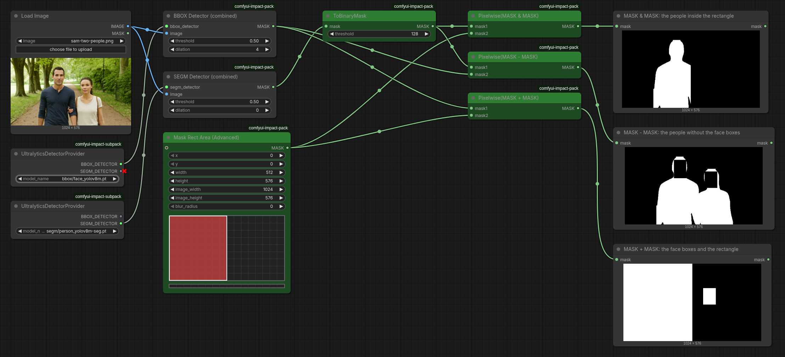
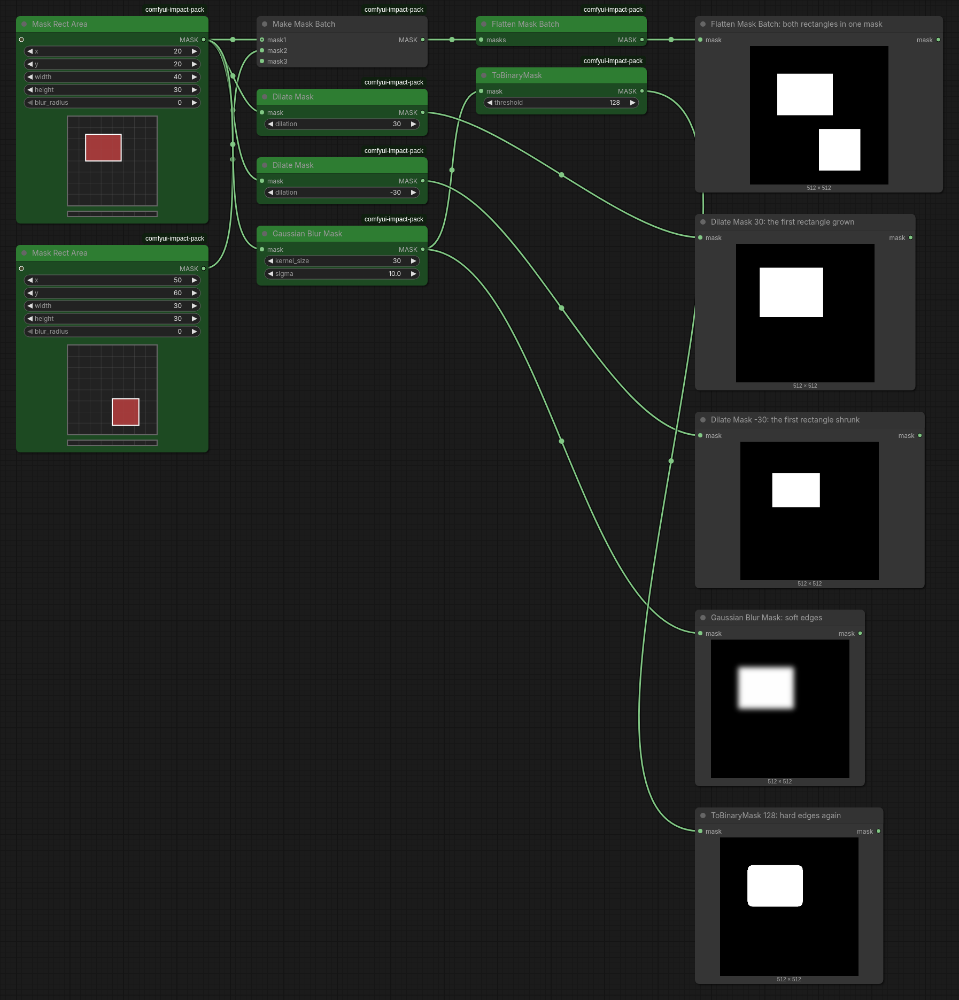
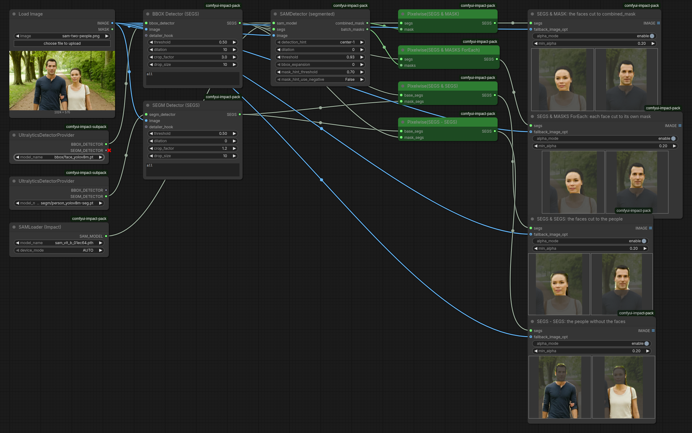

# Mask nodes

The mask nodes of the Impact Pack draw, combine and clean up masks, and cut the masks inside `SEGS`. Take them when one detector or the MaskEditor does not give the area you want, such as a face box narrowed to the silhouette, a body without its face, or a fixed rectangle of the picture.

## Combining two masks

`Pixelwise(MASK & MASK)`, `Pixelwise(MASK - MASK)` and `Pixelwise(MASK + MASK)` take `mask1` and `mask2` and return one `MASK`. They have no options.

* `Pixelwise(MASK & MASK)` (`BitwiseAndMask`) keeps the pixels that are set in both masks.
  * It is meant for binary masks, with the values 0 and 1 only. For values in between the result is not always the smaller value. For example, 0.3 and 0.7 give about 0.14, and 1 and 0.7 give 0.5. Make a soft mask binary with `ToBinaryMask` first.
* `Pixelwise(MASK - MASK)` (`SubtractMask`) takes `mask2` away from `mask1`. Values below 0 become 0.
* `Pixelwise(MASK + MASK)` (`AddMask`) adds the two masks. Values above 1 become 1.
* The two masks must have the same size and the same number of masks in their batch. Otherwise the node returns `mask1` unchanged, without a warning.
  * A mask from a detector has the size of its image. A mask from `Mask Rect Area` is always 512 x 512.

* `BBOX Detector (combined)` returns one mask with the box of each face, and `SEGM Detector (combined)` one mask with the silhouette of each person. `ToBinaryMask` makes the silhouettes binary for `Pixelwise(MASK & MASK)`.
* `Mask Rect Area (Advanced)` makes a mask of 1024 x 576, the size of the image, with a rectangle over its left half. So its mask fits the masks of the detectors.
* `Pixelwise(MASK & MASK)` keeps the people inside the rectangle. `Pixelwise(MASK - MASK)` takes the face boxes away from the people. `Pixelwise(MASK + MASK)` puts the face boxes and the rectangle into one mask.
* The example image is [sam-two-people.png](../images/sam-two-people.png).
* The [hair restyling workflow](../workflow/hair-restyle.png) takes the SAM mask of the faces away from the CLIPSeg mask of the hair with `Pixelwise(MASK - MASK)`. `ToBinaryMask` makes the result binary, and `MASK to SEGS` turns it into `SEGS` for the Detailer.

## Drawing a rectangle

`Mask Rect Area` and `Mask Rect Area (Advanced)` make a mask with one rectangle. They have no input image.

* Each node draws its rectangle on a canvas below its widgets, on a grid with a line every 64 pixels of the mask. The bar under the canvas shows `blur_radius`, full at 255.
* `Mask Rect Area`: `x`, `y`, `width` and `height` are percent of the mask, from 0 to 100. The mask is always 512 x 512 pixels. For a mask at the size of your image, take `Mask Rect Area (Advanced)`.
* `Mask Rect Area (Advanced)` (`MaskRectAreaAdvanced`): `x`, `y`, `width` and `height` are pixels. `image_width` and `image_height` set the size of the mask, and the canvas takes their shape.
  * A new node starts with a rectangle of 256 x 256 in a mask of 512 x 512.
* `blur_radius` softens the edges of the rectangle with a Gaussian blur that reaches `blur_radius` pixels to each side. 0 gives hard edges.
* Each node keeps its values in its node properties and runs with them. A widget updates them when you change it.
  * A number linked to an input reaches the properties only from a node that shows the number in a widget, such as `ImpactInt`.
  * A number that another node computes during the run, such as a size from `ImpactImageInfo`, is ignored. The node keeps the value it had before the link. So type the size of your image into `image_width` and `image_height`.

## Cleaning up a mask

* `ToBinaryMask` sets every value above `threshold` to 1 and every other value to 0.
  * `threshold` counts from 1 to 255. The default 20 is 20/255. A value equal to `threshold` becomes 0.
  * Use it on a soft mask before `Pixelwise(MASK & MASK)` or `MASK to SEGS`, as the [CLIPSeg page](clipseg.md) does with the mask of CLIPSeg.
* `Dilate Mask` (`ImpactDilateMask`) grows the mask with a square of `dilation` x `dilation` pixels, so each edge moves out by about half of `dilation`.
  * A negative `dilation` shrinks the mask instead. 0 returns it unchanged.
* `Gaussian Blur Mask` (`ImpactGaussianBlurMask`) softens the edges of a mask with a Gaussian blur, for feathering.
  * The blur is `kernel_size` x 2 + 1 pixels wide. A larger `sigma` blurs more strongly within that width. `kernel_size` 0 returns the mask unchanged.
  * By default it runs on the CPU. With `gpu_gaussian_blur = True` in `impact-pack.ini` it runs on ComfyUI's compute device after a restart of ComfyUI. Keep it off when VRAM is short.
* `Flatten Mask Batch` (`ImpactFlattenMask`) joins all masks of a batch into one mask. A pixel is set when it is set in any mask of the batch.
  * It is meant for binary masks. Values in between are joined bit by bit, so the result is not always the larger value.
* `Dilate Mask (SEGS)` and `Gaussian Blur Mask (SEGS)` do what `Dilate Mask` and `Gaussian Blur Mask` do, to the mask of every SEG in a `SEGS`. See [Working with SEGS](segs.md#masks).
* `Remove Noise Mask` takes a `LATENT`, not a mask. It returns the latent without the noise mask that `Set Latent Noise Mask` or `Preview Bridge (Latent)` put on it, so that a sampler after it is not limited to the mask.

* Two `Mask Rect Area` nodes draw a rectangle each, shown on their canvas. Both masks are 512 x 512.
* `Make Mask Batch` puts the two masks into one batch. `Flatten Mask Batch` joins the batch into one mask with both rectangles.
* `Dilate Mask` grows the first rectangle with a `dilation` of 30 and shrinks it with -30.
* `Gaussian Blur Mask` softens the edges of the first rectangle. `ToBinaryMask` with a `threshold` of 128 makes them hard again.

## Masks inside SEGS

A `SEGS` holds a mask for each SEG, together with its bbox, crop region, label and confidence. The four `Pixelwise` nodes with `SEGS` in their name change these masks one SEG at a time. Each SEG keeps its bbox, crop region, label and confidence, so the result goes to a Detailer as before. The plain mask nodes above take and return a `MASK`, which has no SEGs.

* `Pixelwise(SEGS & MASK)` (`ImpactSegsAndMask`) keeps, in the mask of every SEG, only the part that is also set in `mask`.
  * `mask` is a single mask at the size of the image of the `SEGS`. The same mask applies to every SEG.
  * The [basic refine workflow](../workflow/basic-refine.png) narrows the face boxes of `BBOX Detector (SEGS)` to the mask of `SAMDetector (combined)` this way before the Detailer.
* `Pixelwise(SEGS & MASKS ForEach)` (`ImpactSegsAndMaskForEach`) does the same with a batch of masks, one for each SEG. The first mask goes with the first SEG, the second with the second, and so on.
  * The `batch_masks` of `SAMDetector (segmented)` is such a batch, in the order of the SEGs it was given.
  * A SEG past the end of the batch is left out of the result.
* `Pixelwise(SEGS & SEGS)` (`BitwiseAndMaskForEach`) keeps, in each mask of `base_segs`, only the part that overlaps the masks of `mask_segs`.
* `Pixelwise(SEGS - SEGS)` (`SubtractMaskForEach`) removes, from each mask of `base_segs`, the part that overlaps the masks of `mask_segs`.
  * Both nodes join all masks of `mask_segs` into one mask first. A SEG of `base_segs` is not paired with one SEG of `mask_segs`.
  * Both `SEGS` must come from images of the same size.
* All four nodes keep every SEG, even one whose mask becomes empty. The only exception is a SEG past the end of the batch of `Pixelwise(SEGS & MASKS ForEach)`.
* All four nodes remove the ControlNet or IPAdapter that `ControlNetApply (SEGS)` or `IPAdapterApply (SEGS)` put on a SEG. Apply `ControlNetApply (SEGS)` or `IPAdapterApply (SEGS)` after the `Pixelwise` node.
* The three `&` nodes keep the values of one mask inside the other when the other mask is binary. Where both masks have values between 0 and 1, the result is not always the smaller value.
* To give a mask from the plain mask nodes to a Detailer, turn it into `SEGS` with [MASK to SEGS](detectors.md#mask-to-segs).

* `BBOX Detector (SEGS)` finds the two faces, and `SEGM Detector (SEGS)` the two people. `SAMDetector (segmented)` makes a silhouette for each face. Its `combined_mask` holds both silhouettes, and its `batch_masks` holds one mask for each face.
* `Pixelwise(SEGS & MASK)` cuts each face SEG to `combined_mask`. `Pixelwise(SEGS & MASKS ForEach)` cuts each face SEG to its own mask of `batch_masks`.
  * With the two faces apart, both nodes give the same masks. They differ when the box of one face holds a part of the other face's silhouette. `Pixelwise(SEGS & MASK)` keeps that part, and `Pixelwise(SEGS & MASKS ForEach)` does not.
* `Pixelwise(SEGS & SEGS)` cuts the face SEGs to the silhouettes of the people. `Simple Detector (SEGS)` does the same inside when it gets a `segm_detector_opt`.
* `Pixelwise(SEGS - SEGS)` takes the face boxes away from the SEGs of the people.
* Each `SEGSPreview` shows the SEGs it gets, faded outside their masks.
* The example image is [sam-two-people.png](../images/sam-two-people.png).
