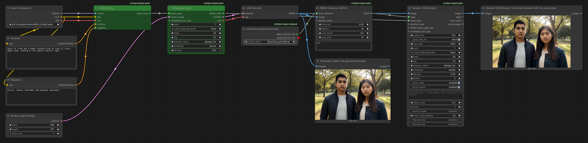
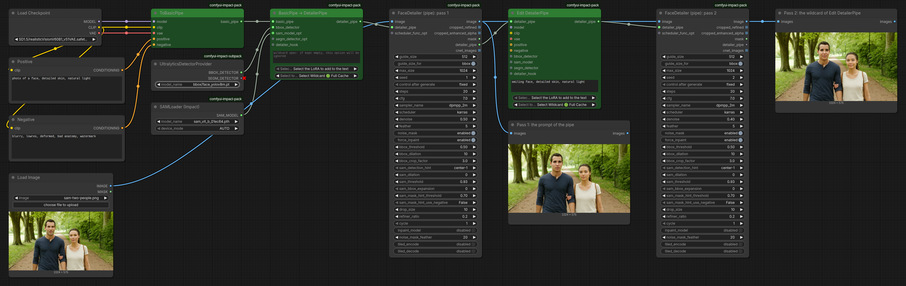

# BASIC_PIPE and DETAILER_PIPE

A pipe carries several inputs on one link. A `BASIC_PIPE` holds what a sampler needs besides the latent, and a `DETAILER_PIPE` adds what a detailer needs to find the areas it redraws. Use a pipe when the same model and prompts go to a sampler, a detailer and further passes: one link replaces five or more, and every node that takes the pipe gets the same parts.

## What a pipe holds

* `BASIC_PIPE`: `model`, `clip`, `vae`, `positive`, `negative`.
* `DETAILER_PIPE`: the same five, then `wildcard`, `bbox_detector`, `segm_detector_opt`, `sam_model_opt`, `detailer_hook`, and the four refiner entries `refiner_model`, `refiner_clip`, `refiner_positive`, `refiner_negative`.

| Entry | What uses it |
| --- | --- |
| `model`, `positive`, `negative` | Sampling, in the samplers and the detailers. |
| `vae` | `KSampler (pipe)` returns it for decoding. The detailers encode and decode the areas with it. |
| `clip` | The detailers encode the `wildcard` with it. `KSampler (pipe)` does not use it. |
| `wildcard` | The prompt of the detailer. A text here replaces `positive` for the detailed areas, or is added to it when it starts with `[CONCAT]`. See the [wildcard syntax of the detailers](ImpactWildcard.md#special-syntax-for-detailer-wildcard). |
| `bbox_detector` | Finds the areas to detail. |
| `sam_model_opt`, `segm_detector_opt` | Optional. They make the mask of each area follow its outline. With both, the SAM model is used. See [Detectors](detectors.md). |
| `detailer_hook` | Optional. See [Detailer Hooks](detailer_hooks.md). |
| `refiner_model`, `refiner_clip`, `refiner_positive`, `refiner_negative` | The SDXL refiner. They are empty unless an [SDXL node](#sdxl-refiner) sets them. |

* A `DETAILER_PIPE` has no refiner VAE. Its `vae` serves both models.
* A `BASIC_PIPE` has no wildcard. `Detailer (SEGS/pipe)` has a `wildcard` widget of its own.

## One pipe for the sampler and the detailer

* `ToBasicPipe` puts the model, CLIP and VAE of the checkpoint and the two prompts into one pipe.
* `KSampler (pipe)` generates the image from the pipe. Its `VAE` output goes to `VAE Decode`, so no link goes back to the checkpoint.
* Its `BASIC_PIPE` output passes the pipe on to `Detailer (SEGS/pipe)`. The detailer redraws the faces that `BBOX Detector (SEGS)` finds, with the same model and prompts. Its own `wildcard` is empty.

## Make a pipe

* `ToBasicPipe` takes the five entries, all required, and returns `basic_pipe`.
* `ToDetailerPipe` takes the five entries, a `bbox_detector` and the `wildcard` text. `sam_model_opt`, `segm_detector_opt` and `detailer_hook` are optional. The refiner entries stay empty.
* `BasicPipe -> DetailerPipe` (`BasicPipeToDetailerPipe`) does the same with a `basic_pipe` in place of the five entries.
* `Select to add LoRA` and `Select to add Wildcard`, on every node of this page with a `wildcard` text, only write into that text. A LoRA you pick is added at the end as `<lora:name>`, a wildcard after a comma. The value of the two lists is always their label and does nothing in a run.
* `FaceDetailer` returns a `detailer_pipe` as well. It holds the model, prompts, wildcard, detectors and hook the node was given, without a refiner, so the next pass can be a `FaceDetailer (pipe)`. See [Detailers](detailers.md).

## Read a pipe

* `FromBasicPipe` returns the five entries of a basic pipe.
* `FromDetailerPipe` returns `model`, `clip`, `vae`, `positive`, `negative`, `bbox_detector`, `sam_model_opt`, `segm_detector_opt` and `detailer_hook`.
* `FromBasicPipe_v2` and `FromDetailerPipe_v2` return the pipe itself first, then the same entries. Use them to take one entry out and pass the pipe on, for example to `Edit BasicPipe`, without a second link from where the pipe was made.
* None of these nodes returns the `wildcard`. Pass the pipe itself on to keep it.
* An entry that was not given comes out empty, such as `sam_model_opt` of a pipe made without a SAM model.

## Edit a pipe

* `Edit BasicPipe` takes a `basic_pipe` and five optional inputs. Each connected input replaces that entry. The other entries stay as they are.
* `Edit DetailerPipe` does the same for a detailer pipe, with the optional inputs `model`, `clip`, `vae`, `positive`, `negative`, `bbox_detector`, `sam_model`, `segm_detector` and `detailer_hook`.
  * A `wildcard` text replaces the wildcard of the pipe. An empty text keeps it, so this node cannot clear a wildcard.
  * No entry can be removed: an input left unconnected keeps the entry. To drop the SAM model or the hook from a pipe, make a new pipe.
  * The refiner entries pass through unchanged. `Edit DetailerPipe (SDXL)` changes them.

* `BasicPipe -> DetailerPipe` adds the face detector and the SAM model to a basic pipe.
* The first `FaceDetailer (pipe)` finds the faces with them and redraws each one with the prompts of the pipe. It returns the pipe unchanged.
* `Edit DetailerPipe` sets a `wildcard` in that pipe. Every other entry stays.
* The second `FaceDetailer (pipe)` finds the faces again in the image of the first pass and redraws them, with the same detectors and model and the wildcard as its prompt.
* The example image is [sam-two-people.png](../images/sam-two-people.png).

## Convert between pipes

* `DetailerPipe -> BasicPipe` (`DetailerPipeToBasicPipe`) returns two basic pipes.
  * `base_basic_pipe`: the five base entries.
  * `refiner_basic_pipe`: `refiner_model`, `refiner_clip`, the `vae` of the pipe, `refiner_positive` and `refiner_negative`. For a detailer pipe without a refiner it holds only the VAE. A sampler cannot run with it, and a detailer that gets it at `refiner_basic_pipe_opt` runs without a refiner.
* `Any PIPE -> BasicPipe` (`AnyPipeToBasic`) takes a value of any type and returns its first five entries as a basic pipe.
  * A `DETAILER_PIPE` starts with these five, so for one it gives the same as `base_basic_pipe`.
  * It is meant for the pipes of other extensions that start with `model`, `clip`, `vae`, `positive` and `negative`, in this order. The node does not check this.

## SDXL refiner

These nodes fill the four refiner entries of a detailer pipe, or read and change them.

* `ToDetailerPipeSDXL` is `ToDetailerPipe` with four more required inputs: `refiner_model`, `refiner_clip`, `refiner_positive` and `refiner_negative`.
* `BasicPipe -> DetailerPipe (SDXL)` (`BasicPipeToDetailerPipeSDXL`) takes a `base_basic_pipe` and a `refiner_basic_pipe`. The VAE of the refiner pipe is dropped: the detailer pipe keeps the VAE of the base pipe.
* `FromDetailer (SDXL/pipe)` (`FromDetailerPipeSDXL`) returns what `FromDetailerPipe_v2` returns, then the four refiner entries.
* `Edit DetailerPipe (SDXL)` (`EditDetailerPipeSDXL`) is `Edit DetailerPipe` with four optional refiner inputs.
* A detailer runs the refiner for the last part of its steps, set by its `refiner_ratio`, and only when all four refiner entries are set. Otherwise the base model takes all steps. See [Detailers](detailers.md).
* The detailers that take a `BASIC_PIPE` get the refiner from a second basic pipe at `refiner_basic_pipe_opt`. They do not use its VAE.
* The workflow [sdxl-detailer.png](../workflow/sdxl-detailer.png) builds detailer pipes from an SDXL base and refiner checkpoint with `ToDetailerPipeSDXL` and `BasicPipe -> DetailerPipe (SDXL)`, and reads them with `FromDetailer (SDXL/pipe)` and `FromDetailerPipe`. It needs SDXL checkpoints.

## Samplers that take a basic pipe

* `KSampler (pipe)` (`ImpactKSamplerBasicPipe`) has the widgets of ComfyUI's `KSampler`, with `basic_pipe` in place of the model and the two prompts.
* `KSampler (Advanced/pipe)` (`ImpactKSamplerAdvancedBasicPipe`) has those of `KSampler (Advanced)`: `add_noise`, `noise_seed`, `start_at_step`, `end_at_step` and `return_with_leftover_noise`.
* Both return the pipe unchanged as `BASIC_PIPE`, the `LATENT`, and the `VAE` of the pipe.
* The `scheduler` list has the schedulers of ComfyUI and those of the pack: `AYS SDXL`, `AYS SD1`, `AYS SVD`, `GITS[coeff=1.2]`, `LTXV[default]`, `OSS FLUX`, `OSS Wan` and `OSS Chroma`.
* A function at `scheduler_func_opt`, such as the one of `GITSScheduler Func Provider`, replaces the `scheduler`.
* When the `scheduler` is linked from a node that gives ComfyUI's schedulers, put `Impact Scheduler Adapter` in between. Its `extra_scheduler` can select one of the pack's schedulers instead.

### Negative Cond Placeholder

* `Negative Cond Placeholder` (`ImpactNegativeConditioningPlaceholder`) stands for the negative of a model that uses none, such as FLUX.1. It has no inputs.
* Connect it to the `negative` of `ToBasicPipe`, or of a detailer. The samplers and detailers of the pack then sample without a negative, and `cfg` sets the `guidance` of the positive instead of a CFG scale.
* ComfyUI's `KSampler` cannot use it and stops with an error.
* The workflow [flux-impact-ksampler.png](../workflow/flux-impact-ksampler.png) samples FLUX.1 with `KSampler (pipe)` and the placeholder as the negative of the pipe. It needs the FLUX.1 models.

## Detailers that take a pipe

These nodes are explained in [Detailers](detailers.md).

* `FaceDetailer (pipe)` takes a `DETAILER_PIPE`. It finds the areas with the detectors of the pipe and details them with the model, prompts, wildcard and hook of the pipe. It returns the same pipe as `detailer_pipe`, for the next pass.
* `Detailer (SEGS/pipe)`, `DetailerDebug (SEGS/pipe)`, `Detailer For Video (SEGS/pipe)` and `MaskDetailer (pipe)` take a `BASIC_PIPE` and return it unchanged. `SEGSDetailer` and `SEGSDetailer For Video (SEGS/pipe)` take one too.
* `Simple Detector (SEGS/pipe)` takes a `DETAILER_PIPE` and uses only its `bbox_detector`, `sam_model_opt` and `segm_detector_opt`. See [Detectors](detectors.md).

## Other nodes that take a basic pipe

* `KSamplerProvider` and `TiledKSamplerProvider` make a sampler from a basic pipe for `TwoSamplersForMask` and `TwoSamplersForMask Upscaler Provider`. See [TwoSamplersForMask](TwoSamplers.md) and [Advanced Iterative Upscale](TwoSamplersUpscale.md).
* `KSamplerAdvancedProvider` makes one for `RegionalPrompt`, `RegionalSampler`, `RegionalSamplerAdvanced` and `TwoAdvancedSamplersForMask`. See [Regional Sampler](regional_sampler.md) and [TwoAdvancedSamplersForMask](TwoAdvancedSamplers.md).
* `PixelKSampleUpscalerProviderPipe`, `PixelTiledKSampleUpscalerProviderPipe`, `TwoSamplersForMask Upscaler Provider (pipe)`, `Upscaler (SEGS/pipe)` and `Reencode Latent (pipe)` take a basic pipe as well.
