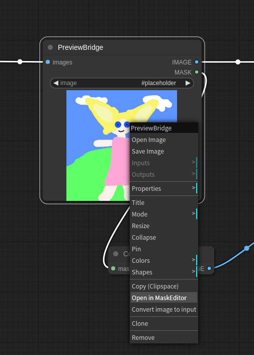
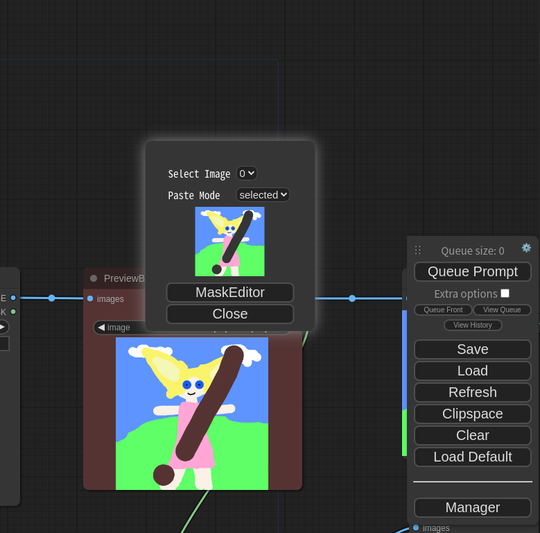
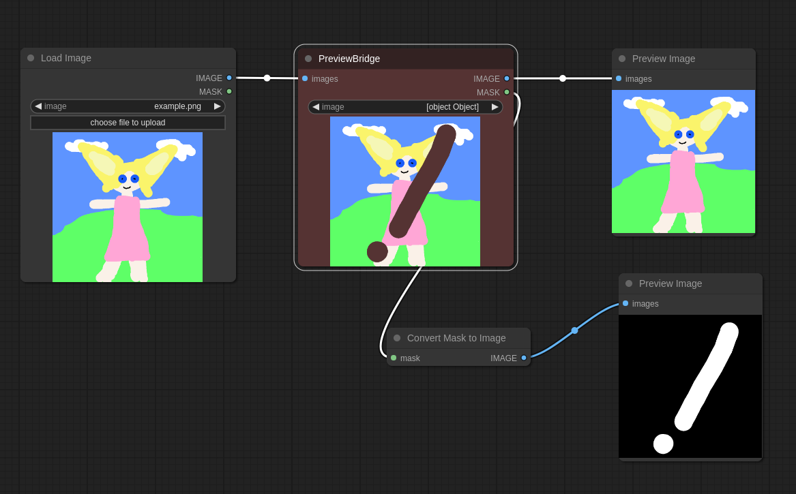
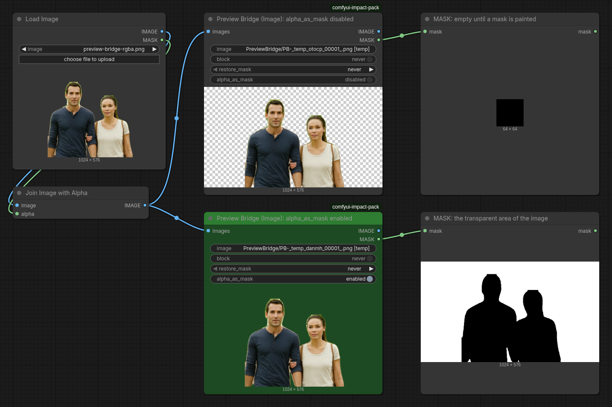

# PreviewBridge: Nodes for supporting 'Clipspace' utilization

* The ```PreviewBridge``` node is a node designed to utilize the Clipspace feature. By right-clicking on the node, you can access a context menu where you can choose the ```Copy (Clipspace)``` option to copy to **Clipspace**. You can then edit the copied data using the **MaskEditor** in **Clipspace** and use ```Paste (Clipspace)``` to apply the changes back to the node.

* Another way to achieve immediate reflection of changes in PreviewBridge is to edit and save changes directly in the MaskEditor using the ```Open in MaskEditor``` option, and then save the changes to the node using the ```Save to node``` button.





* Here is tutorial [video](https://www.youtube.com/watch?v=O3EjONCS-rU).

## A Preview Bridge without an image

* A Preview Bridge gets its image when the node itself is executed. Until then it has no image to open.
* Since V9.0.2, `Open in MaskEditor` and `Open in SAM Detector` show a notice on such a bridge in place of failing without a word.
* A run of the workflow does not always reach the bridge. An unconnected input, a bypass or a switch that routes around the bridge leaves it empty. Check these when the notice comes after a run.

## RGBA images: `alpha_as_mask`

`Preview Bridge (Image)` keeps its mask in the alpha channel of its preview file. An image that brings an alpha channel of its own can therefore be read in two ways, and `alpha_as_mask` (V8.31 or later) selects one.

* `disabled` (default): the alpha is part of the image.
  * The `IMAGE` output is the input, with its alpha.
  * The `MASK` output is empty until a mask is painted in the MaskEditor.
  * The node and the MaskEditor show the image over a checkerboard where it is transparent. The checkerboard is only in the preview and never in the `IMAGE` output.
* `enabled`: the alpha is the mask that the image brings, as `noise_mask` is for `Preview Bridge (Latent)`.
  * The transparent area is the `MASK` output from the first run, and the MaskEditor opens with it.
  * A mask saved in the MaskEditor replaces it, and the `IMAGE` output carries the current mask as its alpha.
  * A new image brings its own alpha. `restore_mask` restores nothing over it.
  * An alpha without any transparency brings no mask. The bridge then behaves as for an RGB image.

[](../workflow/preview-bridge-alpha-as-mask.png)

* `Load Image` returns the alpha of a file as its `MASK` output and an `IMAGE` without alpha. `Join Image with Alpha` puts the two together again. A node that removes a background returns such an RGBA image directly.
* The example image is [preview-bridge-rgba.png](../images/preview-bridge-rgba.png).
* A workflow that relied on the alpha of an RGBA input becoming the mask of the bridge has to enable `alpha_as_mask`. Before V8.31 the bridge picked that alpha up as its mask from the second run on.
* An RGB image gives the same outputs with either setting.
* With `restore_mask` set to `always` or `if_same_size`, the bridge restores a saved mask on a new image. Before V8.31 it wrote that mask into the alpha of an RGBA input itself, so every other node that read the same image saw the mask of the bridge in place of the image's own alpha. The restored mask now stays in the preview file of the bridge.

