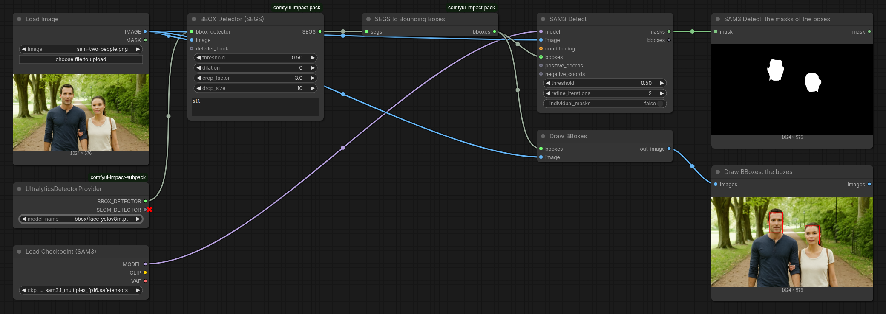
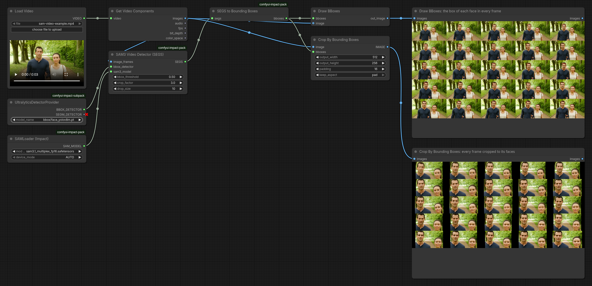
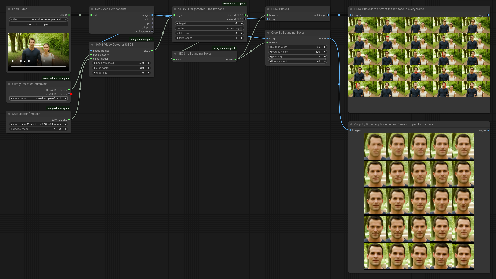
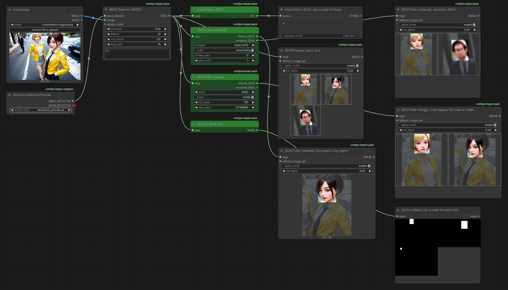
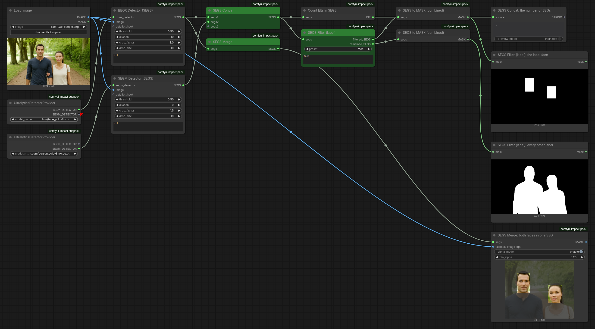
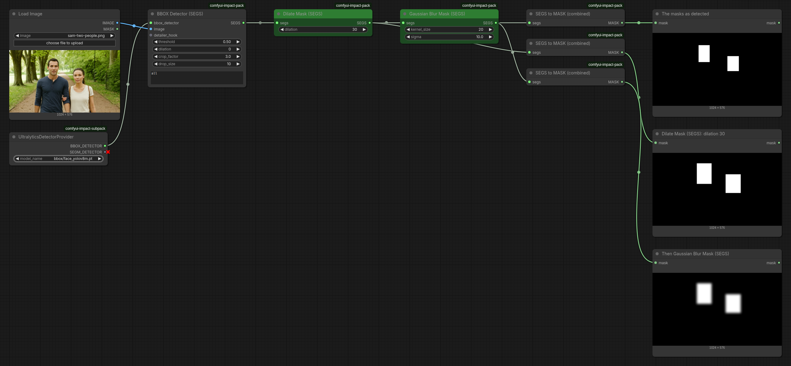

# Working with SEGS

A detector returns what it found as `SEGS`. A `SEGS` holds one SEG for each area, with its mask, bbox, crop region, label and confidence, as [Detectors](detectors.md) explains. The nodes on this page sit between the detector and the Detailer. They show SEGS, choose the SEGs to refine, combine and change SEGS, and give them a ControlNet or an IPAdapter.

To make SEGS from a mask, see [MASK to SEGS](detectors.md#mask-to-segs). To make them from the bounding boxes of ComfyUI, see [Bounding Boxes to SEGS](detectors.md#bounding-boxes-to-segs).

## Look at SEGS

### SEGSPreview

`SEGSPreview` shows a picture of each SEG.

* The picture is the image that the SEG carries. See [The image a SEG carries](#the-image-a-seg-carries).
* A SEG without an image shows the crop of `fallback_image_opt`. When `fallback_image_opt` is not connected either, the node shows nothing for that SEG.
* With `alpha_mode` enabled, the area outside the mask is see-through. `min_alpha` sets how much of that area stays visible, from 0 for nothing to 1 for all of it.
* The `IMAGE` output is a list with the picture of each SEG. With `alpha_mode`, the pictures are black outside the mask.

### Count Elts in SEGS

* `Count Elts in SEGS` (`ImpactCount_Elts_in_SEGS`) returns the number of SEGs as an `INT`. Show it with `Preview as Text`, or give it to a node that takes a number.
* A SEG that holds the masks of many video frames counts once.
* To check only whether a SEGS has any SEG, `SEGS isn't Empty` returns a `BOOLEAN`.

### SEGS to masks

Three nodes turn SEGS into masks of the size of the image. The mask of each SEG is placed at its crop region, and the rest is empty.

* `SEGS to MASK (combined)` (`SegsToCombinedMask`) returns one mask that holds the masks of all SEGs.
* `SEGS to Mask List` (`ImpactSEGSToMaskList`) returns a list with a mask for each SEG. The node after it runs once for each mask.
* `SEGS to Mask Batch` (`ImpactSEGSToMaskBatch`) returns the same masks as one batch.
* A SEG that holds the masks of video frames gives a mask for each frame in the list and in the batch.
* A SEGS without SEGs gives one empty mask in the list and in the batch.

### SEGS to bounding boxes

`SEGS to Bounding Boxes` (`ImpactSEGSToBoundingBoxes`, V9.3 or later) returns the bbox of each SEG as the `BOUNDING_BOX` that nodes of ComfyUI take, such as `SAM3 Detect`, `Draw BBoxes` and `Crop By Bounding Boxes`.

* The output is a list of boxes for each frame. A box has `x`, `y`, `width` and `height`, the label of the SEG as `label` and its confidence as `score`.
* The SEGS of an image give one list. A node of ComfyUI that gets one list with a batch of images uses it for every image.
* A SEGS without SEGs gives one list without a box.
* The node takes any SEGS, so the nodes of [Choose SEGs](#choose-segs) work before it.

In the workflow below, `BBOX Detector (SEGS)` finds two faces. `SAM3 Detect` of ComfyUI makes a mask inside each box, and `Draw BBoxes` draws the boxes.

* `SAM3 Detect` segments inside the boxes only when its `conditioning` is not connected. With a text, it takes the boxes as examples of what the text names.
* `Load Checkpoint` loads the SAM3 model for `SAM3 Detect`. It is the file that `SAMLoader (Impact)` loads, see [SAM, SAM2 and SAM3 models](detectors.md#sam-sam2-and-sam3-models).
* `Crop Image` of ComfyUI takes a single box, not this list.
* For the other direction, see [Bounding Boxes to SEGS](detectors.md#bounding-boxes-to-segs).

#### The boxes of a video

When a SEG holds a mask for each frame of a video, every frame gets a list of its own. The box of a SEG in a frame is the box around its mask in that frame, and a frame without a mask of the SEG gets no box for it.

* `SAM2 Video Detector (SEGS)`, `SAM3 Video Detector (SEGS)` and `MASK to SEGS for Video` give such SEGS. So does `Simple Detector for Video (SEGS)` with `masking_mode` set to `Combine neighboring frames` or `Don't combine`.
* `Simple Detector for Video (SEGS)` with `Pivot SEGS` gives SEGs with one mask for all frames. Their boxes are one list, with the box around the object in all frames, and a node of ComfyUI uses that list for every frame.

In the workflow below, `SAM3 Video Detector (SEGS)` tracks two faces through the 25 frames of [sam-video-example.mp4](../images/sam-video-example.mp4). `Draw BBoxes` draws the box of each face in every frame, and `Crop By Bounding Boxes` crops every frame to the faces.

* `Crop By Bounding Boxes` makes one crop for each frame, around all boxes of that frame.

To follow one object, choose its SEG first. In the workflow below, `SEGS Filter (ordered)` with `target` `x1`, `order` `ascending` and `take_count` 1 keeps the left face, and `Crop By Bounding Boxes` follows that face through the 25 frames.

### SEGSToImageList

* `SEGSToImageList` returns a list with the picture of each SEG, for nodes that take images.
* The picture is the image that the SEG carries, or else the crop of `fallback_image_opt`. With neither, it is a black image of 64 x 64. The mask is not applied.
* A SEGS without SEGs gives one black image of 64 x 64.

### The coordinates of a SEG

* `From SEG_ELT bbox` (`ImpactFrom_SEG_ELT_bbox`) and `From SEG_ELT crop_region` (`ImpactFrom_SEG_ELT_crop_region`) return `left`, `top`, `right` and `bottom` as `INT` values.
* Connect the `bbox` or the `crop_region` output of `From SEG_ELT` to them. `Decompose (SEGS)` gives `From SEG_ELT` one element for each SEG, so the two nodes return a value for each SEG. [Decompose (SEGS list) / Assemble (SEGS list)](segs_list.md) explains these nodes.

## Choose SEGs

The filters return the SEGs they keep as `filtered_SEGS`. The ordered, range and label filters also return the other SEGs as `remained_SEGS`, so that a second Detailer can refine them with other settings.

### By size and place

`SEGS Filter (ordered)` and `SEGS Filter (range)` measure the crop region of a SEG, not its bbox. A larger `crop_factor` at the detector gives larger values.

`SEGS Filter (ordered)` (`ImpactSEGSOrderedFilter`) sorts the SEGs and takes some of them.

* `target` is the value to sort by. `area(=w*h)`, `width` and `height` are the size of the crop region. `x1`, `y1`, `x2` and `y2` are its left, top, right and bottom edges. `confidence` is the score of the detector. `none` keeps the order of the SEGS.
* `descending` puts the largest value first, and `ascending` the smallest.
* `take_start` is the place of the first SEG to take, counted from 0. `take_count` is the number of SEGs to take.
* For example, `area(=w*h)`, `descending`, `take_start` 0 and `take_count` 1 keep the largest face.

`SEGS Filter (range)` (`ImpactSEGSRangeFilter`) keeps the SEGs whose value lies in a range.

* `target` has the values of the ordered filter and two more. `length_percent` is the longer side of the crop region divided by the shorter side, times 100. A square gives 100. `confidence(0-100)` is the score of the detector times 100.
* `inside` keeps the SEGs from `min_value` to `max_value`. `outside` keeps the SEGs below `min_value` or above `max_value`.
* `min_value` and `max_value` are whole numbers.

The ordered, range and label filters also exist as hooks for `FaceDetailer` and the detectors. See [Choose which detections to refine](detailer_hooks.md#choose-which-detections-to-refine).

In the [crowd workflow](../workflow/crowd-face.png), `SEGS Filter (ordered)` gives the largest face to one `DetailerDebug (SEGS/pipe)`. Its `remained_SEGS` go to a second `DetailerDebug (SEGS/pipe)` with other settings.

### By label

`SEGS Filter (label)` (`ImpactSEGSLabelFilter`) keeps the SEGs with the labels you list.

* Write the labels in `labels`, separated by commas. `all` keeps every SEG.
* `eyes`, `eyebrows` and `pupils` also keep their `left_` and `right_` labels, such as `left_eye`.
* `preset` only helps to fill in `labels`. A choice in `preset` adds that label to the end of `labels`. The filter reads `labels` only.
* The labels come from the detector. The faces of `bbox/face_yolov8m.pt` have the label `face`. `MediaPipe FaceMesh to SEGS` gives the parts of a face labels such as `mouth` and `left_eye`. `SEGS Merge` gives `merged`, and `SEGS Assign (label)` sets labels of your own.
* The `labels` input of `BBOX Detector (SEGS)` and `SEGM Detector (SEGS)` runs this filter and keeps its `filtered_SEGS`.

In the [detector labels workflow](../workflow/detector-labels.png), `SEGM Detector (SEGS)` keeps the labels `person` and `handbag`. `Decompose (SEGS)` and `From SEG_ELT` take out the label of each SEG, and a text node of another extension shows them.

`SEGS Classify` splits SEGs into `filtered_SEGS` and `remained_SEGS` by the scores of a Hugging Face image classifier.

### By overlap

When two detectors, or two runs of one detector, find the same area, the Detailer refines it twice. These two filters remove such SEGs. They compare the masks of the SEGs.

`SEGS Filter (intersection)` (`ImpactSEGSIntersectionFilter`) compares two SEGS.

* It removes a SEG of `segs1` when one SEG of `segs2` covers more than `ioa_threshold` of its mask. The share is the overlap divided by the mask area of the SEG of `segs1`.
* A lower `ioa_threshold` removes more SEGs.
* Its only output is what is left of `segs1`. `segs2` stays as it is, for its own Detailer or for `SEGS Concat`.

`SEGS Filter (non max suppression)` (`ImpactSEGSNMSFilter`) works inside one SEGS.

* It goes through the SEGs from the highest confidence down. It keeps a SEG and removes each other SEG that overlaps it by `iou_threshold` or more. The overlap is the shared area divided by the area of both masks together.
* A lower `iou_threshold` removes more SEGs.
* Use it after `SEGS Concat` has put the SEGS of two detectors together.

### By hand

`Picker (SEGS)` (`ImpactSEGSPicker`) passes on the SEGs that you pick in a gallery.

1. Run the workflow once. The node keeps a picture of each SEG.
2. Click `pick`. The gallery shows the pictures, darker outside the mask.
3. Click a picture to select it or to clear it. Ctrl-click selects that picture alone.
4. Click **Done**. `picks` now holds the numbers of the selected pictures, such as `1, 3`.
5. Run the workflow again.

* `picks` counts from 1, in the order of the SEGS. You can also type the numbers. A number without a SEG is ignored.
* With an empty `picks`, the node returns a SEGS without SEGs.
* The pictures come from the image that each SEG carries, or else from `fallback_image_opt`.

In the [Picker workflow](../workflow/segs-picker.png), `SEGSDetailer` with `batch_size` 4 makes four refined versions of each face, each with its own seed. `SEGSToImageList` shows them, and `Picker (SEGS)` gives the one in `picks` to `SEGSPaste`.

### Example

* The `BBOX Detector (SEGS)` looks for the faces of the three people in [combination-original.png](../images/combination-original.png).
* `Count Elts in SEGS` shows how many faces it found. `SEGSPreview` shows each face, and `SEGS to Mask List` gives a mask for each face.
* `SEGS Filter (ordered)` takes the SEG with the largest crop region. Its `remained_SEGS` hold the other faces.
* `SEGS Filter (range)` keeps the SEGs whose crop region is 150 pixels wide or wider. It leaves out small faces in the background.
* The `SEGSPreview` nodes need no `fallback_image_opt` here, because the SEGs of the detector carry their crops.

## Combine SEGS

`SEGS Concat` (`ImpactSEGSConcat`) puts the SEGs of several SEGS into one SEGS.

* When you connect `segs1`, the node adds `segs2`, and so on.
* A SEGS without SEGs is skipped.
* All SEGS must come from images of one size. A SEGS of another size than the first is left out, with an error in the log.

`SEGS Merge` (`ImpactSEGSMerge`) makes one SEG of all SEGs of a SEGS, so that a Detailer refines them in one crop.

* The bbox is the box around all bboxes, and the crop region is the box around all crop regions. The mask holds all masks.
* The label is `merged`, and the confidence is the lowest of the SEGs. The image and any ControlNet or IPAdapter of the SEGs are dropped.

In the [SEGS Merge workflow](../workflow/segs-merge.png), `MASK to SEGS` makes a SEG for each eye of a mask painted over both eyes. `SEGS Filter (ordered)` takes the two SEGs with the smallest `y1`, and `SEGS Merge` makes them one SEG. Two `SEGSPreview` nodes show the SEGs before and after.

To choose one of several SEGS, use `Switch (Any)`. `Switch (SEGS/legacy)` (`SEGSSwitch`) is the same node under an older name. [Switch](switch.md) explains it.

`EmptySegs` returns a SEGS without SEGs and without an image size. `SEGS Concat` skips it. As one input of `Switch (Any)`, it is the choice without SEGs.

### Example

* A `BBOX Detector (SEGS)` looks for faces, and a `SEGM Detector (SEGS)` looks for people in [sam-two-people.png](../images/sam-two-people.png).
* `SEGS Concat` puts the faces and the people into one SEGS. `Count Elts in SEGS` counts its SEGs.
* `SEGS Filter (label)` with the label `face` takes the faces back out. The people are in its `remained_SEGS`.
* `SEGS Merge` makes one SEG of the two faces. `SEGSPreview` shows it from `fallback_image_opt`, because a merged SEG carries no image.

## Change SEGS

### Masks

`Dilate Mask (SEGS)` (`ImpactDilateMaskInSEGS`) and `Gaussian Blur Mask (SEGS)` (`ImpactGaussianBlurMaskInSEGS`) change the mask of every SEG.

* A positive `dilation` grows the mask, and a negative `dilation` shrinks it. 0 leaves the mask as it is.
* `kernel_size` and `sigma` set how strongly the edges of the mask are softened. `kernel_size` 0 leaves the mask as it is.
* The bbox and the crop region stay as they are, so a mask cannot grow past its crop region.
* To cut the masks of SEGS with a mask or with other SEGS, use `Pixelwise(SEGS & MASK)`, `Pixelwise(SEGS & SEGS)` or `Pixelwise(SEGS - SEGS)`.

* The `BBOX Detector (SEGS)` finds the faces in [sam-two-people.png](../images/sam-two-people.png), with `dilation` 0.
* `Dilate Mask (SEGS)` with 30 grows the masks. `Gaussian Blur Mask (SEGS)` then softens their edges.
* Three `SEGS to MASK (combined)` nodes show the masks after each step.

### Labels

`SEGS Assign (label)` (`ImpactSEGSLabelAssign`) gives the SEGs new labels.

* Write the labels in `labels`, separated by commas, in the order of the SEGs. The first SEG gets the first label.
* With fewer labels than SEGs, the last SEGs keep their labels. A warning in the log says when the numbers differ.
* `[LAB]` in the wildcard of a Detailer chooses a prompt by label. See [Special Syntax for Detailer Wildcard](ImpactWildcard.md#special-syntax-for-detailer-wildcard).

### The image a SEG carries

A SEG can carry an image of its crop region. `BBOX Detector (SEGS)`, `SEGM Detector (SEGS)` and `Bounding Boxes to SEGS` put the crop of their image there, and `SEGSDetailer` puts its result there. `MASK to SEGS` and `SEGS Merge` make SEGs without an image.

* `SEGSPreview`, `SEGSToImageList` and `Picker (SEGS)` show that image. They use `fallback_image_opt` only for a SEG without an image.
* `SEGSDetailer` refines that image in place of a crop of its `image` input.
* `SEGSPaste` pastes that image, unless `ref_image_opt` is connected. With neither, it pastes nothing for that SEG.
* `Detailer (SEGS)` always crops its `image` input and does not read that image.

`Set Default Image for SEGS` puts the crop of `image` into every SEG.

* With `override` enabled, the crop replaces the image that a SEG carries. With `override` disabled, only SEGs without an image get the crop.
* When `image` has another size than the SEGS, the SEGS are scaled to it first.

`Remove Image from SEGS` takes the image out of every SEG. After it, `SEGSDetailer` refines a crop of its `image` input, and the preview nodes show `fallback_image_opt`.

### Single SEGs

To change single SEGs, take the SEGS apart with `Decompose (SEGS)`, change its elements and put them together with `Assemble (SEGS)`. [Decompose (SEGS list) / Assemble (SEGS list)](segs_list.md) explains these nodes. The [SEGS manipulation workflow](../workflow/segs-manipulation.png) grows the mask of each SEG with `Dilate Mask` and `Edit SEG_ELT` this way.

## Give SEGS a ControlNet or an IPAdapter

These nodes attach a ControlNet or an IPAdapter to every SEG. The Detailer applies it when it refines that SEG. A second node of this kind adds to the first, and the Detailer applies both.

### ControlNetApply (SEGS)

`ControlNetApply (SEGS)` (`ImpactControlNetApplyAdvancedSEGS`) attaches a ControlNet.

* `control_net` is a ControlNet model, such as the output of `Load ControlNet Model`.
* The control image of each SEG comes from `control_image` when it is connected. The node scales `control_image` to the size of the image of the SEGS and crops it to the crop region of each SEG.
* Without `control_image`, a `segs_preprocessor` makes the control image from the crop while the Detailer runs. The Preprocessor Provider nodes of the Inspire Pack give a `SEGS_PREPROCESSOR`.
* With neither, the crop itself is the control image.
* `strength`, `start_percent` and `end_percent` work as in ComfyUI's `Apply ControlNet`. The percentages count on the full schedule. A Detailer with `denoise` 0.5 samples only the second half, so there an `end_percent` of 0.5 has no effect.
* `vae` is passed on to ComfyUI's ControlNet, for models that need one.
* In `SEGSDetailer For Video (SEGS/pipe)` and `Detailer For Video (SEGS/pipe)`, the ControlNet needs the ComfyUI-Advanced-ControlNet extension.

`ControlNetApply (SEGS) - DEPRECATED` (`ImpactControlNetApplySEGS`) is the older node, without `start_percent`, `end_percent` and `vae`. Node search hides it. Use `ControlNetApply (SEGS)` in new workflows.

### SEGSPreview (CNET Image)

`SEGSPreview (CNET Image)` (`SEGSPreviewCNet`) shows the control image of each SEG.

* It shows the crop of the `control_image` of the last `ControlNetApply (SEGS)`.
* A SEG without a `control_image` shows a black square. A `segs_preprocessor` makes its image only while the Detailer runs, and the `cnet_images` output of the Detailer shows it.
* The `IMAGE` output holds the control images only.

### IPAdapterApply (SEGS)

`IPAdapterApply (SEGS)` (`ImpactIPAdapterApplySEGS`) attaches an IPAdapter.

* It needs the ComfyUI IPAdapter Plus extension. The `ipadapter_pipe` comes from `IPAdapterModelHelper //Inspire` of the Inspire Pack.
* The node scales `reference_image` to the size of the image of the SEGS. Each SEG gets the part of it around its crop region, `context_crop_factor` times the size of the crop region.
* `weight`, `weight_type`, `start_at`, `end_at`, `combine_embeds` and `neg_image` go to `IPAdapterAdvanced` of IPAdapter Plus. `weight_v2` is its FaceID v2 weight.

### ImpactControlNetClearSEGS

`ImpactControlNetClearSEGS` removes every ControlNet and IPAdapter from the SEGs.
