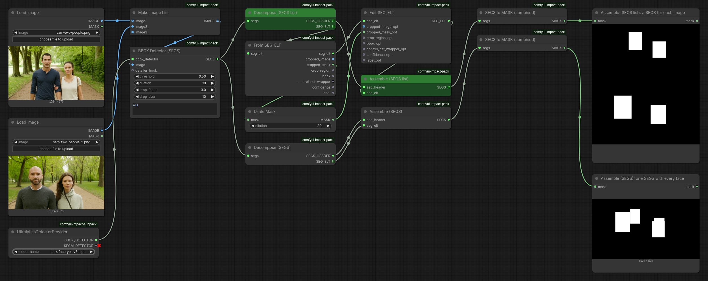

# Decompose (SEGS list) / Assemble (SEGS list)

`Decompose (SEGS)` and `Assemble (SEGS)` take a `SEGS` apart into its elements (`SEG_ELT`) and put it together again, so that single elements can be changed in between. The [SEGS manipulation workflow](../workflow/segs-manipulation.png) shows this for one image.

With a **list** of images there is a `SEGS` for each image, and this pair does not keep them apart: `Assemble (SEGS)` returns a single `SEGS` that holds the elements of all images. `Decompose (SEGS list)` and `Assemble (SEGS list)` (V8.31 or later) keep the list.

* `Decompose (SEGS list)` takes the whole list of `SEGS`. It returns the list of headers and the list of elements, and notes on each of them which `SEGS` it came from.
* `Assemble (SEGS list)` returns one `SEGS` for each header. Every element goes back into the `SEGS` it came from, in its order.
* A `SEGS` without elements, or one that lost all of them on the way, is still returned, empty. The `SEGS` after it stay with their images.
* The nodes between the two work on single elements, as with `Decompose (SEGS)`: `From SEG_ELT`, `Edit SEG_ELT`, `ScaleBy BBOX (SEG_ELT)`, `Dilate Mask (SEG_ELT)`. An element that these nodes build keeps the note.
* An element that carries no note of the given headers cannot be placed. This is an element that was made elsewhere, taken apart by `Decompose (SEGS)`, or rebuilt by a node of another extension. All elements then go into one `SEGS` under the first header, as `Assemble (SEGS)` does, and a warning is logged.
* `Decompose (SEGS)` and `Assemble (SEGS)` are unchanged. `Assemble (SEGS)` is still the way to put a list of `SEGS` into one.

* `Make Image List` makes a list of two images, and the `BBOX Detector` runs once for each. Its output is a list of two `SEGS` with two faces each.
* Upper path: `Decompose (SEGS list)`, a `Dilate Mask` of 30 on the mask of every element, and `Assemble (SEGS list)`. The result is again two `SEGS`. Each image has the masks of its own two faces.
* Lower path: `Decompose (SEGS)` and `Assemble (SEGS)`. The result is one `SEGS` with all four faces, in the size of the first image.
* The example images are [sam-two-people.png](../images/sam-two-people.png) and [sam-two-people-2.png](../images/sam-two-people-2.png).
