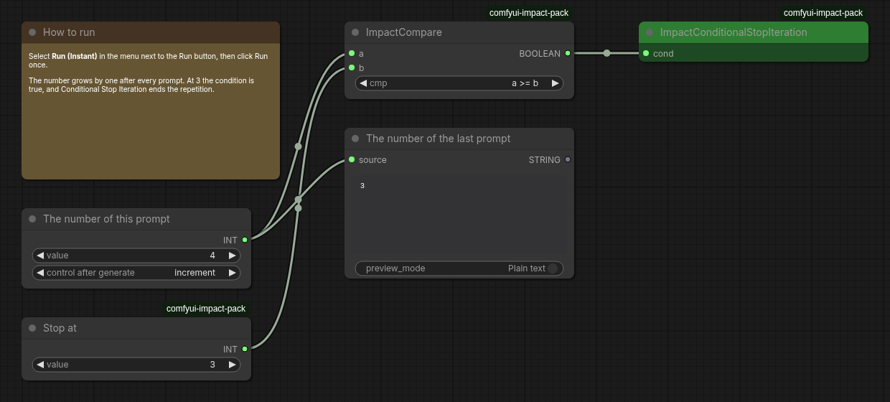

# Conditional Stop Iteration

`ImpactConditionalStopIteration` ends a repeating Run when its `cond` input is true. Use it to let **Run (Instant)** or **Run (On Change)** repeat a workflow until a condition is met: a number of prompts, a value that a node computes, or the result of a comparison.

* `Int` with `control after generate` set to `increment` gives each prompt the next number, starting at 0.
* `ImpactCompare` is true when the number has reached the value of `Stop at`.
* Select **Run (Instant)** in the menu next to the Run button and click Run once. The workflow runs for the numbers 0, 1, 2 and 3, and then stops. The picture shows the workflow after that run: the last prompt had the number 3, and the widget already holds 4 for the next one.
* The run mode is not saved in a workflow. Select it again after loading the picture.

What the node does when the condition is true:

* **Run (Instant)** stays selected and goes back to idle, as after its own Stop button. Click Run to start again.
* **Run (On Change)** has no idle state, so the mode goes back to **Run**. Select **Run (On Change)** again to resume.
* The repetition ends after the prompt that reports the condition. Prompts that are already in the queue still run: the rest of a batch count above 1, or a prompt that **Run (On Change)** queued ahead. The node does not empty the queue.
* Only the browser tab that queued the prompt stops. Auto queue in another tab keeps running.
* With a false condition, the repetition goes on.

Before V8.31 the node unchecked the Auto Queue box of the old menu, which current ComfyUI does not read, so the repetition went on. It needs a ComfyUI frontend of version 1.40.9 or later.
