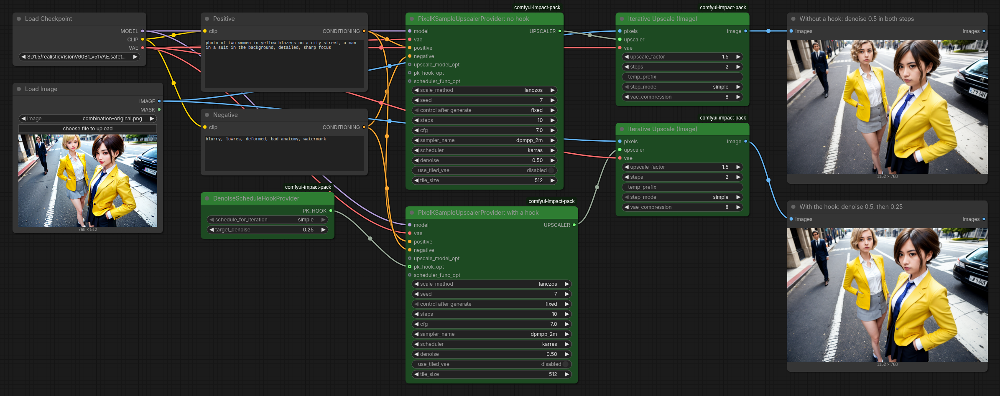

# Iterative upscale

The iterative upscale nodes enlarge a picture in several steps and sample it again after each step. Use them to take a sampled latent or an existing picture to a larger size and sample it there, rather than only resizing it. [Extreme Highresolution Upscale](extreme-upscale.md) shows a larger setup for very high resolutions.

## How the parts fit

* An upscaler provider makes an `UPSCALER`. It holds what one step does: how to resize the picture, the VAE, the model, the prompts and the sampler settings.
* `Iterative Upscale (Latent/on Pixel Space)` and `Iterative Upscale (Image)` divide the `upscale_factor` into `steps` and apply the `UPSCALER` once in each step.
* In each step the upscaler decodes the latent, resizes the picture to the size of that step, encodes it again and samples it.
* A `PK_HOOK` on the `pk_hook_opt` of the provider changes the settings from step to step, such as a denoise that goes down. [PK_HOOK](pk_hook.md) shows schedules of denoise and cfg.

* `Iterative Upscale (Image)` enlarges the 768x512 picture 1.5 times, to 1152x768, in 2 steps: first to 1.25 times, then to 1.5 times. Each step samples with 10 sampling steps.
* The two `PixelKSampleUpscalerProvider` nodes have the same settings, with `denoise` 0.5. The upper branch samples both steps with denoise 0.5.
* The lower branch adds a `DenoiseScheduleHookProvider` with `target_denoise` 0.25. Its first step samples with denoise 0.5 and its second with 0.25.
* The example image is [combination-original.png](../images/combination-original.png).

## Upscaler providers

All providers take `scale_method`, the method that resizes the picture in each step, and `upscale_model_opt`.

* `upscale_model_opt` takes a model from `Load Upscale Model`. In each step the model enlarges the picture until it is at least as wide as the size of the step, and `scale_method` then brings it down to that size. Without a model, `scale_method` resizes the picture directly.

### PixelKSampleUpscalerProvider, PixelKSampleUpscalerProviderPipe

* The plain upscaler. It samples each step like a KSampler, with `seed`, `steps`, `cfg`, `sampler_name`, `scheduler` and `denoise`.
* `denoise` is the strength of the sampling in each step. The default 1.0 starts each step at the full noise level, as a KSampler does for a new picture. For an upscale, use a lower value, such as the 0.5 of the example.
* `use_tiled_vae` decodes and encodes the picture of each step in tiles of `tile_size`.
* `scheduler` also lists the extra schedulers of the pack: `AYS SDXL`, `AYS SD1`, `AYS SVD`, `GITS[coeff=1.2]`, `LTXV[default]`, `OSS FLUX`, `OSS Wan` and `OSS Chroma`.
* `scheduler_func_opt` takes a `SCHEDULER_FUNC`, such as the output of `GITSScheduler Func Provider`. Its noise schedule replaces `scheduler`.
* `PixelKSampleUpscalerProviderPipe` takes the model, the VAE and both prompts from a `BASIC_PIPE`. Only the pipe variant has `tile_cnet_opt` and `tile_cnet_strength`.
* `tile_cnet_opt` takes a tile ControlNet. In each step the enlarged picture goes through the `TilePreprocessor` node of [comfyui_controlnet_aux](https://github.com/Fannovel16/comfyui_controlnet_aux), and the ControlNet is applied with the result at `tile_cnet_strength`. That pack must be installed for this input. With a batch of more than one picture the ControlNet is left out and a warning is logged.

### PixelTiledKSampleUpscalerProvider, PixelTiledKSampleUpscalerProviderPipe

* Samples the latent of each step in tiles of `tile_width` x `tile_height` pixels, so that a large picture needs less VRAM. The decode and the encode of each step also work in tiles, of the larger of the two sizes.
* Since V9.0 the tiled sampler is included in the Impact Pack. The `ComfyUI_TiledKSampler` extension is not needed.
* `tiling_strategy`:
  * `random`: the grid of tiles moves by a random offset at every sampling step, so the borders of the tiles change from step to step.
  * `padded`: adds grids moved by half a tile and blends the tiles with masks.
  * `simple`: one fixed grid.
* `scheduler` lists only the schedulers of ComfyUI, and there is no `scheduler_func_opt`.
* `tile_cnet_opt` and `tile_cnet_strength` work as for `PixelKSampleUpscalerProviderPipe`.
* `overlap` (only on `PixelTiledKSampleUpscalerProvider`) is the overlap of the VAE tiles where `Iterative Upscale (Image)` encodes its input. The tiles of the steps overlap by 64.
* `PixelTiledKSampleUpscalerProviderPipe` takes the model, the VAE and both prompts from a `BASIC_PIPE`.

### TwoSamplersForMask Upscaler Provider, TwoSamplersForMask Upscaler Provider (pipe)

* `TwoSamplersForMask Upscaler Provider` samples the area of `mask` with `mask_sampler` and the rest with `base_sampler`, in each step. Both are `KSAMPLER`s from `KSamplerProvider` or `TiledKSamplerProvider`. [Advanced Iterative Upscale](TwoSamplersUpscale.md) shows the node with `full_sample_schedule`.
* The mask is resized to the size of each step.
* In a step that `full_sample_schedule` selects, the whole picture is sampled with `base_sampler`, and then again with `full_sampler_opt`, or with `base_sampler` when `full_sampler_opt` is not connected.
* `pk_hook_base_opt`, `pk_hook_mask_opt` and `pk_hook_full_opt` are the hooks of the three samplers.
* `TwoSamplersForMask Upscaler Provider (pipe)` (`TwoSamplersForMaskUpscalerProviderPipe`) takes only the VAE from its `BASIC_PIPE`. The model and the prompts come with the samplers.

## Iterative Upscale (Latent/on Pixel Space), Iterative Upscale (Image)

* `Iterative Upscale (Latent/on Pixel Space)` (`IterativeLatentUpscale`) takes a `LATENT`. It returns the upscaled `latent` and the `vae` of the upscaler, for the `VAE Decode` after it.
* `Iterative Upscale (Image)` (`IterativeImageUpscale`) takes an `IMAGE`. It encodes it with its `vae`, runs the same steps, and decodes the result with the same `vae`.
  * With a tiled provider it encodes and decodes in tiles.
* `upscale_factor` is the final size as a multiple of the input. `steps` is the number of steps, and the upscaler samples once in each.
* `step_mode` sets the size of each step:
  * `simple`: each step adds the same amount to the scale. 2 times in 4 steps gives 1.25, 1.5, 1.75 and 2.
  * `geometric`: each step multiplies the scale by the same factor. 2 times in 4 steps gives 1.19, 1.41, 1.68 and 2.
  * With `simple` the first steps enlarge the picture by a larger ratio than the last ones. With `geometric` every step enlarges it by the same ratio.
* `vae_compression` is the number of pixels that one latent cell covers, 8 for SD1.5 and SDXL. The node computes the size of each step from it, so a wrong value gives a wrong size.
* `temp_prefix`: when it is not empty, the picture at the start of each step is saved in the temp folder of ComfyUI under this prefix.
* While the node runs, a badge above its title shows the step and the scale, such as `1/2 steps | x1.25` and then `Final step | x1.50`.
* A noise mask on the input latent stays on the latent of every step. `PixelKSampleUpscalerProvider` and its pipe variant then sample only inside the mask.

## Hooks (PK_HOOK)

A hook goes into the `pk_hook_opt` of a provider and acts in every step of the iterative upscale.

### DenoiseScheduleHookProvider, CfgScheduleHookProvider, StepsScheduleHookProvider

* Each one moves one setting of the provider from its own value in the first step to the target in the last step, in equal parts. With 1 step, the target is used.
* `DenoiseScheduleHookProvider` changes `denoise` to `target_denoise`.
* `CfgScheduleHookProvider` changes `cfg` to `target_cfg`. The cfg of each step is cut to a whole number, the first step included: a provider cfg of 7.5 samples the first step with 7.
* `StepsScheduleHookProvider` changes the sampling `steps` to `target_steps`. Provider steps 10 and a target of 20 give 10, 15 and 20 in 3 steps.
* [PK_HOOK](pk_hook.md) shows schedules of denoise and cfg together.
* `schedule_for_iteration` has one option, `simple`.

### NoiseInjectionHookProvider

* Adds noise to the latent of each step after it is encoded, before it is sampled.
* Needs the [ComfyUI_Noise](https://github.com/BlenderNeko/ComfyUI_Noise) extension. Without it, the run stops with an error that `BNK_NoisyLatentImage` and `BNK_InjectNoise` are not installed.
* The first step uses `start_strength`. Each later step moves towards `end_strength` but does not reach it: from 2 to 1 in 2 steps gives 2, then 1.5.
* `seed` is the seed of the noise in the first step. Each later step adds 2 to it.
* `source` makes the noise on the `CPU` or the `GPU`.

### UnsamplerHookProvider

* Runs a sampler backwards on the latent of each step after it is encoded, which takes it back towards noise. The provider then samples the result.
* Its own `model`, `positive`, `negative`, `steps`, `cfg`, `sampler_name` and `scheduler` drive this reverse sampling. The Unsampler is part of the Impact Pack, so no other extension is needed.
* The reverse sampling stops at a step of `steps`, counted as in a forward schedule. A lower step goes further back towards noise.
* The first step stops at `start_end_at_step`. Each later step moves towards `end_end_at_step` but does not reach it: from 21 to 24 in 2 steps gives 21, then 22.
* `normalize` `enable` shifts and scales the result to a mean of 0 and a standard deviation of 1.

### PixelKSampleHookCombine

* Joins two `PK_HOOK`s into one. At each point where hooks act, `hook1` runs first and `hook2` works on its result.
* For a third hook, connect the combine to `hook1` of a second `PixelKSampleHookCombine`.
* `DetailerHookCombine` is in the same menu, but it joins two `DETAILER_HOOK`s for the Detailers. See [Detailer hooks](detailer_hooks.md).

## Upscaler (SEGS)

`Upscaler (SEGS)` (`SEGSUpscaler`) and `Upscaler (SEGS/pipe)` (`SEGSUpscalerPipe`) enlarge the picture in one step and sample again only the areas of a `SEGS`.

* The whole picture is enlarged by `rescale_factor`, first with `upscale_model_opt` when it is connected, then with `resampling_method`. `supersample` `true` resizes to 8 times the size first and then down.
* The crop region of each SEG is then sampled again at its new size and pasted back through the mask of the SEG, blurred by `feather`. Each SEG uses `seed` plus its index. `Make Tile SEGS` makes SEGS that cover the whole picture in tiles.
* `inpaint_model` and `noise_mask_feather` work as in the [Detailers](detailers.md).
* `upscaler_hook_opt` takes the `UPSCALER_HOOK` output of `PreviewDetailerHookProvider`, which shows the picture on that node after each SEG is pasted. It fits only these two nodes.
* The pipe variant takes the model, the CLIP, the VAE and both prompts from a `BASIC_PIPE`.

## Latent Scale (on Pixel Space)

* `Latent Scale (on Pixel Space)` (`LatentPixelScale`) resizes a latent once through pixel space, without sampling: it decodes it, resizes the picture by `scale_factor` with `scale_method`, and encodes it again. A `scale_factor` below 1 makes it smaller.
* It returns the new `LATENT` and the resized `IMAGE`, so the picture needs no decode of its own.
* `upscale_model_opt` and `use_tiled_vae` work as for the providers. The VAE tiles are 512 pixels.

## Reencode Latent, Reencode Latent (pipe)

* `Reencode Latent` decodes a latent with `input_vae` and encodes the picture with `output_vae`. Use it to give a latent to a model that has another VAE.
* `tile_mode` selects which side works in tiles of `tile_size`, with `overlap`: `None`, `Both`, `Decode(input) only` or `Encode(output) only`.
* `Reencode Latent (pipe)` (`ReencodeLatentPipe`) takes the two VAEs from `input_basic_pipe` and `output_basic_pipe`. It has no `tile_size` or `overlap`: its tiles are 512 pixels with an overlap of 64.
* A noise mask on the input latent is not kept.

## Impact Scheduler Adapter

* The `scheduler` of many Impact nodes, such as `PixelKSampleUpscalerProvider`, lists the extra schedulers of the pack as well as those of ComfyUI. A scheduler value made for the nodes of ComfyUI therefore does not connect to it directly.
* `Impact Scheduler Adapter` takes that value at its `scheduler` input and returns it in the type of the Impact nodes.
* With `extra_scheduler` set to anything other than `None`, it returns that extra scheduler instead.
