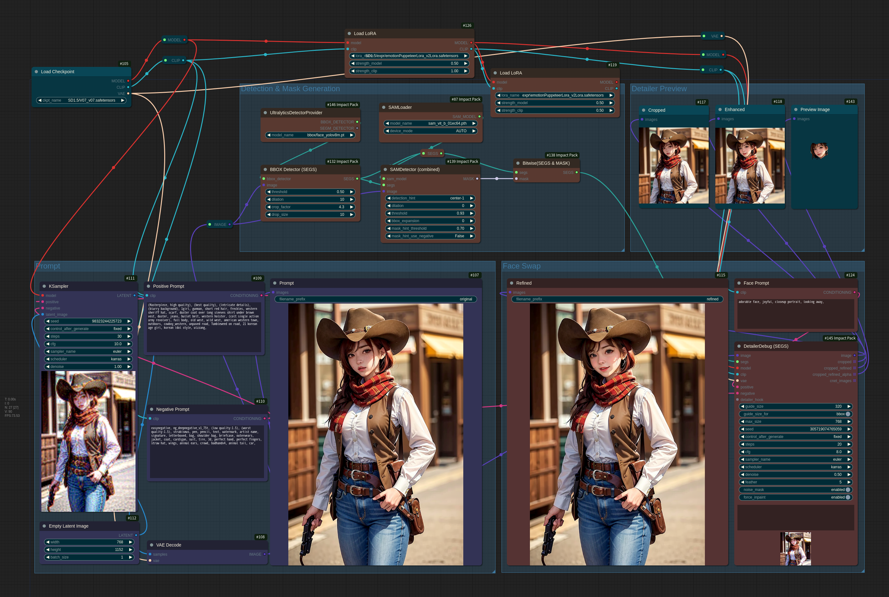
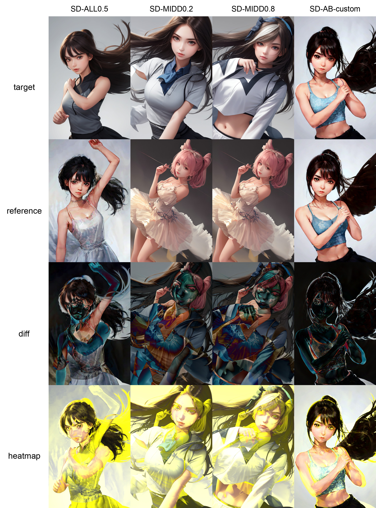
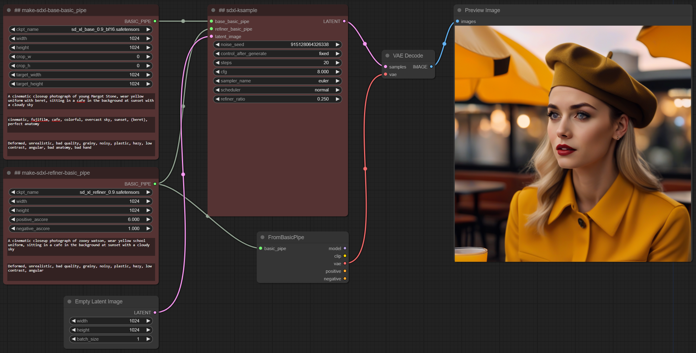
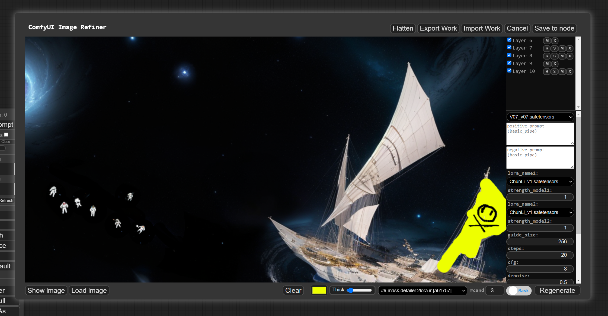

# comfyUI-extension-tutorials

## [ComfyUI-Impact-Pack](https://github.com/ltdrdata/ComfyUI-Impact-Pack)

ComfyUI-Impact-Pack provides various features such as detection, detailler, sender/receiver, etc., to enhance the workflow configuration of ComfyUI.

* [workflow](ComfyUI-Impact-Pack/workflow) contains workflows for ComfyUI.
* You can download various [workflows](ComfyUI-Impact-Pack/workflow) for ComfyUI-Impact-Pack.
* Various tutorial videos are available on the [youtube playlist](https://www.youtube.com/playlist?list=PL_Ej2RDzjQLGfEeizq4GISeY3FtVyFmGP).  

* [Changes from V8.31 to V9.4](ComfyUI-Impact-Pack/tutorial/changes.md)

* Basic Tutorials
  * [Detectors](ComfyUI-Impact-Pack/tutorial/detectors.md)
  * [Detailers](ComfyUI-Impact-Pack/tutorial/detailers.md)
  * [BASIC_PIPE and DETAILER_PIPE](ComfyUI-Impact-Pack/tutorial/pipes.md)
  * [Working with SEGS](ComfyUI-Impact-Pack/tutorial/segs.md)
  * [Mask nodes](ComfyUI-Impact-Pack/tutorial/masks.md)
  * [Lists and batches](ComfyUI-Impact-Pack/tutorial/lists.md)
  * [Logic and flow control](ComfyUI-Impact-Pack/tutorial/logic.md)
  * [Regional Sampler](ComfyUI-Impact-Pack/tutorial/regional_sampler.md)
  * [ImpactWildcardProcessor/Encode](ComfyUI-Impact-Pack/tutorial/ImpactWildcard.md)
  * [PreviewBridge: Nodes for supporting 'Clipspace' utilization](ComfyUI-Impact-Pack/tutorial/previewbridge.md)
  * [Interactive SAM + PreviewBridge](ComfyUI-Impact-Pack/tutorial/sam_with_preview_bridge.md)
  * [SEGS From MediaPipe FaceMesh](ComfyUI-Impact-Pack/tutorial/mediapipe.md)
  * [Switch/Inversed Switch](ComfyUI-Impact-Pack/tutorial/switch.md)
  * [Decompose (SEGS list) / Assemble (SEGS list)](ComfyUI-Impact-Pack/tutorial/segs_list.md)
  * [Conditional Stop Iteration](ComfyUI-Impact-Pack/tutorial/stop_iteration.md)
  * [Language of the nodes](ComfyUI-Impact-Pack/tutorial/locale.md)

* Advanced Tutorials
  * [Detailer Hooks](ComfyUI-Impact-Pack/tutorial/detailer_hooks.md)
  * [Detailer Advanced Options: cycle selection and VAE](ComfyUI-Impact-Pack/tutorial/detailer_advanced_options.md)
  * [Prompt per Tile Upscale](ComfyUI-Impact-Pack/tutorial/PromptPerTileUpscale.md)
  * [Combination with CLIPSeg](ComfyUI-Impact-Pack/tutorial/clipseg.md)
  * [Iterative upscale](ComfyUI-Impact-Pack/tutorial/upscale.md)
  * [Extreme Highresolution Upscale](ComfyUI-Impact-Pack/tutorial/extreme-upscale.md)

* Tutorials (LEGACY)
  * [Basic auto face detection and refine example](ComfyUI-Impact-Pack/tutorial/advanced.md)
  * [Mask Pointer: Using the position prompt of SAM to mask](ComfyUI-Impact-Pack/tutorial/maskpointer.md)
  * [SAMDetection Application](ComfyUI-Impact-Pack/tutorial/sam.md)
  * [Image Sender, Image Receiver, Latent Sender Latent Receiver](ComfyUI-Impact-Pack/tutorial/sender_receiver.md)
  * [TwoSamplersForMask](ComfyUI-Impact-Pack/tutorial/TwoSamplers.md)
  * [Advanced Iterative Upscale (TwoSamplersUpscaleProvider, KSampleProvider, TiledKSampleProvider)](ComfyUI-Impact-Pack/tutorial/TwoSamplersUpscale.md)
  * [PK_HOOK (Pixel KSample Hook)](ComfyUI-Impact-Pack/tutorial/pk_hook.md)
  * [TwoAdvancedSamplersForMask](ComfyUI-Impact-Pack/tutorial/TwoAdvancedSamplers.md)
  * [Batching images with detailer example](ComfyUI-Impact-Pack/tutorial/batching-detailer.md)

* Workflows
  * [Hair restyling](ComfyUI-Impact-Pack/workflow/hair-restyle.png) [[Demo video](https://www.youtube.com/watch?v=fsNBASZYDuA)]
  * [Auto Handfix](ComfyUI-Impact-Pack/workflow/dwpose-segs-handfix.png) [[Demo Video]](https://www.youtube.com/watch?v=DoyqCjKdojY)
  * [Crowd Control](ComfyUI-Impact-Pack/workflow/crowd-face.png) [[Demo Video](https://www.youtube.com/watch?v=9GSQlxZFrLI)]
  * [Gender Senstivie Detailer](ComfyUI-Impact-Pack/workflow/gender-senstivie-detailer.png) [[Demo Video](https://www.youtube.com/watch?v=Vs2r-MErJZw)]
  * [Prompt per Tile Upscale](ComfyUI-Impact-Pack/workflow/prompt-per-tile.png)

## [ComfyUI-Inspire-Pack](https://github.com/ltdrdata/ComfyUI-Inspire-Pack)

* [workflow](ComfyUI-Inspire-Pack/workflow) contains workflows for ComfyUI.

* Tutorials
  * [Lora Block Weight](ComfyUI-Inspire-Pack/tutorial/LoraBlockWeight.md)
  * [SEGS ControlNet](ComfyUI-Inspire-Pack/tutorial/SEGSControlNet.md)
  * [GlobalSeed](ComfyUI-Inspire-Pack/tutorial/GlobalSeed.md)
  * Load From Dir/File
  * Regional Prompt Support
  * KSampler Progress

## [ComfyUI-Workflow-Component](https://github.com/ltdrdata/ComfyUI-Workflow-Component)

ComfyUI-Workflow-Component provides functionality to simplify workflows by turning them into components, as well as an Image Refiner feature that allows improving images based on components.

* [Images](ComfyUI-Workflow-Component/workflow) contains workflows for ComfyUI.
* You can download various [workflows](ComfyUI-Workflow-Component/workflow) for ComfyUI-Workflow-Component.
* Various tutorial videos are available on the [youtube playlist](https://www.youtube.com/playlist?list=PL_Ej2RDzjQLE2Ma9dX0G4OYLrrBve53UV).  
